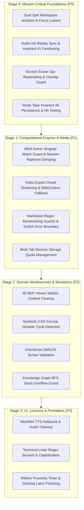

# GazBoard Replay — Comprehensive Feature, Risk & Architecture Matrix

> **Scope**: Authoritative architectural ledger, failure-mode vulnerability analysis, and cross-subsystem interaction matrix covering all custom and baseline features implemented in GazBoard Replay from v4.8.1 through v6.9.2.  
> **Core Architectural Paradigm**: Pure Vanilla JavaScript (ES6 Modules), Canvas2D hardware acceleration, zero frontend frameworks (React/Vue/Svelte-free), zero C++ native addons (`node-gyp`-free), 100% offline autonomy (0 external CDNs), strict 6 Golden Invariants compliance.

---

## 1. Executive Summary & Hardening Prioritization Framework

To maximize stability and prevent regressions as GazBoard scales, every implemented feature is evaluated across four critical engineering dimensions:

1. **Complexity Level**:
   - `CRITICAL` (Multi-threaded / asynchronous / high-order mathematics / dual-surface state management)
   - `HIGH` (Complex AST parsing / iterative non-linear numeric solvers / canvas coordinate pipelines)
   - `MEDIUM` (Stateful DOM modals / event listeners / serialization schemas)
   - `LOW` (Deterministic algorithms / isolated lookups / static presentations)
2. **Risk & Failure Likelihood**:
   - Probability of memory leaks, race conditions, singular matrix zero-division, canvas frame drops, pointer event hijacking, or state corruption.
3. **Hardening Priority (Work Backwards Order)**:
   - **`P0 — Mission-Critical / Zero Tolerance`**: Core foundational engines. Any bug here corrupts board data, freezes drawing, or violates the 6 Golden Invariants.
   - **`P1 — High Hardening Priority`**: High-complexity computational pipelines. Moderate-to-high blast radius; failures impact core performance or media exports.
   - **`P2 — Moderate Hardening Priority`**: Domain-specific workbenches and modal tools. Errors are typically confined to the tool session but can stall rendering if unhandled.
   - **`P3 — Low Risk / Self-Contained`**: Standalone lookup utilities, linting rules, and styling controls with isolated state and zero side effects.
4. **User Impact**:
   - The degree to which users rely on the feature for primary whiteboard tasks (drawing, studying, simulating, exporting).

---

## 2. Master Feature Prioritization & Vulnerability Ledger

This master ledger ranks all 39 primary features from **Highest Hardening Priority (`P0`) down to `P3`**, enabling developers to harden the most vulnerable and architecturally complex systems first.

> **v6.9.2 audit status:** the five P0 rows and the P1 computational/media rows have been audited against the live source, not just the dossiers. 74 findings were logged (68 fixed) across the split workspace, audio-ink timing, replay partitioning, scratch eraser, study tape/covers, circuit simulation, video export, Markdown/KaTeX, the calculus grapher, multi-tab sessions and orthogonal routing. Several rows below describe intended architecture rather than pre-audit behaviour; where they differ, [`releases/RELEASE-6.9.2.md`](releases/RELEASE-6.9.2.md) and [`hardening/AUDIT_LOG.md`](hardening/AUDIT_LOG.md) are authoritative.

| ID | Feature Name | Domain | Complexity | Risk Likelihood | Hardening Priority | User Impact | Primary Failure Modes & Cross-Code Collisions |
| :--- | :--- | :--- | :---: | :---: | :---: | :---: | :--- |
| **F-108** | **Dual Split Study Workspace** | Workspace | `CRITICAL` | `HIGH` | **`P0`** | `CRITICAL` | Pointer routing hijacking between left/right canvases; unmounted host container crashes; split store collision during concurrent edits; coordinate transform offset drift on zoom/pan. |
| **F-103** | **Audio-Ink Timestamp Synchronization** | Audio/Replay | `CRITICAL` | `HIGH` | **`P0`** | `CRITICAL` | Point timestamp stripping during smoothing/decimation (`tools.js`); wall-clock clock drift on background tab sleep; asynchronous audio buffer desynchronization. |
| **F-104** | **Dynamic Replay Engine & Scene Partitioning** | Audio/Replay | `CRITICAL` | `HIGH` | **`P0`** | `CRITICAL` | Invariant #1 violation (session ink leaking into base canvas pass); high-frequency GC pressure from per-frame stroke slicing; requestAnimationFrame lockups on paused audio. |
| **F-101** | **StarNote Scratch-Out Eraser Classifier** | Inking/Gesture | `HIGH` | `HIGH` | **`P0`** | `CRITICAL` | False-positive destruction of cursive handwriting (`w`, `m`, `2 3 2`); sample-rate jitter across 60Hz/120Hz/240Hz digitizers; spatial overlap bounding box miscalculations causing unintended mass deletion. |
| **F-102** | **Active-Recall Study Tape & Answer Covers** | Inking/Study | `MEDIUM` | `HIGH` | **`P0`** | `HIGH` | Invariant #6 violation (loss of cover persistence in `doc.objects`); hit-test failure on faint revealed outlines; attached annotation orphan state during document undo/redo. |
| **F-133** | **Headless MNA Circuit Simulator Engine** | Engineering | `CRITICAL` | `HIGH` | **`P1`** | `HIGH` | Singular matrix division-by-zero during ill-conditioned netlists; Newton-Raphson infinite non-convergence loops; time-step numerical instability ($\Delta t$ oscillation); memory leaks during continuous sim. |
| **F-137** | **Discrete Semiconductors & 555 Timer** | Engineering | `CRITICAL` | `HIGH` | **`P1`** | `HIGH` | Non-linear diode/transistor exponential explosion ($e^{V/V_T}$); 555 comparator threshold chatter; state flip-flop deadlock under floating nodes; audio clipping on high-frequency logic hums. |
| **F-110** | **Multi-Session Stitched WebM Video Exporter** | Media Export | `CRITICAL` | `HIGH` | **`P1`** | `HIGH` | Web Audio buffer concatenation alignment click/pops; offscreen canvas frame-rate timing mismatch; out-of-memory crashes on 4K multi-session video renders; non-finite audio duration lockups. |
| **F-139** | **Direct Client-Side MP4 Video Muxing** | Media Export | `HIGH` | `HIGH` | **`P1`** | `HIGH` | Browser WebCodecs API hardware acceleration incompatibility; keyframe interval misalignment; buffer underflow during fast offline encoding; fallback failure to MediaRecorder. |
| **F-107** | **Obsidian Markdown Engine & KaTeX Typesetting** | Markdown | `HIGH` | `MEDIUM` | **`P1`** | `CRITICAL` | Regex catastrophic backtracking on malformed nested markdown; KaTeX parse exceptions freezing the renderer; SVG `<foreignObject>` vector export security/clipping failures; DOM reflow thrashing. |
| **F-135** | **Dynamic 2D Calculus Function Grapher** | Mathematics | `HIGH` | `MEDIUM` | **`P1`** | `HIGH` | Infinite recursion or division-by-zero on asymptotes ($1/x$, $\tan x$); AST expression parser syntax exceptions; canvas coordinate overflow on extreme limits ($x \to \infty$). |
| **F-127** | **Multi-Tab Bar & Session Persistence** | Workspace | `HIGH` | `MEDIUM` | **`P1`** | `HIGH` | `localStorage` quota exceeded on heavy embedded boards; state leakage across tab switches; stale session cache restoring outdated revisions; lease-lock collision in multi-window modes. |
| **F-139** | **Manhattan 90° Orthogonal Elbow Routing** | Inking/Geometry | `HIGH` | `MEDIUM` | **`P1`** | `HIGH` | Pathfinding infinite loops on overlapping bounding boxes; cardinal snap port coordinate misalignment on scaled/rotated shapes; arrow direction inversion on collinear points. |
| **F-134** | **Pure Canvas 3D Molecular Structure Viewer** | Chemistry | `HIGH` | `MEDIUM` | **`P2`** | `HIGH` | WebGL context loss on multi-canvas boards; camera quaternion rotation gimbal lock; memory retention of large PDB coordinate arrays on repeated modal toggle. |
| **F-137** | **ChemDraw 2D Chemical Sketcher & SMILES** | Chemistry | `HIGH` | `MEDIUM` | **`P2`** | `HIGH` | Malformed SMILES branching/ring closure syntax crashes; aromaticity ring perception failures; coordinate generation overlap on complex fused bicyclic rings. |
| **F-135** | **Symbolic CAS Engine & Reactive Variables** | Mathematics | `HIGH` | `MEDIUM` | **`P2`** | `MEDIUM` | Variable circular reference recursion (`a = b + 1; b = a + 1`); polynomial factoring timeout on high-degree polynomials; symbolic differentiation expression bloating. |
| **F-137** | **3D Surface & Polar Function Graphing** | Mathematics | `HIGH` | `MEDIUM` | **`P2`** | `MEDIUM` | 3D depth-sorting wireframe tearing; evaluation of imaginary/complex numbers; viewport orbit matrix distortion at polar singularities ($\theta = 0, \pi$). |
| **F-139** | **Dataview Query Engine & In-Canvas Kanban** | Knowledge | `MEDIUM` | `MEDIUM` | **`P2`** | `HIGH` | Malformed query expression injection; object mutation during live search; circular board reference deadlocks in cross-card wikilinks; Kanban column state desync. |
| **F-131** | **FSRS v5 Spaced Repetition & Anki Bridge** | Memory/Study | `MEDIUM` | `MEDIUM` | **`P2`** | `HIGH` | Negative interval calculation on anomalous review history; AnkiConnect `127.0.0.1:8765` CORS/network timeout blocking UI; `.apkg` JSZip compression corruption. |
| **F-126** | **Document Navigator, PDF Sidebar & OCR** | PDF/Docs | `HIGH` | `MEDIUM` | **`P2`** | `HIGH` | Multi-hundred page PDF memory bloat in PDF.js; Tesseract WASM heap exhaustion; annotation coordinate scale factor drift during viewport zoom/pan. |
| **F-128** | **Knowledge Graph BFS Clustering & Halos** | Knowledge | `MEDIUM` | `MEDIUM` | **`P2`** | `MEDIUM` | Graph traversal stack overflow on circular wikilinks; halo canvas rendering lag on $>500$ nodes; node coordinate clustering overlap in dense graphs. |
| **F-137** | **Pre-Built Physics Simulation Lab** | Physics | `MEDIUM` | `MEDIUM` | **`P2`** | `MEDIUM` | Coulomb force singularity when point charges overlap ($r \to 0$, $F \to \infty$); collision tunneling at high velocities; rigid body penetration jitter. |
| **F-136** | **Live DC Voltage Slider & Overheat Alarm** | Engineering | `MEDIUM` | `LOW` | **`P2`** | `MEDIUM` | Audio buzzer clipping on continuous high wattage; slider DOM event saturation dragging down sim framerate; stale power readings during netlist rewiring. |
| **F-136** | **Click-to-Measure Bond Distances/Angles** | Chemistry | `MEDIUM` | `LOW` | **`P2`** | `MEDIUM` | Collinear 3-point angle calculation ($\theta = 180^\circ$) returning NaN in $\arccos$; incorrect atom selection index on dense macromolecular structures. |
| **F-138** | **Natural Math-to-LaTeX Converter** | Mathematics | `MEDIUM` | `LOW` | **`P2`** | `MEDIUM` | Ambiguous natural language tokenization (e.g. "x over y plus z" $\to \frac{x}{y} + z$ vs $\frac{x}{y+z}$); unsupported unicode math symbol parsing errors. |
| **F-138** | **Image Occlusion Dual Review Modes** | Memory/Study | `MEDIUM` | `LOW` | **`P2`** | `HIGH` | Active study tape mask visibility state desync during review runner; Anki TSV export delimiter escaping on markdown notes. |
| **F-111** | **Stroke Opacity & Gel-Pen Rendering** | Inking | `LOW` | `LOW` | **`P3`** | `HIGH` | Canvas2D `globalAlpha` state bleed into subsequent render passes if `ctx.restore()` is omitted. |
| **F-114** | **Highlighter 50% Opacity & Contrast** | Inking | `LOW` | `LOW` | **`P3`** | `HIGH` | `globalCompositeOperation` leaking into adjacent tool passes; text color-popping luminance threshold miscalibration on dark boards. |
| **F-112** | **Laser Pointer Trail Duration Controller** | Inking | `LOW` | `LOW` | **`P3`** | `MEDIUM` | Queue timestamp memory accumulation if pointer stops abruptly without a pointer-up event. |
| **F-105** | **AudioBar HUD & Waveform Scrubber** | Audio/Replay | `LOW` | `LOW` | **`P3`** | `HIGH` | Scrubber seek event bouncing during rapid pointer drag; NaN waveform bars on tracks with zero stroke points. |
| **F-109** | **ReplayBar Floating Dockable HUD** | Audio/Replay | `LOW` | `LOW` | **`P3`** | `MEDIUM` | Dock latching jitter when dragged near screen boundaries; viewport boundary clipping on small laptop displays. |
| **F-117** | **Named Bookmarks Inline Label Editor** | Audio/Replay | `LOW` | `LOW` | **`P3`** | `MEDIUM` | Empty label validation; unescaped special characters breaking bookmark JSON storage. |
| **F-130** | **Double-Layered Sidebar Ribbon Menu** | UI/Shell | `LOW` | `LOW` | **`P3`** | `HIGH` | Ribbon category state persistence desync; CSS transform transition clipping during rapid expand/collapse. |
| **F-132** | **118-Element Interactive Periodic Table** | Chemistry | `LOW` | `LOW` | **`P3`** | `MEDIUM` | Search filter regex crashing on special characters; element card stamp coordinate clipping outside visible board bounds. |
| **F-136** | **Bohr Shells & Molar Mass Calculator** | Chemistry | `LOW` | `LOW` | **`P3`** | `MEDIUM` | Formula parser syntax error on unclosed parentheses (e.g. `Ca(OH`); unknown element symbol crash. |
| **F-132** | **STEM Formula Encyclopedia & Balancer** | Mathematics | `LOW` | `LOW` | **`P3`** | `MEDIUM` | Balancing impossible chemical equations producing indeterminate null-space solutions. |
| **F-135** | **Technical Writing & ESL Linter** | Linguistics | `LOW` | `LOW` | **`P3`** | `MEDIUM` | False-positive regex match on technical jargon; replacement text grammar capitalization errors. |
| **F-136** | **Readability Scoring & Auto-Fix** | Linguistics | `LOW` | `LOW` | **`P3`** | `MEDIUM` | Syllable counting heuristics undercounting complex diphthongs; auto-fix text mangling on KaTeX math blocks. |
| **F-138** | **WordNet Academic Dictionary & Thesaurus** | Linguistics | `LOW` | `LOW` | **`P3`** | `HIGH` | Web Speech API speech synthesis unsupported or voice unavailable on stripped Windows N editions. |

---

## 3. Comprehensive Feature Matrix by Domain

### Domain 1: Audio Recording, Temporal Replay & Media Export

| Feature ID & Name | Primary Source Files | Interacting / Affected Files | Complexity & Risk | Priority & Impact | Vulnerability & Cross-Subsystem Collision Points | Architectural Approach & Mechanics |
| :--- | :--- | :--- | :---: | :---: | :--- | :--- |
| **F-103: Audio-Ink Timestamp Synchronization** | [`src/js/core/audio-recorder.js`](../src/js/core/audio-recorder.js)<br>[`src/js/core/tools.js`](../src/js/core/tools.js) | [`src/js/core/store.js`](../src/js/core/store.js)<br>[`src/js/app.js`](../src/js/app.js)<br>[`src/js/ui/toolbar.js`](../src/js/ui/toolbar.js) | `CRITICAL`<br>Risk: `HIGH` | **`P0`**<br>Impact: `CRITICAL` | **Point Decimation & Curve Smoothing**: If any inking tool simplification pass drops `p.t`, audio synchronization breaks permanently for that stroke. Storing non-monotonic timestamps causes playback stuttering. | Millisecond-precision wall-clock timestamps ($p.t = \text{now}() - t_{\text{start}}$) attached to every pointer point. Invariant #2 guarantees timestamp preservation across all interpolation and curve-fitting algorithms. |
| **F-104: Dynamic Canvas Replay Engine & Glow Inking** | [`src/js/core/replay.js`](../src/js/core/replay.js)<br>[`src/js/core/surface.js`](../src/js/core/surface.js) | [`src/js/core/render.js`](../src/js/core/render.js)<br>[`src/js/ui/audio-bar.js`](../src/js/ui/audio-bar.js) | `CRITICAL`<br>Risk: `HIGH` | **`P0`**<br>Impact: `CRITICAL` | **Invariant #1 Partitioning Failure**: If the base canvas filter `(o) => o.audioId !== activeTrackId` fails, strokes double-render, creating visual artifacts and ghosting. High-frequency stroke point slicing can degrade canvas framerate below 60 FPS. | Dynamic dual-pass canvas architecture: base canvas excludes active session strokes; overlay pass renders past strokes (with 450ms bloom decay), active stroke with cyan glow (`#00e5ff`, `shadowBlur: 14`), and future ghost strokes (`alpha: 0.38`). |
| **F-105: AudioBar HUD & Waveform Scrubber** | [`src/js/ui/audio-bar.js`](../src/js/ui/audio-bar.js)<br>[`src/js/ui/density-canvas.js`](../src/js/ui/density-canvas.js) | [`src/js/core/replay.js`](../src/js/core/replay.js)<br>[`src/js/app.js`](../src/js/app.js) | `LOW`<br>Risk: `LOW` | **`P3`**<br>Impact: `HIGH` | Event loop lockup during rapid seek scrubbing; divide-by-zero on zero-duration tracks. | Floating HUD hosting transport controls and density scrub histogram with bucketed point aggregation. |
| **F-109: ReplayBar Floating Dockable HUD** | [`src/js/ui/replay-bar.js`](../src/js/ui/replay-bar.js) | [`src/js/core/surface.js`](../src/js/core/surface.js)<br>[`src/js/app.js`](../src/js/app.js) | `LOW`<br>Risk: `LOW` | **`P3`**<br>Impact: `MEDIUM` | Pointer capture latching preventing user from releasing toolbar; viewport edge collision bugs. | 6px drag threshold dockable toolbar supporting Top/Bottom/Left/Right/Free positions with spring easing. |
| **F-110: Multi-Session Stitched WebM Video Exporter** | [`src/js/export-video.js`](../src/js/export-video.js) | [`src/js/core/replay.js`](../src/js/core/replay.js)<br>[`src/js/core/store.js`](../src/js/core/store.js) | `CRITICAL`<br>Risk: `HIGH` | **`P1`**<br>Impact: `HIGH` | Web Audio buffer concatenation clicks; memory overflow on 4K renders; stalled `MediaRecorder` on inactive tabs. Invariant #3 strictly enforced against `Infinity` durations. | Offscreen canvas renderer running at 30/60 FPS, stitching multi-track audio buffers sequentially with bounding box auto-framing. |
| **F-116: Canvas Audio Player Cards** | [`src/js/core/render.js`](../src/js/core/render.js)<br>[`src/js/core/tools.js`](../src/js/core/tools.js) | [`src/js/ui/audio-bar.js`](../src/js/ui/audio-bar.js)<br>[`src/js/core/store.js`](../src/js/core/store.js) | `MEDIUM`<br>Risk: `LOW` | **`P2`**<br>Impact: `MEDIUM` | Multiple audio tracks playing concurrently without mutual exclusion; hit-testing collisions with overlapping notes. | Embedded interactive canvas cards with waveform thumbnail, metadata, and direct tap-to-play controls. |
| **F-117: Named Bookmarks Inline Label Editor** | [`src/js/ui/density-canvas.js`](../src/js/ui/density-canvas.js)<br>[`src/js/ui/audio-bar.js`](../src/js/ui/audio-bar.js) | [`src/js/core/store.js`](../src/js/core/store.js) | `LOW`<br>Risk: `LOW` | **`P3`**<br>Impact: `MEDIUM` | Unsanitized bookmark label string injection; desync between scrubber tooltip position and canvas boundaries. | Expandable inline input pill committing semantic labels to `track.bookmarks` in document state. |
| **F-120: Live Primary Surface ReplayEngine Wiring** | [`src/js/app.js`](../src/js/app.js)<br>[`src/js/core/surface.js`](../src/js/core/surface.js) | [`src/js/core/replay.js`](../src/js/core/replay.js) | `HIGH`<br>Risk: `MEDIUM` | **`P1`**<br>Impact: `HIGH` | Race condition between user inking on canvas while an audio replay session is animating. | Dispatches live replay events through the main `Surface` pipeline with mode guards separating Reading and Writing states. |
| **F-122: Multi-Mode Replay Presentation** | [`src/js/core/replay-clock.js`](../src/js/core/replay-clock.js)<br>[`src/js/core/surface.js`](../src/js/core/surface.js) | [`src/js/export-video.js`](../src/js/export-video.js)<br>[`src/js/ui/audio-bar.js`](../src/js/ui/audio-bar.js) | `MEDIUM`<br>Risk: `LOW` | **`P2`**<br>Impact: `MEDIUM` | Visual mode state desynchronization between interactive preview and offscreen video export stream. | Three selectable visual modes: **Live Reveal** (progressive write), **Spotlight** (glow target), and **Static** (fixed ink with cursor). |
| **F-123: Revision-Keyed Per-Track Replay Cache** | [`src/js/core/replay-clock.js`](../src/js/core/replay-clock.js)<br>[`src/js/core/replay.js`](../src/js/core/replay.js) | [`src/js/core/store.js`](../src/js/core/store.js)<br>[`src/js/export-video.js`](../src/js/export-video.js) | `HIGH`<br>Risk: `MEDIUM` | **`P1`**<br>Impact: `HIGH` | Stale cache retrieval if `Store` revision stamp increments without invalidating the 16-slot LRU bucket. | Indexes stroke arrays by revision stamp and track ID, eliminating $O(N)$ scans for 6.4x faster rendering. |
| **F-125: Replay Camera Follow & Focus Resilience** | [`src/js/core/replay.js`](../src/js/core/replay.js)<br>[`src/js/core/camera.js`](../src/js/core/camera.js) | [`src/js/core/tools.js`](../src/js/core/tools.js) | `MEDIUM`<br>Risk: `LOW` | **`P2`**<br>Impact: `HIGH` | Rapid camera snapping/jitter on discontinuous distant strokes; pointer capture loss on window blur. | 360ms spring easing camera centering on active replay coordinates with 50ms maximum delta clamps. |
| **F-139: Direct Client-Side MP4 Video Muxing** | [`src/js/export-video.js`](../src/js/export-video.js)<br>[`src/vendor/mp4-muxer.mjs`](../src/vendor/mp4-muxer.mjs) | [`src/js/ui/toolbar.js`](../src/js/ui/toolbar.js)<br>[`src/js/app.js`](../src/js/app.js) | `HIGH`<br>Risk: `HIGH` | **`P1`**<br>Impact: `HIGH` | WebCodecs API unsupported in legacy webviews; audio/video timestamp chunk drift; memory heap spikes during encoding. | Pure JS MP4 container muxing via `mp4-muxer` and WebCodecs (`VideoEncoder`/`AudioEncoder`) with seamless WebM fallback. |

---

### Domain 2: Inking Pipeline, Eraser Gestures & Geometry

| Feature ID & Name | Primary Source Files | Interacting / Affected Files | Complexity & Risk | Priority & Impact | Vulnerability & Cross-Subsystem Collision Points | Architectural Approach & Mechanics |
| :--- | :--- | :--- | :---: | :---: | :--- | :--- |
| **F-101: StarNote Gesture Scratch-Out Eraser** | [`src/js/core/scratch.js`](../src/js/core/scratch.js)<br>[`src/js/core/tools.js`](../src/js/core/tools.js) | [`src/js/core/erase.js`](../src/js/core/erase.js)<br>[`src/js/core/surface.js`](../src/js/core/surface.js)<br>[`src/js/ui/toolbar.js`](../src/js/ui/toolbar.js) | `HIGH`<br>Risk: `HIGH` | **`P0`**<br>Impact: `CRITICAL` | **False-Positive Note Destruction**: High probability of misclassifying natural cursive handwriting (`w`, `m`, `2 3 2`, or mathematical integrals) as scratch gestures if turn thresholds or overlap calculations fail. Must maintain atomic undo. | Multi-tier kinematic classifier ($\ge 5$ sharp turns, density $\ge 3.5$, displacement $\le 0.35$). Dominant reversal axis spatial overlap guard ($\ge 0.25$) eliminates handwriting collisions. |
| **F-102: Active-Recall Study Tape & Answer Covers** | [`src/js/core/render.js`](../src/js/core/render.js)<br>[`src/js/core/tools.js`](../src/js/core/tools.js) | [`src/js/core/hit.js`](../src/js/core/hit.js)<br>[`src/js/core/store.js`](../src/js/core/store.js)<br>[`src/js/app.js`](../src/js/app.js) | `MEDIUM`<br>Risk: `HIGH` | **`P0`**<br>Impact: `HIGH` | **Invariant #6 Fragility**: If revealed covers lose hit-testability, users cannot toggle them back. Attached annotations can become permanently invisible if parent cover ID tracking is corrupted. | Persistent document objects (`subtype: 'tape'` or rectangular covers). Concealed renders neon diagonal hatching; revealed renders dashed boundary remaining hittable for instant re-concealment. |
| **F-111: Stroke Opacity Slider & Gel-Pen Styling** | [`src/js/core/render.js`](../src/js/core/render.js)<br>[`src/js/core/tools.js`](../src/js/core/tools.js) | [`src/js/ui/panels.js`](../src/js/ui/panels.js) | `LOW`<br>Risk: `LOW` | **`P3`**<br>Impact: `HIGH` | `ctx.globalAlpha` state leaking into background grids or selection handles if context state save/restore balance is broken. | Injects normalized `o.opacity` ($0.10 - 1.00$) into Canvas2D drawing paths, supporting ballpoint and translucent gel-pen styling. |
| **F-112: Laser Pointer Trail Duration Controller** | [`src/js/core/surface.js`](../src/js/core/surface.js)<br>[`src/js/core/tools.js`](../src/js/core/tools.js) | [`src/js/ui/panels.js`](../src/js/ui/panels.js) | `LOW`<br>Risk: `LOW` | **`P3`**<br>Impact: `MEDIUM` | Point accumulation memory leak if pointer moves off-screen without blur handling. | Time-decay FIFO point queue with configurable trail lifetime ($0\text{ms} - 10.0\text{s}$), redrawing on animation loop. |
| **F-114: Highlighter 50% Opacity & Contrast** | [`src/js/core/render.js`](../src/js/core/render.js)<br>[`src/js/core/tools.js`](../src/js/core/tools.js) | [`src/js/ui/toolbar.js`](../src/js/ui/toolbar.js) | `LOW`<br>Risk: `LOW` | **`P3`**<br>Impact: `HIGH` | Visual mudding of underlying black text if composite mode is incorrectly set to `multiply` on dark board backgrounds. | Calibrated default 50% opacity using luminance-aware `source-over` contrast enhancement, preventing black text washing. |
| **F-124: Sample-Rate-Stable Scratch Classifier** | [`src/js/core/scratch.js`](../src/js/core/scratch.js) | [`test/custom-features.test.mjs`](../test/custom-features.test.mjs) | `HIGH`<br>Risk: `MEDIUM` | **`P1`**<br>Impact: `HIGH` | Hardware digitizer discrepancy: a gesture easily recognized at 60Hz might fail at 240Hz without spatial distance resampling. | Normalizes input points into equidistant 3px spatial segments prior to evaluating inflection curvature and reversal angles. |
| **F-139: Manhattan 90° Orthogonal Routing & Snap** | [`src/js/core/connectors.js`](../src/js/core/connectors.js) | [`src/js/core/render.js`](../src/js/core/render.js)<br>[`src/js/core/tools.js`](../src/js/core/tools.js) | `HIGH`<br>Risk: `MEDIUM` | **`P1`**<br>Impact: `HIGH` | Infinite collision avoidance loop when two cards touch; snap port coordinate calculation drifting during canvas zoom/pan. | Computes 2-bend or 3-bend Manhattan orthogonal routes with obstacle clearance. Attaches to cardinal midpoints (`n`, `s`, `e`, `w`). |

---

### Domain 3: Split Workspace, Markdown & Knowledge Synthesis

| Feature ID & Name | Primary Source Files | Interacting / Affected Files | Complexity & Risk | Priority & Impact | Vulnerability & Cross-Subsystem Collision Points | Architectural Approach & Mechanics |
| :--- | :--- | :--- | :---: | :---: | :--- | :--- |
| **F-108: Split Study Workspace & Note Overview** | [`src/js/ui/split-workspace.js`](../src/js/ui/split-workspace.js)<br>[`src/js/ui/note-overview.js`](../src/js/ui/note-overview.js) | [`src/js/core/surface.js`](../src/js/core/surface.js)<br>[`src/js/app.js`](../src/js/app.js) | `CRITICAL`<br>Risk: `HIGH` | **`P0`**<br>Impact: `CRITICAL` | **State & Pointer Bleed**: Left study pane and right scratch pane must keep isolated `Store`, `Surface`, nibs, and undo/redo stacks. Focus loss can cause `Ctrl+Z` to undo on the wrong board or drag excerpts into wrong stores. | Mounts dual independent canvas surfaces in a shared DOM split container, providing synchronized or decoupled viewport cameras and note thumbnail previews. |
| **F-106: Obsidian Properties & Autocomplete** | [`src/js/ui/properties-dialog.js`](../src/js/ui/properties-dialog.js)<br>[`src/js/ui/toolbar.js`](../src/js/ui/toolbar.js) | [`src/js/core/store.js`](../src/js/core/store.js)<br>`src/index.html` | `MEDIUM`<br>Risk: `LOW` | **`P2`**<br>Impact: `MEDIUM` | Tag tree recursion loops on deeply nested `#parent/child/grandchild` taxonomies; stale alias autocomplete indices. | Workspace-wide tag and alias aggregation modal providing interactive autocomplete pills and status badges. |
| **F-107: Unified OmniSearch Command Palette** | [`src/js/ui/search-dialog.js`](../src/js/ui/search-dialog.js) | [`src/js/ui/panels.js`](../src/js/ui/panels.js)<br>[`src/js/app.js`](../src/js/app.js) | `MEDIUM`<br>Risk: `LOW` | **`P2`**<br>Impact: `HIGH` | Uncaught command exception breaking the modal search input; focus trap issues locking user out of canvas. | Multi-word token fuzzy search modal (<kbd>Ctrl+K</kbd>) executing boards, settings, tools, and simulations with instant keyboard execution. |
| **F-121: Obsidian YAML Block-List Metadata** | [`src/js/core/markdown.js`](../src/js/core/markdown.js) | [`src/js/core/boardrefs.js`](../src/js/core/boardrefs.js) | `MEDIUM`<br>Risk: `LOW` | **`P2`**<br>Impact: `MEDIUM` | Multiline indentation parsing failure corrupting board card frontmatter on export to Obsidian. | Regex tokenizer parsing multiline bulleted and quoted comma lists into arrays without string mangling. |
| **F-126: Source-Linked Visual Excerpt Cards** | [`src/js/core/excerpts.js`](../src/js/core/excerpts.js)<br>[`src/js/app.js`](../src/js/app.js) | [`src/js/core/render.js`](../src/js/core/render.js)<br>[`src/js/ui/contextmenu.js`](../src/js/ui/contextmenu.js) | `MEDIUM`<br>Risk: `MEDIUM` | **`P2`**<br>Impact: `HIGH` | Broken source pointer references when target board is deleted or renamed; excerpt image memory accumulation. | Captures bounded PNG snapshots with spatial coordinates, source `boardId`, and page index, enabling 1-click return jumps. |
| **F-127: Split-Pane Excerpt Transfer** | [`src/js/ui/split-workspace.js`](../src/js/ui/split-workspace.js)<br>[`src/js/app.js`](../src/js/app.js) | [`src/js/core/excerpts.js`](../src/js/core/excerpts.js) | `HIGH`<br>Risk: `MEDIUM` | **`P1`**<br>Impact: `HIGH` | Dropping card into left pane unintentionally modifying right pane store; drag preview coordinate misalignment across zoom scales. | Routes clipboard payloads and native drag-and-drop between left and right study boards without cross-store collision. |
| **F-128: Markdown Heading & Block Links** | [`src/js/core/boardrefs.js`](../src/js/core/boardrefs.js)<br>[`src/js/core/markdown.js`](../src/js/core/markdown.js) | [`src/js/app.js`](../src/js/app.js) | `MEDIUM`<br>Risk: `LOW` | **`P2`**<br>Impact: `HIGH` | Anchor link clicks failing if card header text contains emojis, KaTeX formulas, or special markdown formatting. | Wikilink anchor parser resolving `[[Board#Heading]]` and `[[Board#^block-id]]`, smoothly scrolling camera to matching headers. |
| **F-129: Obsidian Markdown Formatting Syntax** | [`src/js/core/markdown.js`](../src/js/core/markdown.js) | [`src/js/core/render.js`](../src/js/core/render.js) | `HIGH`<br>Risk: `MEDIUM` | **`P1`**<br>Impact: `CRITICAL` | Catastrophic regex backtracking on malformed nested markup; KaTeX syntax errors crashing card rendering. | Comprehensive markdown tokenizer rendering highlights (`==x==`), sub/superscript, footnotes, and callout quote boxes. |
| **F-139: Dataview Query Engine & Kanban Cards** | [`src/js/core/dataview.js`](../src/js/core/dataview.js)<br>[`src/js/core/kanban.js`](../src/js/core/kanban.js) | [`src/js/ui/sidebar-ribbon.js`](../src/js/ui/sidebar-ribbon.js)<br>[`src/js/core/store.js`](../src/js/core/store.js) | `MEDIUM`<br>Risk: `MEDIUM` | **`P2`**<br>Impact: `HIGH` | Infinite query re-render loops if dataview result mutations trigger board store change events; malformed queries locking the card. | Pure JS Dataview parser (`TABLE`/`LIST` with `WHERE`/`SORT`) operating safely without `eval()`. In-canvas Kanban maintains task workflows. |
| **F-139: Tab Session Persistence & Graph Clusters** | [`src/js/ui/tabs.js`](../src/js/ui/tabs.js)<br>[`src/js/ui/graph-view.js`](../src/js/ui/graph-view.js) | [`src/js/app.js`](../src/js/app.js)<br>[`src/js/core/boardrefs.js`](../src/js/core/boardrefs.js) | `HIGH`<br>Risk: `MEDIUM` | **`P1`**<br>Impact: `HIGH` | Stale tab session overwriting newer edits; BFS graph clustering stack overflow on dense circular wikilinks. | `WorkspaceSessionManager` serializes tab sessions to `localStorage`. Graph view renders glowing community clustering halos. |
| **F-139: Dual Split Orientations & Excerpt Dock** | [`src/js/ui/split-workspace.js`](../src/js/ui/split-workspace.js) | [`src/js/core/excerpts.js`](../src/js/core/excerpts.js)<br>[`src/js/ui/sidebar-ribbon.js`](../src/js/ui/sidebar-ribbon.js) | `MEDIUM`<br>Risk: `LOW` | **`P2`**<br>Impact: `HIGH` | Canvas resize observer failing to update camera projection matrix when flipping between horizontal and vertical layouts. | Toggles split workspace layout between vertical (`⬌`) and horizontal (`⬍`) with slide-up Excerpt Shelf Dock for rapid card reuse. |

---

### Domain 4: Engineering Workbench, Electronics & Physics

| Feature ID & Name | Primary Source Files | Interacting / Affected Files | Complexity & Risk | Priority & Impact | Vulnerability & Cross-Subsystem Collision Points | Architectural Approach & Mechanics |
| :--- | :--- | :--- | :---: | :---: | :--- | :--- |
| **F-130: Double-Layered Sidebar Ribbon Menu** | [`src/js/ui/sidebar-ribbon.js`](../src/js/ui/sidebar-ribbon.js) | `src/index.html`<br>[`src/js/app.js`](../src/js/app.js) | `LOW`<br>Risk: `LOW` | **`P3`**<br>Impact: `HIGH` | Proximity auto-hide timer dismissing ribbon while user is interacting with sub-menu sliders. | Collapsible dual-layer workspace rail (<kbd>Ctrl+B</kbd>) with categorized drawers and proximity inking auto-hide. |
| **F-133: Industrial Circuit Workbench & MNA Engine** | [`src/js/core/circuit-sim.js`](../src/js/core/circuit-sim.js)<br>[`src/js/ui/circuit-workbench.js`](../src/js/ui/circuit-workbench.js) | [`src/js/core/diagram-builder.js`](../src/js/core/diagram-builder.js)<br>[`src/js/app.js`](../src/js/app.js) | `CRITICAL`<br>Risk: `HIGH` | **`P1`**<br>Impact: `HIGH` | **Matrix Singularity & Divergence**: Floating nodes or short-circuited voltage sources produce singular conductance matrices. Numerical divergence in Newton-Raphson freezes the thread if iteration limits are absent. | Headless Modified Nodal Analysis (MNA) matrix solver with LU factorization. Interactive 2.5D workbench (<kbd>Ctrl+Shift+E</kbd>) with magnetic port snap, animated electrons, and DMM. |
| **F-136: Live DC Voltage Slider & Overheat Alarm** | [`src/js/ui/circuit-workbench.js`](../src/js/ui/circuit-workbench.js)<br>[`src/js/core/circuit-sim.js`](../src/js/core/circuit-sim.js) | [`src/js/core/tools.js`](../src/js/core/tools.js) | `MEDIUM`<br>Risk: `LOW` | **`P2`**<br>Impact: `MEDIUM` | Continuous Web Audio oscillator buzzing causing audio distortion; slider event thrashing during rapid dragging. | Live $0\text{V}-30\text{V}$ power rail slider calculating Joule dissipation ($P=VI$) with audio buzzer and visual overheat badges ($>120\text{W}$). |
| **F-137: Discrete Semiconductor & Logic Simulation** | [`src/js/core/circuit-sim.js`](../src/js/core/circuit-sim.js)<br>[`src/js/ui/circuit-workbench.js`](../src/js/ui/circuit-workbench.js) | [`src/js/ui/sidebar-ribbon.js`](../src/js/ui/sidebar-ribbon.js) | `CRITICAL`<br>Risk: `HIGH` | **`P1`**<br>Impact: `HIGH` | **Exponential Overflow & Oscillation**: BJT/Diode Shockley equation $I = I_S(e^{V_D/V_T} - 1)$ yields `Infinity` if voltage exceeds junction breakdown. Astable 555 oscillation can overload particle renderer. | Non-linear iterative companion models for BJT (NPN/PNP), MOSFET (N/P), Zener diodes, LM741 Op-Amps, NE555 timers, and full digital logic gates. |
| **F-137: Pre-Built Physics Simulation Lab** | [`src/js/ui/phet-runner.js`](../src/js/ui/phet-runner.js) | [`src/js/app.js`](../src/js/app.js)<br>[`src/js/core/render.js`](../src/js/core/render.js) | `MEDIUM`<br>Risk: `MEDIUM` | **`P2`**<br>Impact: `MEDIUM` | Numerical tunneling during 2D rigid body collisions at high velocities; division by zero when two point charges overlap in Coulomb lab. | Interactive HTML5 simulation suite: optics ray tracing (Snell's Law), Coulomb electric fields ($\vec{E} = \frac{kq}{r^2}\hat{r}$), 2D collisions, and Newtonian sandbox. |

---

### Domain 5: Mathematics, Symbolic CAS & Graphing

| Feature ID & Name | Primary Source Files | Interacting / Affected Files | Complexity & Risk | Priority & Impact | Vulnerability & Cross-Subsystem Collision Points | Architectural Approach & Mechanics |
| :--- | :--- | :--- | :---: | :---: | :--- | :--- |
| **F-132: STEM Formula Encyclopedia & Balancer** | [`src/js/core/scientific-math.js`](../src/js/core/scientific-math.js)<br>[`src/js/ui/sidebar-ribbon.js`](../src/js/ui/sidebar-ribbon.js) | [`src/js/core/store.js`](../src/js/core/store.js)<br>[`src/js/app.js`](../src/js/app.js) | `LOW`<br>Risk: `LOW` | **`P3`**<br>Impact: `MEDIUM` | Balancing impossible chemical equations producing indeterminate null-space solutions. | Balances stoichiometry via Gaussian elimination over atomic conservation matrices; catalogs high school STEM formulas. |
| **F-135: Dynamic 2D Calculus Function Grapher** | [`src/js/ui/function-grapher.js`](../src/js/ui/function-grapher.js)<br>[`src/vendor/function-plot.js`](../src/vendor/function-plot.js) | [`src/js/core/scientific-math.js`](../src/js/core/scientific-math.js)<br>[`src/js/app.js`](../src/js/app.js) | `HIGH`<br>Risk: `MEDIUM` | **`P1`**<br>Impact: `HIGH` | Asymptote singularities ($1/x$, $\tan x$) drawing vertical connecting line artifacts across canvas; Riemann integration step overflow. | Plots dynamic 2D curves (<kbd>Ctrl+Shift+G</kbd>) with tangent derivative slider ($\frac{df}{dx}$), secant lines, and Riemann definite integral area shading. |
| **F-135: Lightweight Symbolic CAS Engine** | [`src/js/core/scientific-math.js`](../src/js/core/scientific-math.js)<br>[`src/vendor/nerdamer/`](../src/vendor/nerdamer) | [`src/js/ui/sidebar-ribbon.js`](../src/js/ui/sidebar-ribbon.js) | `HIGH`<br>Risk: `MEDIUM` | **`P2`**<br>Impact: `MEDIUM` | Circular variable dependency deadlocks (`x = y + 1; y = x - 1`); deeply nested polynomial differentiation timeouts. | Symbolic polynomial differentiation, root isolation, and linear equation solving with reactive whiteboard notebook variables. |
| **F-136: Curve Tracing, Dual Functions & Extrema** | [`src/js/ui/function-grapher.js`](../src/js/ui/function-grapher.js) | [`src/js/core/scientific-math.js`](../src/js/core/scientific-math.js) | `MEDIUM`<br>Risk: `LOW` | **`P2`**<br>Impact: `HIGH` | Multiple extrema clustered tightly causing coordinate label collisions; crosshair pointer lag on high-resolution screens. | Dual-curve overlay plotting $g(x)$ in `#ec4899` with live crosshair tooltip `(x, y)` and automated target rings for roots ($y=0$) and extrema ($\frac{dy}{dx}=0$). |
| **F-137: 3D Surface & Polar Function Graphing** | [`src/js/ui/function-grapher.js`](../src/js/ui/function-grapher.js) | [`src/vendor/math.min.js`](../src/vendor/math.min.js) | `HIGH`<br>Risk: `MEDIUM` | **`P2`**<br>Impact: `MEDIUM` | Complex number returns for negative square roots ($z = \sqrt{1 - x^2 - y^2}$); wireframe depth sorting anomalies during orbit rotation. | 3D surface plotter ($z = f(x, y)$) with elevation/azimuth orbit rotation and polar coordinate calculus graphing ($r = f(\theta)$). |
| **F-138: Natural Math-to-LaTeX & Quadratic CAS** | [`src/js/core/scientific-math.js`](../src/js/core/scientific-math.js)<br>[`src/js/ui/mathedit.js`](../src/js/ui/mathedit.js) | [`src/js/ui/sidebar-ribbon.js`](../src/js/ui/sidebar-ribbon.js) | `MEDIUM`<br>Risk: `LOW` | **`P2`**<br>Impact: `MEDIUM` | Ambiguous operator precedence in conversational sentences; unescaped LaTeX control characters breaking KaTeX renderer. | Translates conversational math strings into formatted LaTeX equations; step-by-step quadratic discriminant solver ($b^2 - 4ac$). |

---

### Domain 6: Chemistry & 3D Molecular Modeling

| Feature ID & Name | Primary Source Files | Interacting / Affected Files | Complexity & Risk | Priority & Impact | Vulnerability & Cross-Subsystem Collision Points | Architectural Approach & Mechanics |
| :--- | :--- | :--- | :---: | :---: | :--- | :--- |
| **F-132: 118-Element Interactive Periodic Table** | [`src/js/ui/periodic-table.js`](../src/js/ui/periodic-table.js) | [`src/js/ui/sidebar-ribbon.js`](../src/js/ui/sidebar-ribbon.js)<br>[`src/js/app.js`](../src/js/app.js) | `LOW`<br>Risk: `LOW` | **`P3`**<br>Impact: `MEDIUM` | Stamping element cards outside the visible canvas viewport boundaries. | Complete 118-element modal with property filters, electronegativity heatmaps, and 1-click element card stamping. |
| **F-134: 3D Molecular Structure Viewer** | [`src/js/ui/molecule-viewer.js`](../src/js/ui/molecule-viewer.js)<br>[`src/vendor/3Dmol-min.js`](../src/vendor/3Dmol-min.js) | [`src/js/ui/sidebar-ribbon.js`](../src/js/ui/sidebar-ribbon.js)<br>[`src/js/app.js`](../src/js/app.js) | `HIGH`<br>Risk: `MEDIUM` | **`P2`**<br>Impact: `HIGH` | WebGL context loss on systems with low VRAM; memory retention on repeated modal open/close cycles; unhandled non-standard PDB tags. | Canvas 3D molecular viewer (<kbd>Ctrl+Shift+M</kbd>) with CPK atom coloring, Ball & Stick/VDW/Wireframe representations, and auto-spin orbit. |
| **F-136: Bond Measurements & PDB Coordinate Importer** | [`src/js/ui/molecule-viewer.js`](../src/js/ui/molecule-viewer.js) | [`src/js/core/render.js`](../src/js/core/render.js) | `MEDIUM`<br>Risk: `LOW` | **`P2`**<br>Impact: `MEDIUM` | Floating-point precision error producing values $>1$ in dot product $\cos\theta = \frac{\mathbf{u}\cdot\mathbf{v}}{\|\mathbf{u}\|\|\mathbf{v}\|}$, causing `Math.acos` to return `NaN`. | 2 clicks measure 3D Euclidean distance ($d$ in Å); 3 clicks measure bond angle ($\theta^\circ$). Includes custom PDB/XYZ text coordinate parser. |
| **F-136: Bohr Shell Orbitals & Molar Mass Calculator** | [`src/js/ui/periodic-table.js`](../src/js/ui/periodic-table.js)<br>[`src/js/core/scientific-math.js`](../src/js/core/scientific-math.js) | [`src/js/ui/sidebar-ribbon.js`](../src/js/ui/sidebar-ribbon.js) | `LOW`<br>Risk: `LOW` | **`P3`**<br>Impact: `MEDIUM` | Nested parentheses parsing crash (e.g. `(NH4)2SO4`); hydration dot multiplier bugs (`CuSO4*5H2O`). | Concentric Bohr shell electron configuration inspector ($2, 8, 18\dots$) and chemical formula molar weight calculator. |
| **F-137: ChemDraw 2D Structure Canvas & SMILES** | [`src/js/ui/chemical-sketcher.js`](../src/js/ui/chemical-sketcher.js) | [`src/js/ui/molecule-viewer.js`](../src/js/ui/molecule-viewer.js)<br>[`src/js/app.js`](../src/js/app.js) | `HIGH`<br>Risk: `MEDIUM` | **`P2`**<br>Impact: `HIGH` | Invalid SMILES syntax crashing parser; aromatic nitrogen / heterocycle ring valence errors; atom overlap in auto-layout. | 2D chemical structure drawing canvas with heteroatom palette, ring stamps (Benzene, Cyclohexane), SMILES parser, and 3D viewer bridge. |

---

### Domain 7: Linguistics, Grammar & Spaced Repetition

| Feature ID & Name | Primary Source Files | Interacting / Affected Files | Complexity & Risk | Priority & Impact | Vulnerability & Cross-Subsystem Collision Points | Architectural Approach & Mechanics |
| :--- | :--- | :--- | :---: | :---: | :--- | :--- |
| **F-131: FSRS v5 Spaced Repetition & Anki Bridge** | [`src/js/core/fsrs.js`](../src/js/core/fsrs.js)<br>[`src/js/core/anki.js`](../src/js/core/anki.js)<br>[`src/js/ui/study-runner.js`](../src/js/ui/study-runner.js) | [`src/js/core/store.js`](../src/js/core/store.js)<br>[`src/js/ui/sidebar-ribbon.js`](../src/js/ui/sidebar-ribbon.js) | `MEDIUM`<br>Risk: `MEDIUM` | **`P2`**<br>Impact: `HIGH` | AnkiConnect HTTP timeout freezing the UI if desktop Anki is closed; anomalous review timestamps producing negative next-interval days. | Pure JS Free Spaced Repetition Scheduler (FSRS v5) computing stability $S$, difficulty $D$, and retrievability $R$. Review runner (<kbd>Ctrl+Shift+R</kbd>) with `.apkg` export. |
| **F-135: Technical Writing & ESL Linter** | [`src/js/core/technical-linter.js`](../src/js/core/technical-linter.js) | [`src/js/ui/sidebar-ribbon.js`](../src/js/ui/sidebar-ribbon.js) | `LOW`<br>Risk: `LOW` | **`P3`**<br>Impact: `MEDIUM` | Regular expression false positives on domain-specific mathematical terms; word replacement index offset drifting. | Rule-based technical writing linter detecting passive voice, redundancies, wordiness, and adjacent duplicate words. |
| **F-136: Readability Scoring & Auto-Fix** | [`src/js/core/technical-linter.js`](../src/js/core/technical-linter.js) | [`src/js/ui/sidebar-ribbon.js`](../src/js/ui/sidebar-ribbon.js) | `LOW`<br>Risk: `LOW` | **`P3`**<br>Impact: `MEDIUM` | Text with zero punctuation causing sentence count of 0, triggering division by zero in Flesch-Kincaid formula. | Flesch Reading Ease ($0-100$) and Flesch-Kincaid Grade Level calculations with 1-click batch auto-fix cleanups. |
| **F-136: Active Recall Review Scorecard** | [`src/js/ui/study-runner.js`](../src/js/ui/study-runner.js) | [`src/js/core/store.js`](../src/js/core/store.js) | `LOW`<br>Risk: `LOW` | **`P3`**<br>Impact: `MEDIUM` | Stamped review scorecard text card overlapping existing user board notes. | End-of-session review scorecard summarizing retention accuracy %, rating breakdown, and permanent whiteboard stamping. |
| **F-138: WordNet Academic Dictionary & Thesaurus** | [`src/js/ui/academic-dictionary.js`](../src/js/ui/academic-dictionary.js) | [`src/js/ui/sidebar-ribbon.js`](../src/js/ui/sidebar-ribbon.js)<br>[`src/js/app.js`](../src/js/app.js) | `LOW`<br>Risk: `LOW` | **`P3`**<br>Impact: `HIGH` | Web Speech API speech synthesis unsupported or voice unavailable on stripped Windows N editions; audio thread collision. | Offline WordNet / AWL dictionary (<kbd>Ctrl+Shift+D</kbd>) with IPA phonetics, definitions, synonyms, antonyms, and native Web Speech TTS. |
| **F-138: Academic Writing & Grammar Linter** | [`src/js/core/technical-linter.js`](../src/js/core/technical-linter.js) | [`src/js/ui/sidebar-ribbon.js`](../src/js/ui/sidebar-ribbon.js) | `LOW`<br>Risk: `LOW` | **`P3`**<br>Impact: `MEDIUM` | False flags on foreign author names in citation checks; over-eager passive voice flagging in scientific methodology sections. | Evaluates formal scholarly tone, colloquialisms, subject-verb agreement, and citation integrity with 1-click tone elevation. |
| **F-138: Image Occlusion Dual Modes & Cloze Deck** | [`src/js/ui/study-runner.js`](../src/js/ui/study-runner.js) | [`src/js/core/render.js`](../src/js/core/render.js)<br>[`src/js/ui/sidebar-ribbon.js`](../src/js/ui/sidebar-ribbon.js) | `MEDIUM`<br>Risk: `LOW` | **`P2`**<br>Impact: `HIGH` | Occlusion mask state desync when toggling between "Hide All" and "Hide One" during an active runner session. | Dual image occlusion review modes (Hide All vs Hide One) for Study Tape and covers with Anki-compatible cloze deck TSV export. |

---

## 4. Deep-Dive Failure Modes & Collision Vulnerabilities for `P0` and `P1` Systems

### 4.1 Split Workspace Dual Canvas & Store Partitioning (`P0`)
- **Vulnerability**: Two concurrent canvas instances (`Surface`) operate within the same DOM window.
- **Critical Failure Mode**:
  1. Pointer event bubbling or global window listener collisions routing pointer events meant for the left board into the right board's `Store`.
  2. Keyboard shortcuts (<kbd>Ctrl+Z</kbd>, <kbd>Ctrl+Y</kbd>) dispatching undo mutations to the inactive pane, desynchronizing the user's undo history.
  3. Drag-and-drop of visual excerpt cards passing direct object references instead of deep-cloned JSON objects, causing mutations on one board to silently corrupt the other.
- **Architectural Safeguard**: Strict isolation via container-scoped pointer listeners, explicit focus lease tracking (`activeSurfaceId`), deep-cloning serialization on excerpt transfer, and independent undo/redo transaction stacks.

### 4.2 Audio-Ink Clock Synchronization & Scene Partitioning (`P0`)
- **Vulnerability**: High-frequency temporal coordination between the HTML5 Audio element and Canvas2D rendering loops.
- **Critical Failure Mode**:
  1. Operating system audio buffering stalls or tab backgrounding causing the Web Audio clock to freeze while `performance.now()` continues, creating drift between voice and pen strokes.
  2. Smoothing passes (Catmull-Rom or Bézier) in `tools.js` generating synthetic interpolated points without copying parent timestamps (`p.t`), causing strokes to pop abruptly into existence.
  3. Violation of **Invariant #1**: If the base canvas pass fails to filter `o.audioId !== activeTrackId`, recorded session strokes render simultaneously in both the base canvas and the replay overlay, causing high-contrast glow bleeding and ghosting.
- **Architectural Safeguard**: High-resolution delta clock clamping ($\le 50\text{ms}$ step limits), automated audio time synchronization anchors every frame, invariant unit tests asserting `p.t` presence on 100% of generated stroke points, and strict layer filtering in `Surface.render()`.

### 4.3 StarNote Scribble Eraser Kinematics (`P0`)
- **Vulnerability**: Distinguishing user-intended erasure scribbles from ordinary rapid handwriting.
- **Critical Failure Mode**:
  1. A user writing cursive letters (`w`, `m`, `minimum`) or fast double loops triggers the scratch detector, wiping out entire lines of user notes.
  2. Digitizer polling differences (e.g., 60Hz mouse vs 240Hz stylus) altering the point density metric ($N / \text{length}$), making the eraser hyper-sensitive on styluses and unresponsive on mice.
- **Architectural Safeguard**: Normalized spatial resampling at 3px intervals (`scratch.js`), mandatory dominant reversal axis overlap checks ($\ge 0.25$), bounding box density thresholds, and immediate atomic undo push prior to stroke deletion.

### 4.4 Modified Nodal Analysis (MNA) & Non-Linear Semiconductors (`P1`)
- **Vulnerability**: Solving large sparse matrix equations $\mathbf{A}\mathbf{x} = \mathbf{z}$ on every simulation step ($\Delta t = 50\,\mu\text{s}$).
- **Critical Failure Mode**:
  1. Floating circuit nodes or ideal voltage source loops creating singular matrices ($\det(\mathbf{A}) = 0$), causing LU decomposition to divide by zero and return `NaN`, poisoning all node voltages.
  2. Non-linear Newton-Raphson iterations for semiconductor companion models (BJT, MOSFET, Diodes) failing to converge within 50 iterations, locking the JavaScript main thread.
- **Architectural Safeguard**: Minimum shunt conductance ($G_{\text{min}} = 10^{-12}\,\Omega^{-1}$) injected to ground on all nodes, voltage-limiting damping on non-linear exponential updates ($V_{\text{new}} = V_{\text{old}} + \alpha \Delta V$), and hard iteration caps (max 40 iterations) with fallback to previous state.

### 4.5 Video Export Pipeline & Direct MP4 Muxing (`P1`)
- **Vulnerability**: Asynchronous offscreen frame capture, audio stitching, and container muxing.
- **Critical Failure Mode**:
  1. Recording long lecture sessions (30+ minutes) exhausting browser memory if video chunks are held in uncompressed RAM before muxing.
  2. Audio buffer concatenation producing phase mismatch clicks or misalignment between video frames and voice track.
  3. WebCodecs hardware encoder failure on unsupported GPU configurations without graceful fallback to `MediaRecorder` WebM.
- **Architectural Safeguard**: Chunk-flushing stream architecture (`mp4-muxer` target file system or memory buffer with immediate chunk commit), sample-rate normalization to 48kHz via `OfflineAudioContext`, finite duration validation (Invariant #3), and automated feature-detection fallback.

---

## 5. Prioritized Hardening & Regression Defense Roadmap

To ensure maximum codebase stability, developers and AI coding agents should work backwards through this prioritized 4-stage hardening roadmap:



### Stage 0: Mission-Critical Foundations (`P0` — Must Be Bulletproof)
1. **Split Workspace**: Verify that no pointer, keyboard, or clipboard event leaks across pane boundaries. Test dragging 50 excerpts concurrently while drawing.
2. **Audio-Ink Clock Synchronization**: Audit every point generator and smoothing filter in `tools.js` and `ink.js` to ensure point timestamps (`p.t`) are never dropped or modified.
3. **Replay Scene Partitioning**: Verify Invariant #1 in all viewport zoom and pan states; ensure no audio-recorded strokes render during the base canvas pass.
4. **Scribble Eraser**: Run automated test suites with real cursive handwriting corpora to verify 0% false-positive erasure rates.
5. **Study Tape**: Verify Invariant #6 across full board save/load cycles; ensure revealed tape boundaries remain responsive to clicks.

### Stage 1: Computational Engines & Media Pipelines (`P1`)
1. **MNA Matrix Stability**: Inject $G_{\text{min}}$ ground resistors to guarantee non-singular matrices; clamp semiconductor exponential voltage steps.
2. **Video Muxing**: Stress-test 10-minute continuous video exports at 60 FPS; verify fallback from `mp4-muxer` to WebM `MediaRecorder` when hardware encoding fails.
3. **Markdown & KaTeX**: Wrap all KaTeX render calls in try/catch error boundaries; audit markdown regular expressions for nested quantifier vulnerabilities.
4. **Multi-Tab Sessions**: Implement LRU eviction when serialized session sizes exceed 4.5 MB in `localStorage`.

### Stage 2: Domain Workbenches & Simulators (`P2`)
1. **3D Mol Viewer**: Implement explicit WebGL context destruction (`gl.getExtension('WEBGL_lose_context').loseContext()`) on modal close to prevent memory leaks.
2. **Symbolic CAS**: Implement depth-limited cycle detection in reactive notebook variables to prevent recursive variable expansion hangs.
3. **ChemDraw SMILES**: Validate SMILES string grammar with an explicit lexer before generating 2D coordinates or bridging to the 3D viewer.
4. **Knowledge Graph**: Guard BFS graph traversals with a visited-set limit to prevent call-stack exhaustion on complex circular wikilink networks.

### Stage 3: Self-Contained Utilities & UI Enhancements (`P3`)
1. **WordNet Lexicon**: Provide silent visual fallbacks if Web Speech API voices are unavailable.
2. **Technical Linter**: Calibrate readability syllable counters and ensure batch auto-fix preserves KaTeX math formulas.
3. **Ribbon Customizer**: Ensure ribbon docking state and category pinning survive window resize events.

---

## 6. Verification Checklist & Invariant Ledger

Before committing code modifications or releases, execute these strict verification commands in PowerShell:

```powershell
# 1. New Features & Regression Smoke Test:
node scripts/smoke.js --new-features

# 2. Strict 100% Translation Coverage Check (2,238 / 2,238 keys across 7 locales):
node scripts/i18n-check.js
```

### The 6 Non-Negotiable Invariants:
1. **Scene Partitioning During Audio Replay**: Base canvas pass MUST exclude active audio strokes: `(o) => o.audioId !== activeTrackId`. Replay strokes render exclusively in the dynamic overlay pass.
2. **Stroke Point Timestamp Preservation (`p.t`)**: Smoothing passes, curve fitters, and simplify algorithms in `tools.js` and `ink.js` must strictly preserve `p.t`.
3. **Finite Audio Duration Safeguard**: Never rely on `audio.duration` without checking `isFinite()`; fall back to wall-clock `track.durationMs`.
4. **100% Internationalization (i18n) Parity**: Every user-facing UI string must be wrapped in `t('...')` and translated across all 7 locales (`ar`, `bn`, `de`, `es`, `pt-BR`, `zh-Hans`, `zh-Hant`).
5. **Zero Extra Native Dependencies**: Zero C++ compilation (`node-gyp`). All algorithms, solvers, and parsers must remain pure portable JavaScript.
6. **Study Tape and Answer Cover Toggle**: Both study tape and answer covers persist in board document state and toggle between concealed and revealed on direct tap.
