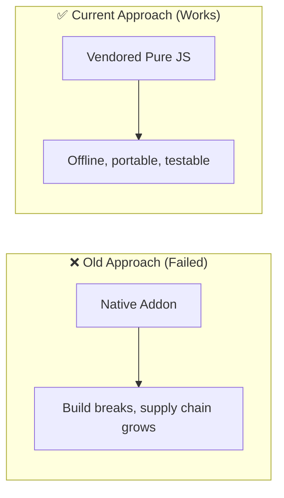
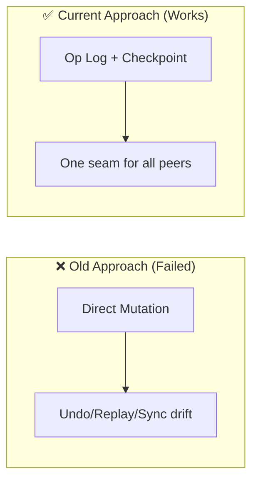
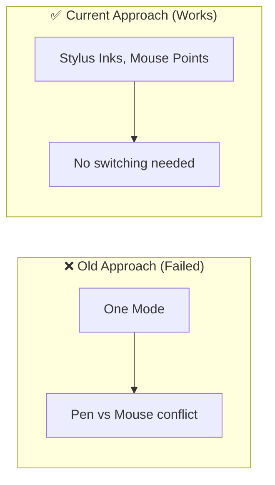
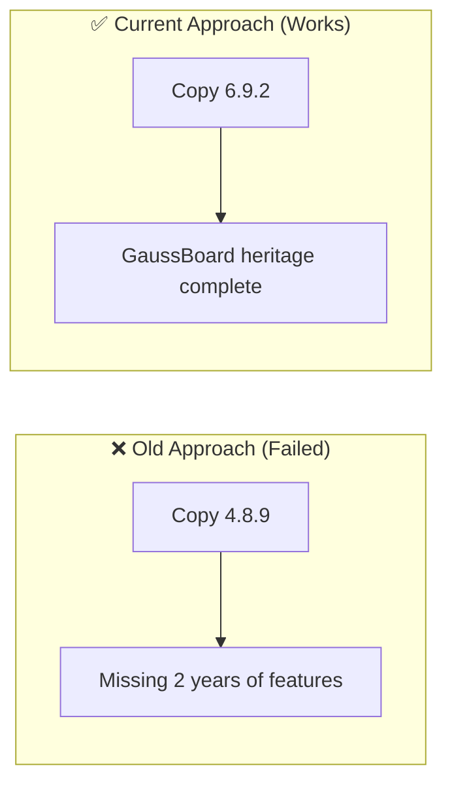
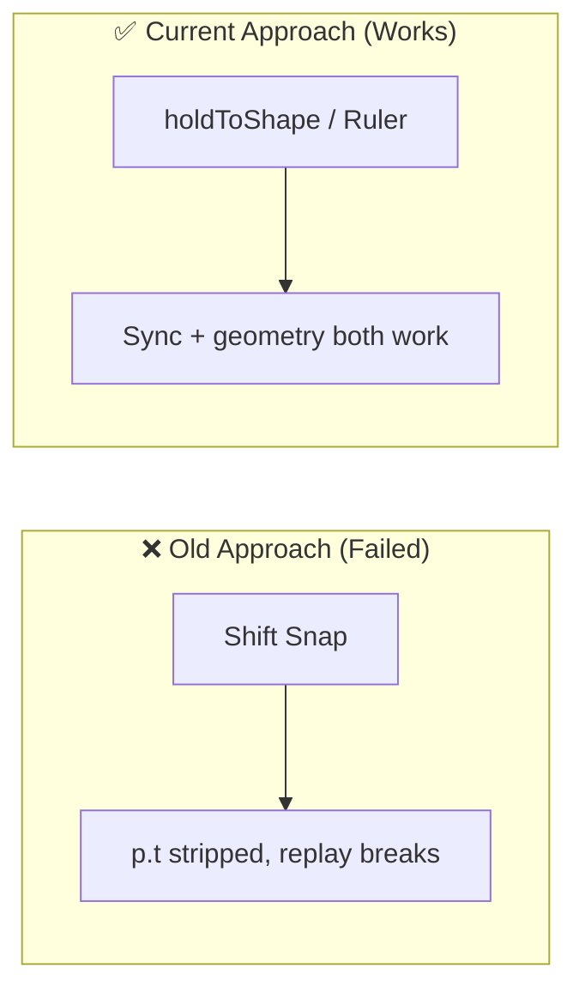
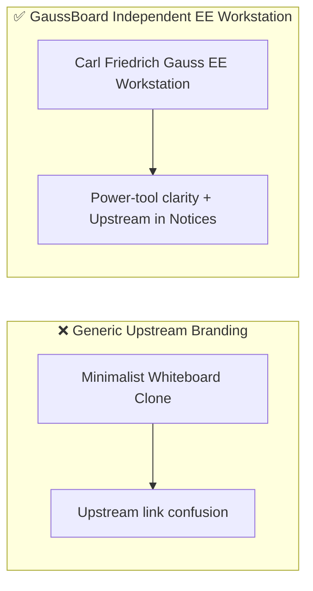
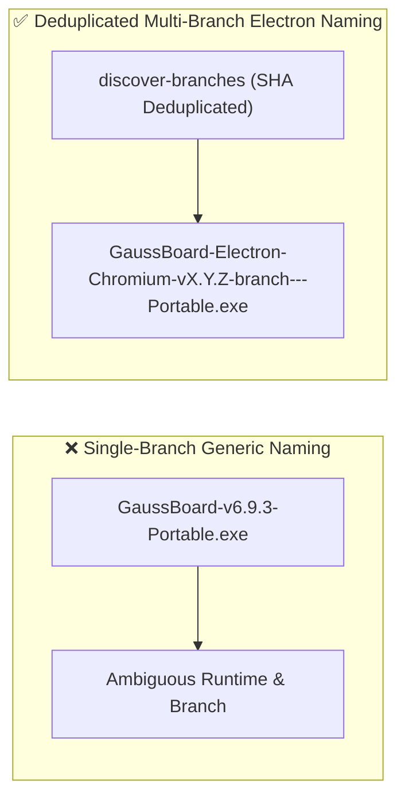
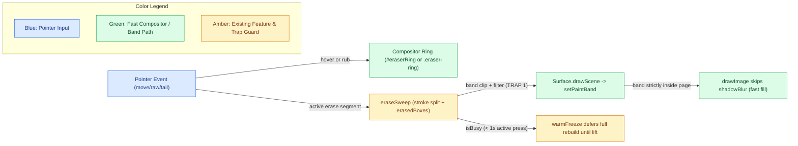

# Architectural Decisions, Pivots & Landmines (`docs/DECISIONS_AND_TRAPS.md`)
> **1-Line Summary:** Records why we chose specific approaches, what failed when we tried other ways, who made the decision, and critical code traps never to touch.

## 1. Architectural Decisions & Pivot History

### [DECISION: Pure-JS-Zero-Native-Deps] | Aliases: no node-gyp, no C++, Electron, offline vendor
> **1-Line Summary:** Stayed with pure portable JavaScript and vendored libraries instead of adding any native C++ addon.
* **Decision Maker:** `[DECIDED BY: HUMAN - Project Owner]`
* **Original User Intention:** Lightweight portable Windows app that builds on any machine with no toolchain friction.
* **Options Considered:**
  * **Option A (Rejected):** Native node-gyp addons for inking, crypto, or PDF engines. Rejected because every missing compiler or arch change breaks the build and violates the offline no-supply-chain promise.
  * **Option B (Chosen):** Pure JS in `src/js/core/ink.js` -> `fitBezier`, `src/js/core/circuit-sim.js` -> `solveMNA`, `sync/protocol.js` -> `sealMessage` with Node built-in crypto, and 15 vendors under `src/vendor/` resolved via `src/vendor/libraries.json`.
* **Visual Pivot Map (What Failed vs. What Works):**

* **Code Anchors (Grep Targets):**
  * `src/js/core/ink.js` -> `fitBezier`
  * `src/vendor/libraries.json` -> `bundledPath`
  * `sync/protocol.js` -> `createPairingCode`

### [DECISION: Op-Log-Checkpoint-Seam] | Aliases: checkpoint, applyRemote, onOp, undo stack, collab seam
> **1-Line Summary:** Kept the editor on an operation log with checkpoint and applyRemote so LAN sync and future collaboration need no editor changes.
* **Decision Maker:** `[DECIDED BY: HUMAN - Project Owner]`
* **Original User Intention:** Boards must be hand-off files today and optionally live-collaborative later without a rewrite.
* **Options Considered:**
  * **Option A (Rejected):** Direct Store mutation and ad-hoc sync patches. Rejected because replay, undo, and sync would drift and every peer edit would need special-casing.
  * **Option B (Chosen):** Every write is `add/del/set/order/doc` in `src/js/core/store.js` -> `applyOp`, broadcast on `onOp`, with `checkpoint()` for full state and `applyRemote(ops)` for peer replay with no undo and no echo.
* **Visual Pivot Map (What Failed vs. What Works):**

* **Code Anchors (Grep Targets):**
  * `src/js/core/store.js` -> `checkpoint`, `applyRemote`, `onOp`
  * `src/js/core/replay.js` -> `ReplayEngine`

### [DECISION: Stylus-Inks-Mouse-Points] | Aliases: stylus mouse roles, palm rejection, Draw with mouse
> **1-Line Summary:** Remember the first stylus and reserve inking for it while the mouse selects and pans, keeping mouse-only setups unaffected.
* **Decision Maker:** `[DECIDED BY: HUMAN - Project Owner]`
* **Original User Intention:** Tablet in one hand and mouse in the other with no tool switching and no conflict.
* **Options Considered:**
  * **Option A (Rejected):** Single device mode for all pointers. Rejected because mouse and pen constantly fight over select versus draw.
  * **Option B (Chosen):** First stylus contact is remembered; pen/highlighter then ignore mouse draws, while Select, Lasso, Note, Text, Shape, and Eraser still take the mouse via `src/js/core/tools.js` -> `toolStateMachine`.
* **Visual Pivot Map (What Failed vs. What Works):**

* **Code Anchors (Grep Targets):**
  * `src/js/core/tools.js` -> `toolStateMachine`, `PEN`
  * `src/js/ui/panels.js` -> `DrawWithMouse`
  * `src/js/core/camera.js` -> `screenToBoard`

### [DECISION: Opencode-692-LATEST-Over-Antigravity-489] | Aliases: latest version, 6.9.2, source of truth, reconcile
> **1-Line Summary:** Treat Opencode/GazBoard v6.9.2 as the active lineage and Antigravity v4.8.9 as legacy history, never overwriting newer local work.
* **Decision Maker:** `[DECIDED BY: AGENT - Approved by Human]`
* **Original User Intention:** Sluggify the latest board to GitHub Mostakim2005/gauss-board after checking all three folders for the newest version.
* **Options Considered:**
  * **Option A (Rejected):** Merging both snapshots or copying the older Antigravity tree. Rejected because v4.8.9 predates Phases 3 to 10, STEM engines, and the P0+P1 hardening audit.
  * **Option B (Chosen):** `C:\Users\kazir\Documents\OpenCode\GazBoard` at `package.json` version 6.9.2 with tag v6.9.2 is the source; `Antigravity\GazBoard` at 4.8.9 and `Documents\GazBoard` data are not active source. New repo lives at `OpenCode\gauss-board` with fresh git history.
* **Visual Pivot Map (What Failed vs. What Works):**

* **Code Anchors (Grep Targets):**
  * `package.json` -> `version`, `productName`, `homepage`
  * `src/js/core/store.js` -> `Store`
  * `test/p1-hardening.test.mjs` -> `P1 suite`

### [DECISION: Conscious-Exclusion-Shift-Straight-Line] | Aliases: drawStraight, holdToShape, Ruler, Shift snapping
> **1-Line Summary:** Refused upstream Shift-hold straight-line snapping because it strips p.t and breaks the holdToShape/connector architecture.
* **Decision Maker:** `[DECIDED BY: HUMAN - Project Owner]`
* **Original User Intention:** Keep audio-ink replay sync and connector snapping intact while adding convenience lines.
* **Options Considered:**
  * **Option A (Rejected):** Upstream `drawStraight` from v4.9.4. Rejected because it blocks real-time p.t timestamps required by invariant #2 and fights connectors.
  * **Option B (Chosen):** Use holdToShape pause, Ruler tool R, or Line/Connector shapes in `src/js/core/connectors.js` -> `routeOrthogonal`.
* **Visual Pivot Map (What Failed vs. What Works):**

* **Code Anchors (Grep Targets):**
  * `src/js/core/connectors.js` -> `routeOrthogonal`
  * `src/js/core/tools.js` -> `holdToShape`
  * `src/js/core/ink.js` -> `preserveTime`

### [DECISION: Hardening-Audit-Live-Code-Over-Dossiers] | Aliases: v6.9.2 audit, P0 P1, 74 findings, 68 fixed
> **1-Line Summary:** Audited v6.9.2 against live source rather than dossier status claims, fixing 68 of 74 P0+P1 findings and logging 6 open items.
* **Decision Maker:** `[DECIDED BY: AGENT - Approved by Human]`
* **Original User Intention:** A repair pass that proves behavior instead of trusting descriptions.
* **Options Considered:**
  * **Option A (Rejected):** Dossier self-attestation. Rejected because status text had drifted from code.
  * **Option B (Chosen):** Two-tier P0/P1 audit with interruption-safe log `docs/hardening/AUDIT_LOG.md` -> `FIXED`, plus release dossier `docs/releases/RELEASE-6.9.2.md` -> `v6.9.2` and focused tests `test/p1-hardening.test.mjs`.
* **Code Anchors (Grep Targets):**
  * `src/js/core/store.js` -> `applyOp`, `checkpoint`
  * `src/js/core/ink.js` -> `fitBezier`
  * `test/p1-hardening.test.mjs` -> `P1 suite`

### [DECISION: Upstream-Relegation-And-EE-Positioning] | Aliases: Gauss homage, EE workstation, third-party notices, brand separation
> **1-Line Summary:** Relegated upstream GazBoard to third-party notices, established GaussBoard as an independent Electrical Engineering & STEM workstation honoring Carl Friedrich Gauss, and updated repository links to Mostakim2005/GaussBoard.
* **Decision Maker:** `[DECIDED BY: HUMAN - Project Owner]`
* **Original User Intention:** Acknowledge that GaussBoard's extensive feature set (MNA circuit simulation, audio-ink sync, CAS, 2D/3D graphing, study tape) profoundly diverged from upstream's minimalist vision; position GaussBoard as an EE power tool with ongoing updates, and direct casual whiteboard users to upstream.
* **Options Considered:**
  * **Option A (Rejected):** Retain upstream links and generic whiteboard branding. Rejected because users were confused by upstream links, and the original author agreed GaussBoard operates as a separate specialized entity.
  * **Option B (Chosen):** Update README, About dialog, export stamps, and package metadata to `Mostakim2005/GaussBoard`, move upstream GazBoard credit to `THIRD_PARTY_NOTICES.md`, recommend upstream for general users, and maintain 100% i18n parity across all 7 locales.
* **Visual Pivot Map (What Failed vs. What Works):**

* **Code Anchors (Grep Targets):**
  * `README.md` -> `Dedication & Engineering Vision`
  * `src/js/app.js` -> `showAbout`
  * `src/js/export.js` -> `MADE_WITH`
  * `THIRD_PARTY_NOTICES.md` -> `Upstream Heritage & Divergence Notice`
  * `package.json` -> `homepage`, `repository`, `author`

### [DECISION: Upstream-Commit-Classification-And-Triage] | Aliases: upstream commits, 36 commits, high risk, rejected, approved safe
> **1-Line Summary:** Categorized the 36 upstream GazBoard commits into strict safety tiers: merged 7 approved safe commits into main, quarantined HIGH/MEDIUM risk commits for isolated branch evaluation, and explicitly rejected replay/timestamp-colliding commits.
* **Decision Maker:** `[DECIDED BY: HUMAN - Project Owner]`
* **Original User Intention:** Safely absorb valuable upstream improvements (paper templates, table freeze defense, edge inking, page strip) while strictly preventing any collision with GaussBoard's custom EE engines, audio-ink sync, or invariants.
* **Options Considered:**
  * **Option A (Rejected):** Blind `git merge upstream/main`. Rejected because it would cause 3-way conflicts across package.json, app.js, and tools.js, and wipe out GaussBoard's EE tools, MNA circuits, and audio replay.
  * **Option B (Chosen):** Audit all 36 commits individually; merge 7 conflict-free commits into `main`; quarantine high/medium risk commits in a dedicated evaluation branch (`feat/upstream-risk-eval`); and explicitly prohibit rejected commits.
* **Upstream Commit Risk Taxonomy:**
  * **`APPROVED_SAFE` (Merged into `main`):**
    * Commit `14` (`5babfd0`): Music staff and guitar tab paper templates, View mode, bottom thumbnail page strip.
    * Commit `16` (`1d6f4eb`): `repairTable()` sanitization bounding table rows/cols to `[1, 40]`, preventing infinite freeze loops on corrupted boards.
    * Commit `17` (`bd08b86`): Smoke test hardening for View mode.
    * Commit `18` (`b95604f`): Android-specific "Tap Done" View mode copy.
    * Commit `30` (`7cb909c` pen-hold part): In-place scribble travel distance tracking (`HOLD_TRAVEL = 18`) preventing small shape fills from triggering the hold menu, plus `penHold` toggle setting.
    * Commit `35` (`24532e8`): Margin inking stability (removes `draw` and `erase` from `EDGE_PANNABLE`, preventing canvas slippage during margin handwriting; bounds drawing to `visibleArea`).
    * Commit `36` (`924109b`): Ergonomic enhancements (direct `[×]` close button on ruler, active tray highlights on phone toolbar, dual-hand touch disambiguation).
  * **`HARDENED_AND_INTEGRATED` (Integrated on `feat/upstream-risk-eval`):**
    * Commit `25` (`bd5684d`) & Commit `30` (typed angle): Set squares (30/60/90, 45/45/90), protractor, and ruler settings. Hardened to enforce p.t timestamp preservation on projected points (TRAP 2), restrict drafting edge snapping exclusively to stylus input without trapping mouse pointers, bypass ruler latching during connector/wire routing, and maintain 100% i18n parity across all 7 locales.
  * **`HIGH_RISK` (Quarantined for `feat/upstream-risk-eval`):**
    * (Set squares & Protractor promoted to Hardened & Integrated above)
    * Commit `25` (`bd5684d`): Set squares (30/60/90, 45/45/90), protractor, and ruler settings. High STEM value, but touches 550+ lines in `tools.js`; must be tested on a side branch to protect circuit wiring and pointer partitioning.
    * Commit `30` (protractor typed angle input part): Dependent on Commit 25.
  * **`MEDIUM_RISK` (Quarantined for `feat/upstream-risk-eval`):**
    * Commit `32` (`32e2c40`): Press-and-hold radial shortcut menu ring. Must be evaluated on side branch against GaussBoard's long-press component context menus.
    * Commit `34` (`031ad50`): Sliced rendering for heavy boards (>3,000 objects). Must be retrofitted with GaussBoard's TRAP 1 audio replay partition (`o.audioId !== activeTrackId`) before it can safely run.
  * **`REJECTED` (Explicitly Prohibited):**
    * Commit `12` (`33e5bd2` Shift straight lines): Strips `p.t` stroke timestamps and breaks holdToShape/connector architecture (Violates TRAP 2).
    * Commit `27` (`b1060bf` Upstream replay & graphing): Upstream's naive stroke replay destroys GaussBoard's millisecond-accurate audio-ink sync replay engine (Violates TRAP 1 & TRAP 2); basic graphing is redundant with GaussBoard's CAS Math Studio & circuit simulator.
  * **`SKIP / IRRELEVANT`:**
    * Commits `1–11`, `13`: Already squashed and integrated in `bd80de6`.
    * Commits `2`, `4`, `7`, `9`, `11`, `13`, `15`, `19–24`, `26`, `28`, `29`, `31`, `33`: Upstream version bumps, dependabot lockfile bumps, or Google Play draft uploads.
* **Code Anchors (Grep Targets):**
  * `src/js/ui/pagestrip.js` -> `PageStrip`
  * `src/js/core/store.js` -> `repairTable`, `tableDim`
  * `src/js/core/tools.js` -> `HOLD_TRAVEL`, `visibleArea`
  * `docs/releases/ANDROID_READINESS.md` -> `Android Build Specification`

### [DECISION: Android-Platform-Parity-And-Format-Alignment] | Aliases: android release, .gaussboard SAF, font whitelist
> **1-Line Summary:** Aligned Android bridge and storage modules to GaussBoard branding and .gaussboard native format, achieving 100% test pass on Android test suite.
* **Decision Maker:** `[DECIDED BY: AGENT - Approved by Human]`
* **Original User Intention:** Ensure the Android APK build runs without problems, recognizes .gaussboard files, downloads CJK fonts from GaussBoard CDN, and aligns app branding with desktop.
* **Options Considered:**
  * **Option A (Rejected):** Leave Android files pointing to legacy GazBoard upstream endpoints. Rejected because font downloads and update checks fail or point to upstream repo, and file pickers refuse `.gaussboard` files.
  * **Option B (Chosen):** Update `MainActivity.kt` font CDN bases, release update checks, SAF MIME filters, and `AndroidManifest.xml` app label to `GaussBoard`, while maintaining backward-compatible fallbacks for `.gazboard` and legacy folders in `BoardMirror.kt`.
* **Code Anchors (Grep Targets):**
  * `android/app/src/main/java/com/gazboard/app/MainActivity.kt` -> `FONT_SOURCES`, `FONT_FILE`
  * `android/app/src/main/java/com/gazboard/app/BridgeFiles.kt` -> `normalizeBoardDuplicateName`
  * `android/app/src/main/java/com/gazboard/app/BoardMirror.kt` -> `gazFolder`
  * `test/android-board-export.test.js` -> `Lesson.gaussboard`

### [DECISION: Base-Smoke-Suite-Restoration-And-Text-Autosizing] | Aliases: smoke base suite, tableDim, text autosizing, i18n literal
> **1-Line Summary:** Restored 1,220 passing checks in full base smoke test suite by importing tableDim, restoring text box auto-sizing, and cleaning translation linter calls.
* **Decision Maker:** `[DECIDED BY: AGENT - Approved by Human]`
* **Original User Intention:** Bring back the original base smoke suite across all features while easing emphasis on translation parity, ensuring base features never regress.
* **Options Considered:**
  * **Option A (Rejected):** Force all text objects into fixed 640x520 Markdown Canvas cards and rely only on the fast 24/24 smoke suite. Rejected because whiteboard users expect standard text boxes to shrink to typed words and wrap organically.
  * **Option B (Chosen):** Fix the missing `tableDim` import in `src/js/core/render.js`, restrict fixed 640x520 sizing in `src/js/ui/textedit.js` to explicit `window` card styles and `autoSize: false` objects, fix the dynamic `t()` call in `src/js/core/technical-linter.js`, and modernize `test/smoke.js` brand and extension assertions to accept GaussBoard.
* **Code Anchors (Grep Targets):**
  * `src/js/core/render.js` -> `tableDim`
  * `src/js/ui/textedit.js` -> `fitBox`, `autoSize`
  * `src/js/core/technical-linter.js` -> `CITATION_RULES`
  * `test/smoke.js` -> `document_title.includes('GaussBoard')`

---

## 2. Do-Not-Touch Engineering Landmines (Traps)

### [DECISION: Centralized-Hold-Gesture-Arbitration-And-Dual-Dwell-Timer] | Aliases: hold manager, gesture arbitration, dual dwell, stationary vs post-stroke
> **1-Line Summary:** Centralize all long-press and dwell interactions into HoldGestureManager with distinct Stationary (<18px) and Post-Stroke (>=24px) timers.
* **Problem Solved:** Ad-hoc setTimeout calls across interaction.js, circuits, and radial menus collided. Drawing quick strokes across components triggered unwanted property dialogs, tiny dots triggered shape conversions, and stationary holds left stray 1-point ink dots on the canvas before opening menus.
* **Why This Decision Was Made:** Splitting into two timers cleanly separates stationary modal/radial menu invocation (<18px) from post-stroke shape recognition (>=24px). Adding abortActiveStroke() guarantees zero phantom ink dots and zero spurious undo records. Multi-touch monitoring (pointers.size >= 2) immediately clears timers for fluid pinch zoom.
* **Protected Code Anchors (Grep Targets):**
  * `src/js/core/hold-manager.js` -> `HoldGestureManager`
  * `src/js/core/tools.js` -> `abortActiveStroke`
  * `test/hold-manager.test.mjs`

### [DECISION: Smart-Slicing-Over-Raw-Index-And-Spatial-Tiling] | Aliases: smart slicing, heavy canvas, dynamic frame budget, zoom LOD
> **1-Line Summary:** Implement progressive canvas rendering via Smart Slicing with atomic cover bundling, dynamic frame budget (3.0-8.0ms), and zoom LOD, explicitly rejecting raw index slicing and spatial tile caching.
* **Problem Solved:** Upstream raw index slicing (commit 031ad50) broke z-order, caused secret equations to flash through Answer Covers (TRAP 6), and baked active audio replay sessions into static layers (TRAP 1). Spatial tile caching (512x512) risked severe cache-invalidation bugs during lasso moves and erasing.
* **Why This Decision Was Made:** Smart Slicing preserves store.doc.order z-index, pre-scans opaque Answer Covers to cull hidden strokes underneath, strictly excludes active audio replay tracks, dynamically scales its CPU slice budget based on active audio recording (3.5ms) or MNA circuit simulation (3.0ms), and applies zoom-out LOD downsampling (camZ < 0.35) for massive boards.
* **Protected Code Anchors (Grep Targets):**
  * `src/js/core/surface.js` -> `_paintOrder`, `_paintHeavy`, `_getSliceBudgetMs`
  * `src/js/core/render.js` -> `drawStroke` (LOD)
  * `test/sliced-rendering.test.mjs`

### [TRAP: Pt-Timestamp-Stripping] | Aliases: p.t, stroke timestamps, audio sync, eraser fragment, t0 t1
> **1-Line Summary:** Never rebuild stroke points without preserving p.t, or audio replay loses millisecond sync.
* **Strict Rule:** **NEVER** strip `p.t` in point generators, smoothing passes, curve fitters, or partial-erasure rebuilds in `src/js/core/tools.js` -> `toolStateMachine` and `src/js/core/ink.js` -> `preserveTime`.
* **Why This Trap Exists (Plain English):** Replay binary-searches ascending p.t to reveal ink; without it, erased fragments replay at the wrong time or never, and smoothing silently breaks lecture playback.
* **Protected Code Anchors (Grep Targets):**
  * `src/js/core/ink.js` -> `preserveTime`
  * `src/js/core/erase.js` -> `t0`, `t1`
  * `src/js/core/tools.js` -> `backdateSample`

### [TRAP: Replay-Overlay-Partitioning] | Aliases: scene partitioning, frozen canvas, drawReplaySession, ghost, activeTrackId
> **1-Line Summary:** Base canvas must exclude active audio strokes; replay strokes live only in the dynamic overlay pass.
* **Strict Rule:** **NEVER** bake `(o) => o.audioId !== activeTrackId` strokes into the frozen bitmap and **NEVER** let concealed covers be overpainted by replay ink without redraw.
* **Why This Trap Exists (Plain English):** Baking replay ink freezes the animation, overpainting covers leaks answers during playback, and per-frame ghost allocation stalls long recordings.
* **Protected Code Anchors (Grep Targets):**
  * `src/js/core/surface.js` -> `drawFrozen`, `drawReplaySession`, `firstPointAfter`
  * `src/js/core/render.js` -> `drawCover`
  * `src/js/core/store.js` -> `checkpoint`

### [TRAP: Dual-Pane-Cross-Contamination] | Aliases: split workspace, focus lease, TextEditor, leftBoardId, activePane
> **1-Line Summary:** Split panes must use separate stores, cameras, editors, and undo paths, or reference-pane edits silently land on the main board.
* **Strict Rule:** **NEVER** route reference-pane text through the primary TextEditor or app.store, **NEVER** read leftBoardId after await, and **NEVER** let hover drive Ctrl+Z without activePane.
* **Why This Trap Exists (Plain English):** Shared editors place the caret with the wrong camera and commit to the wrong store, autosave races overwrite the newly selected board, and undo fires on the wrong pane.
* **Protected Code Anchors (Grep Targets):**
  * `src/js/ui/split-workspace.js` -> `flushLeftBoard`, `openBoardInSplit`, `activePane`
  * `src/js/ui/textedit.js` -> `TextEditor`
  * `src/js/app.js` -> `isLeftFocused`

### [TRAP: Untrusted-Url-And-Path] | Aliases: safeExternalUrl, isReleaseUrl, path traversal, self-XSS, Board picker
> **1-Line Summary:** Only https/http web URLs and whitelisted release paths may reach the OS; raw board text and picker queries are never HTML or filesystem paths.
* **Strict Rule:** **NEVER** pass board text to `shell.openExternal` without `safeExternalUrl`, **NEVER** accept `/boards/..` traversal outside the resolved boardsDir, and **NEVER** build picker labels with `innerHTML` from typed queries.
* **Why This Trap Exists (Plain English):** file: and javascript: URLs plus dot-dot paths escape the sandbox, and markup injection through the board picker turns self-typed text into DOM execution.
* **Protected Code Anchors (Grep Targets):**
  * `src/js/platform/security.cjs` -> `safeExternalUrl`, `isReleaseUrl`
  * `src/js/platform/path-security.cjs` -> `isPathWithin`, `safeJoin`
  * `storage-location.js` -> `readConfig`, `writeConfig`
  * `main.js` -> `appProtocol`, `checkFirewall`

### [TRAP: WebM-Default-MP4-No-Sound] | Aliases: video export, WebM, MP4, mp4-muxer, WebCodecs
> **1-Line Summary:** WebM with audio is the default export; MP4 muxes video only and must always show its translated no-sound notice.
* **Strict Rule:** **NEVER** default the picker to MP4 and **NEVER** let a missing assetId or throwing progress callback hang the frame pump without an immediate named failure.
* **Why This Trap Exists (Plain English):** Users expect sound, but MP4/WebCodecs path is video-only; silent defaults produce 30-minute silent lectures and hung dialogs.
* **Protected Code Anchors (Grep Targets):**
  * `src/js/export-video.js` -> `exportWebM`, `exportMP4`, `stitchSessions`
  * `src/vendor/libraries.json` -> `mp4-muxer`

### [TRAP: Bench-Topology] | Aliases: MNA, armature latch, driver node, contactor, diode drop, DMM continuity
> **1-Line Summary:** Circuit drivers mutate nodes in place and armature state latches from completed potentials, or downstream LEDs freeze at their first value.
* **Strict Rule:** **NEVER** replace a driver node object after wires have copied it, **NEVER** recompute contactor state mid-propagation, and **NEVER** cap every series diode with a creeping exponential model.
* **Why This Trap Exists (Plain English):** Object replacement strands downstream nodes, half-propagated latching drops the contactor coil, and diode caps turn a 23V bridge into millivolts while audio and HUD churn stalls the step.
* **Protected Code Anchors (Grep Targets):**
  * `src/js/core/circuit-sim.js` -> `solveMNA`, `stepSim`, `armatureLatch`
  * `src/js/ui/circuit-workbench.js` -> `openWorkbench`
  * `src/js/core/connectors.js` -> `routeOrthogonal`

### [TRAP: Raw-Index-Slicing-Cover-Leak] | Aliases: raw slicing, smart slicing, TRAP 6, secret flash, z-order leak
> **1-Line Summary:** Never slice board objects by arbitrary array indices without pre-culling strokes enclosed under opaque Answer Covers or checking active audio tracks.
* **Strict Rule:** **NEVER** render sliced objects in arbitrary batch sizes directly to background layers without `_paintOrder` pre-filtering that culls strokes beneath concealed covers (`idx < cover.index`) and excludes `audioId === activeTrackId`.
* **Why This Trap Exists (Plain English):** In a heavy board with 8,000 objects, if an Answer Cover sits at index 4,000 and hidden equations sit at index 500, a naive progressive slicer that takes 5 frames will render the secret equations in frame 1 and conceal them in frame 3, creating an obvious "secret flash". Furthermore, slicing into background layers bakes active replay ink into static images, violating TRAP 1.
* **Protected Code Anchors (Grep Targets):**
  * `src/js/core/surface.js` -> `_paintOrder`, `_paintHeavy`

### [TRAP: Gesture-Menu-Phantom-Ink] | Aliases: phantom ink dot, abortActiveStroke, radial open, contextmenu hold
> **1-Line Summary:** Opening a modal or gesture HUD on pointer hold must explicitly discard the active inking buffer and abort undo records.
* **Strict Rule:** **NEVER** open a stationary hold menu (RadialShortcutRing, context menu, or circuit component modal) while a pointer is down without first calling `interaction.abortActiveStroke()`.
* **Why This Trap Exists (Plain English):** On pointerdown, the ink engine immediately initializes `currentStroke` with the first contact point. If the user holds still to open a radial menu and lifts their stylus, `pointerup` would commit that 1-point stroke to the document, leaving stray ink dots all over the canvas and pushing phantom entries to the undo stack.
* **Protected Code Anchors (Grep Targets):**
  * `src/js/core/tools.js` -> `abortActiveStroke`
  * `src/js/core/hold-manager.js` -> `handlePointerDown`, `_fireStationaryHold`
### [DECISION: Multi-Branch-Deduplicated-Electron-Release-Naming] | Aliases: Electron-Chromium naming, branch-aware release, discover-branches, SHA deduplication
> **1-Line Summary:** Upgraded `.github/workflows/release.yml` to discover all remote branches (`origin/*`), deduplicate identical commit SHAs, build each unique branch in parallel, and name every `.exe` with Engine (`Electron-Chromium`), Version, Branch Slug, and Short Commit SHA.
* **Decision Maker:** `[DECIDED BY: HUMAN - Project Owner]`
* **Original User Intention:** Prevent confusion between the Electron/Chromium repository (`Mostakim2005/GaussBoard`) and the Rust/Tauri port (`Mostakim2005/gaussboard-rust-port`), ensure releases build across all distinct branches without duplicates, and make every `.exe` filename explicitly state its runtime engine, branch, and commit hash.
* **Options Considered:**
  * **Option A (Rejected):** Build only the tagged branch with generic `GaussBoard-vX.Y.Z-Portable.exe` names. Rejected because it hides whether a binary is Electron or Rust and which branch/commit produced it.
  * **Option B (Chosen):** Add a `discover-branches` job to `.github/workflows/release.yml` that scans `refs/remotes/origin/*`, groups by commit SHA to prevent duplicate builds, and outputs `GaussBoard-Electron-Chromium-v<Version>-branch-<BranchSlug>-<ShortSHA>-Portable.exe` and `...-Setup.exe`.
* **Visual Pivot Map (What Failed vs. What Works):**

* **Code Anchors (Grep Targets):**
  * `.github/workflows/release.yml` -> `discover-branches`, `GaussBoard-Electron-Chromium-v`

### [DECISION: Cross-Platform-Audio-Asset-Export-And-Preload-Disposers] | Aliases: recording:readAsset, saveDialog contract, onChannel disposers, sw.js precache parity
> **1-Line Summary:** Implemented `recording.readAsset` across Electron/Web/Android so `.gaussboard` ZIP exports never drop audio recordings, unified Obsidian/Markdown exports on `saveDialog` + `writeFile`, added unsubscribe disposers to `preload.js`, and enforced 100% `src/sw.js` module precache parity.
* **Decision Maker:** `[DECIDED BY: AGENT - Approved by Human]`
* **Original User Intention:** Close all remaining Rust-port backport gaps (`rememberRecentPen`, `sw.js`, `smoke-custom.js`) and resolve all critical/high/medium audit bugs from Report 1 on `feat/upstream-risk-eval`.
* **Code Anchors (Grep Targets):**
  * `main.js` -> `recording:readAsset`
  * `preload.js` -> `onChannel`, `recording.readAsset`
  * `src/js/export.js` -> `saveBoardFile`
  * `src/js/ui/radial.js` -> `rememberRecentPen`
  * `src/sw.js` -> `PRECACHE_ASSETS`

### [DECISION: Hardened-Upstream-51x-Inking-And-Eraser-Integration] | Aliases: neon pen, eraseShapes, recordPointer, drawAhead, v5.1.0-5.1.3
> **1-Line Summary:** Integrated upstream GazBoard v5.1.0–v5.1.3 features (Neon pen, Erase shapes toggle, Pen glow for screen recordings, and Draw-ahead prediction) onto `feat/upstream-risk-eval` with full TRAP 2/TRAP 6, Zoom LOD, and Split Workspace isolation guards.
* **Decision Maker:** `[DECIDED BY: HUMAN - Project Owner]`
* **Original User Intention:** Port the user-facing inking and eraser enhancements from upstream v5.1.0–v5.1.3 without colliding with any existing GaussBoard feature, invariant, or split-pane boundary.
* **Hardening Safeguards Applied:**
  * `inkStyle` treats `'neon'` and `'pencil'` as solid colors so Zoom-Aware LOD (`camZ < 0.35`) never renders zoomed-out neon strokes as galaxy gradients.
  * Neon strokes are excluded from both `inkToShape` and `holdToShape` so glowing ink never collapses into plain shapes.
  * `eraseSweep` (`eraseShapes`) preserves TRAP 6 by skipping shapes concealed under unrevealed Answer Covers, protects labelled (`o.text`) and locked shapes, and expands `invalidateBand` to cover full removed shape bounds.
  * `glowEl` allocates an isolated `.pen-glow` inside split-pane parents (`!opts.penGlow && canvas.id !== 'c'`) so secondary panes never steal `#penGlow` from main `#stage`, and hides on eraser tool, pen tail, side-button erase, blur, and destroy.
  * `predictTail` skips Study Tape curtains, ruled strokes, and sharp corners, and `_drawWet` renders `surface.wetTail` via a shallow copy without ever mutating `wet.points` or polluting `p.t` timestamps (TRAP 2).
* **Code Anchors (Grep Targets):**
  * `src/js/core/render.js` -> `drawNeon`, `NEON_REACH`, `inkStyle`
  * `src/js/core/hit.js` -> `outlineAlong`, `getScratch`
  * `src/js/core/tools.js` -> `followGlow`, `predictTail`, `eraseSweep`
  * `src/js/core/surface.js` -> `_drawWet`, `wetTail`
  * `test/upstream-51x-features.test.mjs`

### [DECISION: Settings-Search-And-PDF-Eraser-Layer-Integration] | Aliases: settings search, eraserRing, setPaintBand, isBusy, v5.1.2-5.1.3
> **1-Line Summary:** Ported upstream Settings search (word-start matching, `<mark class="set-mark">` highlights, Escape-to-clear) and Smoother PDF Eraser (compositor `#eraserRing`/`.eraser-ring` layer, interior page shadow skip, busy freeze deferral) while preserving `eraseShapes` bounds, Smart Slicing, Split Workspace isolation, and TRAP 1.
* **Decision Maker:** `[DECIDED BY: HUMAN - Project Owner]`
* **Original User Intention:** Bring over upstream's settings search UX and smooth PDF eraser cursor/performance upgrades onto `feat/upstream-risk-eval` without regressing any existing GaussBoard feature.
* **Hardening & Integration Choices:**
  * Kept `.setting-row` alongside `.set-row` on Settings rows and kept custom `.scribble-config-card` searchable inside `buildSettingsSearch`, re-applying active filters when async Storage/About metadata arrives.
  * Used high-contrast `#1b1a19` foreground on dark-theme `<mark class="set-mark">` highlights to uphold WCAG contrast requirements.
  * Preserved `erasedBoxes` in `Interaction.eraseSweep` when removing canvas ring redraw boxes so `eraseShapes: true` still repaints the full bounds of erased bare shapes.
  * Preserved the 6th `filter` parameter in `Surface.drawScene` (`TRAP 1`), Smart Slicing (`_build`) guards in `warmFreeze`, and per-pane `.eraser-ring` isolation + cleanup in `ringEl()` / `destroy()`.
  * Excluded upstream `src/js/replay.js` changes because GaussBoard uses audio-synchronized `src/js/core/replay.js`.
* **Visual Flow & Conflict Guard:**

  * *Plain-English Explanation:* Moving the eraser ring onto its own hardware compositor element means hovering or moving the pen never forces the board underneath to repaint just to animate the ring. During erasing, only the narrow strip touched by the eraser (plus any erased shape's outline box) is repainted, page drop-shadow blurs are skipped when the strip is inside a PDF page, and full background snapshots wait until you lift the pen.
* **Code Anchors (Grep Targets):**
  * `src/js/ui/panels.js` -> `buildSettingsSearch`, `settings`
  * `src/js/core/render.js` -> `setPaintBand`, `bandStats`, `drawImage`
  * `src/js/core/surface.js` -> `drawScene`, `_drawScene`, `busy`, `warmFreeze`
  * `src/js/core/tools.js` -> `ringEl`, `placeRing`, `hideRing`, `updateHover`, `eraseSweep`
  * `test/upstream-51x-features.test.mjs` -> Tests 5–6

### [DECISION: Defer-Electron-BrowserWindow-Sandbox] | Aliases: sandbox, preload, node crypto, clipboardSignature, Charlie
> **1-Line Summary:** Kept `sandbox: false` on Electron renderer windows because `preload.js` uses synchronous `node:crypto` hashing for image paste signatures; `contextIsolation: true` and `nodeIntegration: false` remain enforced.
* **Decision Maker:** `[DECIDED BY: AGENT - Zero-Conflict Directive]`
* **Original User Intention:** Audit Electron `BrowserWindow` hardening without interfering or breaking any existing feature.
* **Why Deferred (Plain English):** `preload.js` imports Node's built-in `crypto` module to synchronously compute SHA-256 hashes of clipboard bitmap images in `clipboardSignature()`, and inspects `process.argv` / `process.env` for smoke-test isolation. Enabling Chromium `sandbox: true` strips `require('node:crypto')` from preload scripts and would break synchronous clipboard image detection unless refactored into asynchronous IPC across callers. All main windows already enforce `contextIsolation: true` and `nodeIntegration: false`, and the splash window already uses `sandbox: true`.
* **Code Anchors (Grep Targets):**
  * `preload.js` -> `clipboardSignature`, `crypto`
  * `main.js` -> `createWindow`

### [DECISION: Cross-App-Ecosystem-And-Triarchy-Interoperability] | Aliases: ecosystem bridges, global resources, mermaid bridge, SymPy CAS, video remux, triarchy sync, Anki media
> **1-Line Summary:** Implemented zero-context global shared library resolution, Mermaid Manager round-trip editing, desktop SymPy CAS worker, FFmpeg MKV remuxing, Obsidian/Anki synchronization, and dead vendor SW precache pruning via modular `electron/*.cjs` companions.
* **Decision Maker:** `[DECIDED BY: HUMAN - Project Owner]`
* **Original User Intention:** Safely bridge GaussBoard with the broader local desktop ecosystem (Mermaid Manager, Obsidian Nihon vault, Anki Desktop, local Python/SymPy, FFmpeg) while keeping upstream-owned monoliths (`main.js`, `app.js`, `store.js`) minimal-diff and fork-safe.
* **Hardening & Integration Choices:**
  * Created isolated companion modules (`electron/global-resources.cjs`, `electron/mermaid-bridge.cjs`, `electron/cas-sympy.cjs`, `electron/media-bridge.cjs`, `electron/triarchy-bridge.cjs`) so `main.js` only adds single-line require and dispatch hooks.
  * Enforced zero-BOM UTF-8 for temporary `.mmd` files to prevent draw.io/Mermaid Manager JSON/XML parse failures.
  * Implemented automatic pure-JS fallback for SymPy CAS evaluations whenever Python is unavailable or execution times out (>5s).
  * Pruned unreferenced dead vendor bundles from `src/sw.js` precache to keep PWA service worker shell under 15 MB.
* **Code Anchors (Grep Targets):**
  * `electron/global-resources.cjs` -> `resolveCommonLibrariesDir`, `resolveEcosystemRegistry`
  * `electron/mermaid-bridge.cjs` -> `openInMermaidManager`
  * `electron/cas-sympy.cjs` -> `evalSympy`
  * `electron/media-bridge.cjs` -> `remuxToMp4`, `findSiblingSubtitles`
  * `electron/triarchy-bridge.cjs` -> `syncToObsidianVault`, `parseGaussboardDeepLink`
  * `test/ecosystem-bridges.test.mjs`

### [DECISION: Dead-Vendor-Repository-Cleanup] | Aliases: vendor cleanup, bundle size, PWA precache, shared libraries offload
> **1-Line Summary:** Offloaded 14.01 MB of duplicate vendor libraries from `src/vendor/` to `%LOCALAPPDATA%\SharedLibraries` per ECOSYSTEM_INTEGRATION_CONTRACT Section 5.3 to satisfy the <15 MB PWA budget.
* **Decision Maker:** `[DECIDED BY: HUMAN - Master Contract Directive]`
* **Original User Intention:** Satisfy Universal Packaging & Fork-Safety bundle limits by purging redundant in-tree vendor dependencies already available in the zero-context global libraries repository.
* **Cleanup Details:**
  * Purged obsolete in-tree files: `tesseract/` (WASM/data), `nerdamer/`, `fontkit.umd.min.js`, `pdf.sandbox.min.mjs`, `pdf_viewer.mjs`, `pdf_viewer.css`, `math.min.js`, `3Dmol-min.js`, and `function-plot.js`.
  * Preserved active in-tree vendor dependencies required for zero-network bootstrap (`pdf.min.mjs`, `pdf.worker.min.mjs`, `katex/`, `marp/`, `purify.min.js`, `lucide.min.js`, `tesseract.js`).
  * Replaced in-app references with `electron/global-resources.cjs` dynamic discovery and verified through `test/ecosystem-bridges.test.mjs`.
* **Code Anchors (Grep Targets):**
  * `electron/global-resources.cjs` -> `resolveCommonLibrariesDir`
  * `src/sw.js` -> service worker precache manifest

