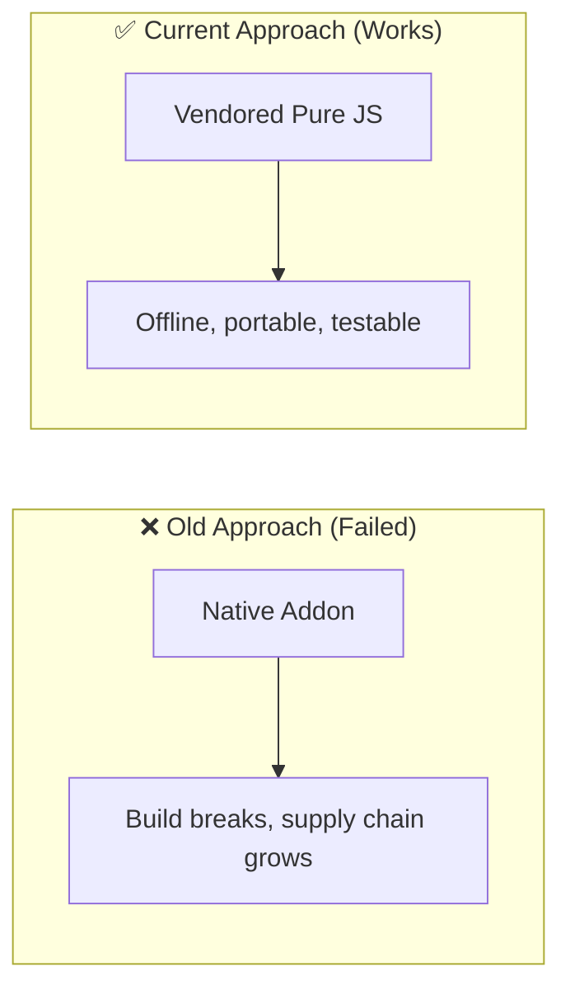
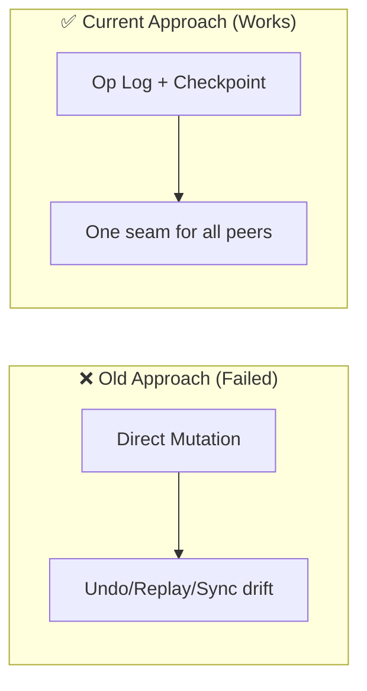
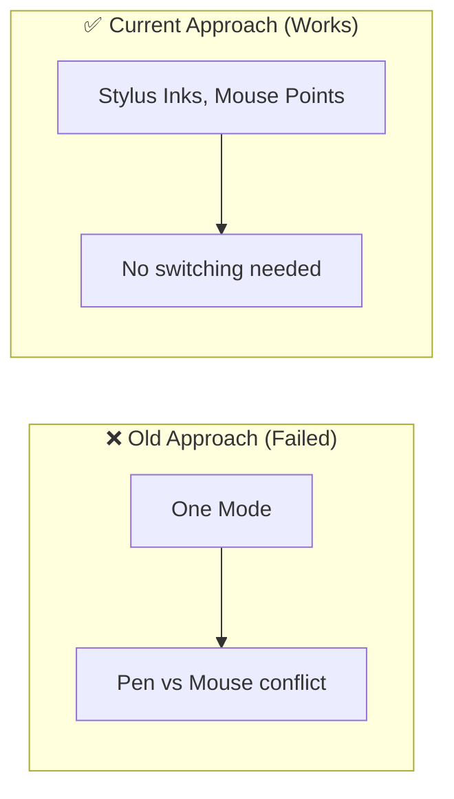
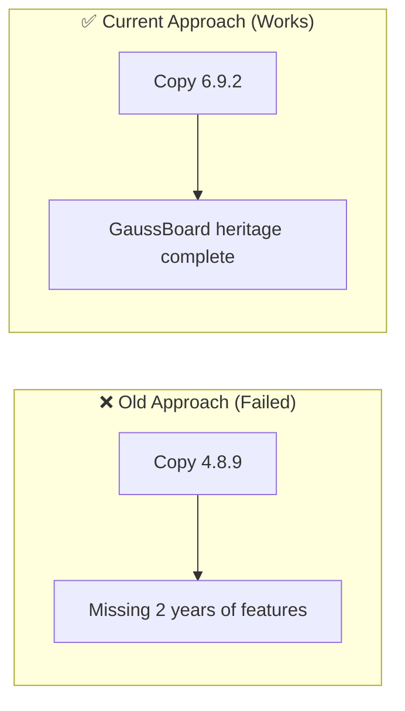
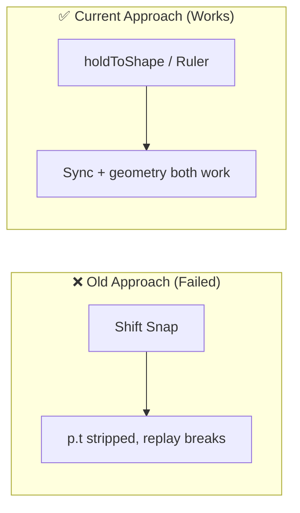

# Architectural Decisions, Pivots & Landmines (`docs/DECISIONS_AND_TRAPS.md`)
> **1-Line Summary:** Records why we chose specific approaches, what failed when we tried other ways, who made the decision, and critical code traps never to touch.

## 1. Architectural Decisions & Pivot History

### [DECISION: Pure-JS-Zero-Native-Deps] | Aliases: no node-gyp, no C++, Electron, offline vendor
> **1-Line Summary:** Stayed with pure portable JavaScript and vendored libraries instead of adding any native C++ addon.
* **Decision Maker:** `[DECIDED BY: HUMAN - Project Owner]`
* **Original User Intention:** Lightweight portable Windows app that builds on any machine with no toolchain friction.
* **Options Considered:**
  * **Option A (Rejected):** Native node-gyp addons for inking, crypto, or PDF engines. Rejected because every missing compiler or arch change breaks the build and violates the offline no-supply-chain promise.
  * **Option B (Chosen):** Pure JS in `src/js/core/ink.js` -> `fitBezier`, `src/js/core/circuit-sim.js` -> `solveMNA`, `sync/protocol.js` -> `sealMessage` with Node built-in crypto, and 15 vendors under `src/vendor/` resolved via `src/vendor/libraries.json`.
* **Visual Pivot Map (What Failed vs. What Works):**

* **Code Anchors (Grep Targets):**
  * `src/js/core/ink.js` -> `fitBezier`
  * `src/vendor/libraries.json` -> `bundledPath`
  * `sync/protocol.js` -> `createPairingCode`

### [DECISION: Op-Log-Checkpoint-Seam] | Aliases: checkpoint, applyRemote, onOp, undo stack, collab seam
> **1-Line Summary:** Kept the editor on an operation log with checkpoint and applyRemote so LAN sync and future collaboration need no editor changes.
* **Decision Maker:** `[DECIDED BY: HUMAN - Project Owner]`
* **Original User Intention:** Boards must be hand-off files today and optionally live-collaborative later without a rewrite.
* **Options Considered:**
  * **Option A (Rejected):** Direct Store mutation and ad-hoc sync patches. Rejected because replay, undo, and sync would drift and every peer edit would need special-casing.
  * **Option B (Chosen):** Every write is `add/del/set/order/doc` in `src/js/core/store.js` -> `applyOp`, broadcast on `onOp`, with `checkpoint()` for full state and `applyRemote(ops)` for peer replay with no undo and no echo.
* **Visual Pivot Map (What Failed vs. What Works):**

* **Code Anchors (Grep Targets):**
  * `src/js/core/store.js` -> `checkpoint`, `applyRemote`, `onOp`
  * `src/js/core/replay.js` -> `ReplayEngine`

### [DECISION: Stylus-Inks-Mouse-Points] | Aliases: stylus mouse roles, palm rejection, Draw with mouse
> **1-Line Summary:** Remember the first stylus and reserve inking for it while the mouse selects and pans, keeping mouse-only setups unaffected.
* **Decision Maker:** `[DECIDED BY: HUMAN - Project Owner]`
* **Original User Intention:** Tablet in one hand and mouse in the other with no tool switching and no conflict.
* **Options Considered:**
  * **Option A (Rejected):** Single device mode for all pointers. Rejected because mouse and pen constantly fight over select versus draw.
  * **Option B (Chosen):** First stylus contact is remembered; pen/highlighter then ignore mouse draws, while Select, Lasso, Note, Text, Shape, and Eraser still take the mouse via `src/js/core/tools.js` -> `toolStateMachine`.
* **Visual Pivot Map (What Failed vs. What Works):**

* **Code Anchors (Grep Targets):**
  * `src/js/core/tools.js` -> `toolStateMachine`, `PEN`
  * `src/js/ui/panels.js` -> `DrawWithMouse`
  * `src/js/core/camera.js` -> `screenToBoard`

### [DECISION: Opencode-692-LATEST-Over-Antigravity-489] | Aliases: latest version, 6.9.2, source of truth, reconcile
> **1-Line Summary:** Treat Opencode/GazBoard v6.9.2 as the active lineage and Antigravity v4.8.9 as legacy history, never overwriting newer local work.
* **Decision Maker:** `[DECIDED BY: AGENT - Approved by Human]`
* **Original User Intention:** Sluggify the latest board to GitHub Mostakim2005/gauss-board after checking all three folders for the newest version.
* **Options Considered:**
  * **Option A (Rejected):** Merging both snapshots or copying the older Antigravity tree. Rejected because v4.8.9 predates Phases 3 to 10, STEM engines, and the P0+P1 hardening audit.
  * **Option B (Chosen):** `C:\Users\kazir\Documents\OpenCode\GazBoard` at `package.json` version 6.9.2 with tag v6.9.2 is the source; `Antigravity\GazBoard` at 4.8.9 and `Documents\GazBoard` data are not active source. New repo lives at `OpenCode\gauss-board` with fresh git history.
* **Visual Pivot Map (What Failed vs. What Works):**

* **Code Anchors (Grep Targets):**
  * `package.json` -> `version`, `productName`, `homepage`
  * `docs/releases/RELEASE-6.9.2.md` -> `v6.9.2`
  * `docs/hardening/AUDIT_LOG.md` -> `FIXED`

### [DECISION: Conscious-Exclusion-Shift-Straight-Line] | Aliases: drawStraight, holdToShape, Ruler, Shift snapping
> **1-Line Summary:** Refused upstream Shift-hold straight-line snapping because it strips p.t and breaks the holdToShape/connector architecture.
* **Decision Maker:** `[DECIDED BY: HUMAN - Project Owner]`
* **Original User Intention:** Keep audio-ink replay sync and connector snapping intact while adding convenience lines.
* **Options Considered:**
  * **Option A (Rejected):** Upstream `drawStraight` from v4.9.4. Rejected because it blocks real-time p.t timestamps required by invariant #2 and fights connectors.
  * **Option B (Chosen):** Use holdToShape pause, Ruler tool R, or Line/Connector shapes in `src/js/core/connectors.js` -> `routeOrthogonal`.
* **Visual Pivot Map (What Failed vs. What Works):**

* **Code Anchors (Grep Targets):**
  * `src/js/core/connectors.js` -> `routeOrthogonal`
  * `src/js/core/tools.js` -> `holdToShape`
  * `AI_BOOTSTRAP.md` -> `Conscious Exclusion`

### [DECISION: Hardening-Audit-Live-Code-Over-Dossiers] | Aliases: v6.9.2 audit, P0 P1, 74 findings, 68 fixed
> **1-Line Summary:** Audited v6.9.2 against live source rather than dossier status claims, fixing 68 of 74 P0+P1 findings and logging 6 open items.
* **Decision Maker:** `[DECIDED BY: AGENT - Approved by Human]`
* **Original User Intention:** A repair pass that proves behavior instead of trusting descriptions.
* **Options Considered:**
  * **Option A (Rejected):** Dossier self-attestation. Rejected because status text had drifted from code.
  * **Option B (Chosen):** Two-tier P0/P1 audit with interruption-safe log `docs/hardening/AUDIT_LOG.md` -> `FIXED`, plus release dossier `docs/releases/RELEASE-6.9.2.md` -> `v6.9.2` and focused tests `test/p1-hardening.test.mjs`.
* **Code Anchors (Grep Targets):**
  * `docs/hardening/AUDIT_LOG.md` -> `FIXED`
  * `docs/releases/RELEASE-6.9.2.md` -> `74 findings`
  * `test/p1-hardening.test.mjs` -> `P1 suite`

---

## 2. Do-Not-Touch Engineering Landmines (Traps)

### [TRAP: Pt-Timestamp-Stripping] | Aliases: p.t, stroke timestamps, audio sync, eraser fragment, t0 t1
> **1-Line Summary:** Never rebuild stroke points without preserving p.t, or audio replay loses millisecond sync.
* **Strict Rule:** **NEVER** strip `p.t` in point generators, smoothing passes, curve fitters, or partial-erasure rebuilds in `src/js/core/tools.js` -> `toolStateMachine` and `src/js/core/ink.js` -> `preserveTime`.
* **Why This Trap Exists (Plain English):** Replay binary-searches ascending p.t to reveal ink; without it, erased fragments replay at the wrong time or never, and smoothing silently breaks lecture playback.
* **Protected Code Anchors (Grep Targets):**
  * `src/js/core/ink.js` -> `preserveTime`
  * `src/js/core/erase.js` -> `t0`, `t1`
  * `src/js/core/tools.js` -> `backdateSample`

### [TRAP: Replay-Overlay-Partitioning] | Aliases: scene partitioning, frozen canvas, drawReplaySession, ghost, activeTrackId
> **1-Line Summary:** Base canvas must exclude active audio strokes; replay strokes live only in the dynamic overlay pass.
* **Strict Rule:** **NEVER** bake `(o) => o.audioId !== activeTrackId` strokes into the frozen bitmap and **NEVER** let concealed covers be overpainted by replay ink without redraw.
* **Why This Trap Exists (Plain English):** Baking replay ink freezes the animation, overpainting covers leaks answers during playback, and per-frame ghost allocation stalls long recordings.
* **Protected Code Anchors (Grep Targets):**
  * `src/js/core/surface.js` -> `drawFrozen`, `drawReplaySession`, `firstPointAfter`
  * `src/js/core/render.js` -> `drawCover`
  * `src/js/core/store.js` -> `checkpoint`

### [TRAP: Dual-Pane-Cross-Contamination] | Aliases: split workspace, focus lease, TextEditor, leftBoardId, activePane
> **1-Line Summary:** Split panes must use separate stores, cameras, editors, and undo paths, or reference-pane edits silently land on the main board.
* **Strict Rule:** **NEVER** route reference-pane text through the primary TextEditor or app.store, **NEVER** read leftBoardId after await, and **NEVER** let hover drive Ctrl+Z without activePane.
* **Why This Trap Exists (Plain English):** Shared editors place the caret with the wrong camera and commit to the wrong store, autosave races overwrite the newly selected board, and undo fires on the wrong pane.
* **Protected Code Anchors (Grep Targets):**
  * `src/js/ui/split-workspace.js` -> `flushLeftBoard`, `openBoardInSplit`, `activePane`
  * `src/js/ui/textedit.js` -> `TextEditor`
  * `src/js/app.js` -> `isLeftFocused`

### [TRAP: Untrusted-Url-And-Path] | Aliases: safeExternalUrl, isReleaseUrl, path traversal, self-XSS, Board picker
> **1-Line Summary:** Only https/http web URLs and whitelisted release paths may reach the OS; raw board text and picker queries are never HTML or filesystem paths.
* **Strict Rule:** **NEVER** pass board text to `shell.openExternal` without `safeExternalUrl`, **NEVER** accept `/boards/..` traversal outside the resolved boardsDir, and **NEVER** build picker labels with `innerHTML` from typed queries.
* **Why This Trap Exists (Plain English):** file: and javascript: URLs plus dot-dot paths escape the sandbox, and markup injection through the board picker turns self-typed text into DOM execution.
* **Protected Code Anchors (Grep Targets):**
  * `src/js/platform/security.cjs` -> `safeExternalUrl`, `isReleaseUrl`
  * `src/js/platform/path-security.cjs` -> `isPathWithin`, `safeJoin`
  * `storage-location.js` -> `readConfig`, `writeConfig`
  * `main.js` -> `appProtocol`, `checkFirewall`

### [TRAP: WebM-Default-MP4-No-Sound] | Aliases: video export, WebM, MP4, mp4-muxer, WebCodecs
> **1-Line Summary:** WebM with audio is the default export; MP4 muxes video only and must always show its translated no-sound notice.
* **Strict Rule:** **NEVER** default the picker to MP4 and **NEVER** let a missing assetId or throwing progress callback hang the frame pump without an immediate named failure.
* **Why This Trap Exists (Plain English):** Users expect sound, but MP4/WebCodecs path is video-only; silent defaults produce 30-minute silent lectures and hung dialogs.
* **Protected Code Anchors (Grep Targets):**
  * `src/js/export-video.js` -> `exportWebM`, `exportMP4`, `stitchSessions`
  * `src/vendor/libraries.json` -> `mp4-muxer`

### [TRAP: Bench-Topology] | Aliases: MNA, armature latch, driver node, contactor, diode drop, DMM continuity
> **1-Line Summary:** Circuit drivers mutate nodes in place and armature state latches from completed potentials, or downstream LEDs freeze at their first value.
* **Strict Rule:** **NEVER** replace a driver node object after wires have copied it, **NEVER** recompute contactor state mid-propagation, and **NEVER** cap every series diode with a creeping exponential model.
* **Why This Trap Exists (Plain English):** Object replacement strands downstream nodes, half-propagated latching drops the contactor coil, and diode caps turn a 23V bridge into millivolts while audio and HUD churn stalls the step.
* **Protected Code Anchors (Grep Targets):**
  * `src/js/core/circuit-sim.js` -> `solveMNA`, `stepSim`, `armatureLatch`
  * `src/js/ui/circuit-workbench.js` -> `openWorkbench`
  * `src/js/core/connectors.js` -> `routeOrthogonal`
