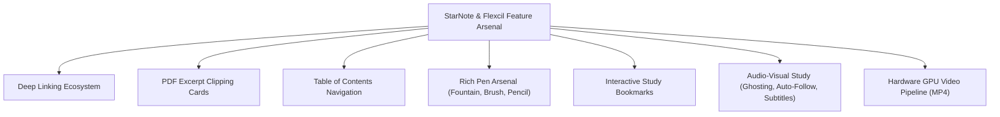

# GazBoard Replay — Master Feature Catalog & Hybrid Architecture Specification
## Complete Inventory of Base Features, Shipped Evolution, StarNote/Flexcil Inspirations & C# Native Companion Blueprint

> **Document Classification:** Master Product Specification, Technical Architecture, and External AI Evaluation Dossier.  
> **Target OS:** Windows 10 / 11 (Packaged 64-bit `.exe` / NSIS / Portable).  
> **Hardware Profile:** Huion H950P Digitizer Tablet (8,192 pressure levels, ~233 PPS report rate) + 23.8" 120Hz ASUS Display (8.33ms VSync budget).  
> **Performance Philosophy:** Fluid 120 FPS responsiveness and rock-solid feature reliability take precedence over memory frugality. High RAM allocation and bundling native runtimes (C# .NET 8, PDFium, FFmpeg/MediaFoundation) are explicitly approved.  
> **Multi-Layer System Status:** Strictly **ON HOLD** (fully specified in Section 6 for future resumption).

> **Current release and handover:** current source is v5.0.0. This catalog's shipped evolution inventory stops at v4.8.11, while later history is in `docs/MASTER_POST_4.8.11_FEATURES_AND_AUDIT.md` and release dossiers. Use [`docs/releases/AUDIT-POST-4.8.1-TO-5.0.0.md`](releases/AUDIT-POST-4.8.1-TO-5.0.0.md) for the current ranked feature audit and [`docs/DEVELOPER_HANDOVER.md`](DEVELOPER_HANDOVER.md) for current repository state. Future-facing sections here are proposals and must not be presented as shipped features without source and test evidence.

---

## 1. Complete Inventory of Base Features (v4.8.1 Upstream Baseline)

This section documents every core built-in capability inherited from the upstream GazBoard v4.8.1 architecture (verified against `BASE_FEATURE_CATALOG-4.8.1.md` and source modules):

| # | Base Feature Area | Upstream Implementation Details | Source Modules |
| :--- | :--- | :--- | :--- |
| **B-01** | **Infinite 2D Canvas & Viewport Camera** | World-to-screen coordinate system allowing unbounded panning, zooming (10% to 500%), and trackpad/touch pinch navigation. Culls offscreen objects at high zoom levels. | `src/js/core/camera.js`<br>`src/js/core/surface.js` |
| **B-02** | **Pens, Pressure & Centerline Inking** | Captures pointer input into ordered stroke sample points preserving `(x, y)` coordinates, pressure `p` (0.0 to 1.0), and color. Generates smooth paths using midpoint averaging. | `src/js/core/tools.js`<br>`src/js/core/ink.js`<br>`src/js/core/render.js` |
| **B-03** | **Highlighter & Laser Pointer** | Single-path translucent ink overlay (`globalAlpha` blending) and a temporary fading laser pointer trail for presentations that leaves no permanent document objects. | `src/js/core/render.js`<br>`src/js/core/surface.js` |
| **B-04** | **Partial & Object Eraser** | Cuts intersecting sample paths into surviving fragments (split strokes) or deletes entire objects on contact. Supports hardware stylus flip-to-erase buttons. | `src/js/core/erase.js`<br>`src/js/core/hit.js` |
| **B-05** | **Shape Recognition & Geometric Primitives** | Classifies completed freehand strokes; automatically straightens lines, arrows, rectangles, triangles, and ellipses when fit error is below threshold. Exact undo restores original ink. | `src/js/core/recognize.js`<br>`src/js/core/tools.js` |
| **B-06** | **Selection, Lasso, Bounding Box & Transforms** | Rectangular marquee and freehand lasso selection feeding shared move, scale, rotate, constrain, lock/unlock, z-order (front/back), duplicate, and delete operations. | `src/js/core/tools.js`<br>`src/js/core/transform.js`<br>`src/js/ui/contextmenu.js` |
| **B-07** | **Sticky Notes & Text Boxes** | Auto-wrapping, resizable sticky notes and text objects supporting system fonts, font size steppers, text alignment, and rich text runs with bold, italic, and underline. | `src/js/core/richtext.js`<br>`src/js/ui/textedit.js` |
| **B-08** | **Tables & Cell Editing** | Editable grid tables with dynamic row/column insertion, cell text editing, automatic column width sizing, and clipboard table formatting support. | `src/js/core/tools.js`<br>`src/js/core/render.js` |
| **B-09** | **Mathematical Notation (LaTeX / KaTeX)** | Native mathematical formula objects. Lazily loads KaTeX for offline typesetting; supports both standalone LaTeX formula blocks and inline `$math$` spans in text. | `src/js/core/maths.js`<br>`src/js/ui/mathedit.js` |
| **B-10** | **Connectors & Magnetic Object Anchors** | Straight and elbow connection lines with magnetic snapping to object bounding boxes and shapes. Endpoints dynamically follow connected objects during transforms. | `src/js/core/connectors.js`<br>`src/js/core/render.js` |
| **B-11** | **Images, Clipboard Paste & Drag-and-Drop** | Direct insertion of PNG, JPEG, SVG, and WebP images via system file picker, native OS clipboard paste (Ctrl+V), or drag-and-drop onto the canvas. | `src/js/insert.js`<br>`preload.js`<br>`main.js` |
| **B-12** | **PDF, Word & PowerPoint Imports** | Rasterizes PDF pages into canvas printouts via PDF.js. Office documents (DOCX, PPTX) are converted through LibreOffice (`soffice`) when installed. | `src/js/importers/pdf.js`<br>`src/js/importers/pptx.js`<br>`src/js/ui/pagepicker.js` |
| **B-13** | **Paged Canvas, Paper Ruling & Templates** | Supports both infinite canvas mode and fixed-dimension paged sheets (A4, Letter) with customizable paper rulings: blank, horizontal lines, grid, and dot grid. | `src/js/core/pages.js`<br>`src/js/templates.js` |
| **B-14** | **Board Library, Folders & Tag Organization** | Gallery view listing saved boards from local storage, nested folder hierarchies, recent-board history tracking, and `#tag` indexing. | `src/js/ui/boardpicker.js`<br>`src/js/core/folders.js`<br>`src/js/core/recent.js` |
| **B-15** | **Persistence, Autosave & Atomic Document Store** | State managed centrally via `Store`. Atomic serialized JSON `.gazboard` persistence and ZIP packaging (`PK\x03\x04`) for bundling embedded audio and image assets. | `src/js/core/store.js`<br>`storage-location.js`<br>`main.js` |
| **B-16** | **Static Export (PNG, SVG, PDF)** | Exports whole-board or selected regions into high-resolution raster PNG, scalable vector SVG, or multi-page paginated PDF documents. | `src/js/export.js`<br>`src/js/board-export.js` |
| **B-17** | **Local Network (LAN) Board Sharing** | Peer-to-peer pairing over local Wi-Fi/Ethernet to stream board updates between devices without external cloud servers. | `sync/node.js`<br>`sync/protocol.js` |
| **B-18** | **Accessibility, i18n & Presentation Tools** | Full UI string internationalization across 7 languages (`ar`, `bn`, `de`, `es`, `pt-BR`, `zh-Hans`, `zh-Hant`), keyboard navigation, and a floating presentation countdown timer. | `src/js/i18n.js`<br>`src/js/ui/timer.js`<br>`src/locales/*.json` |

---

## 2. Complete Inventory of Shipped Evolution Features (v4.8.2 to v4.8.8)

This section documents all custom features added to GazBoard across the v4.8.2–v4.8.8 development cycle (verified against `FEATURE_EVOLUTION-4.8.1-to-4.8.8.md`):

| # | Shipped Feature | Version | Description & Architectural Realization | Source Modules |
| :--- | :--- | :--- | :--- | :--- |
| **E-01** | **Audio-Synchronized Inking** | v4.8.2 | Inks recorded while lecture audio is active are stamped with millisecond-precision timing (`p.t`, `t0`, `t1`) relative to session start. | `src/js/core/audio-recorder.js`<br>`src/js/core/ink.js` |
| **E-02** | **Audio Density Scrubber & Bookmarks** | v4.8.2 | Audio playback bar displaying an activity heatmap/waveform showing dense note-taking moments, with named bookmark flags. | `src/js/ui/audio-bar.js`<br>`src/js/ui/density-canvas.js` |
| **E-03** | **Canvas Audio Player Cards** | v4.8.2 | Interactive `type: 'audio'` cards placed directly on the whiteboard canvas with one-tap inline playback controls. | `src/js/core/render.js`<br>`src/js/core/tools.js` |
| **E-04** | **Replay Reanimation & Scene Partitioning** | v4.8.3 | Dual-pass rendering: base frozen pass excludes active audio strokes `(o) => o.audioId !== activeTrackId`, while dynamic overlay renders progressive strokes with neon glow. | `src/js/core/replay.js`<br>`src/js/core/surface.js` |
| **E-05** | **StarNote Scratch-Out Gesture Eraser** | v4.8.3 | Detects rapid alternating directional reversals with spatial overlap guards, allowing scribbling over items to delete them without switching tools. | `src/js/core/scratch.js`<br>`src/js/core/tools.js` |
| **E-06** | **Click-to-Seek Audio Navigation** | v4.8.3 | Tapping any stroke or diagram on canvas jumps audio playback immediately to the second that item was drawn, accompanied by a visual halo pulse. | `src/js/core/replay.js`<br>`src/js/core/hit.js` |
| **E-07** | **Non-Destructive Image Cropping** | v4.8.4 | Visual edge crop handles storing source crop rectangles `{ cropX, cropY, cropW, cropH }` without destroying raw image pixels, with undo/reset. | `src/js/ui/contextmenu.js`<br>`src/js/core/render.js` |
| **E-08** | **Anchored Image Annotations** | v4.8.4 | Inks and highlighters drawn over embedded images automatically bind to the underlying image (`attachedTo: imageId`), moving and scaling with it. | `src/js/core/tools.js`<br>`src/js/core/render.js` |
| **E-09** | **Pluggable Inking Engines** | v4.8.5 | Selectable curve-fitting engines: Default midpoint, Catmull-Rom/Bézier velocity smoothing, Windows Ink approximation, and Perfect Freehand. | `src/js/core/ink.js`<br>`src/js/ui/panels.js` |
| **E-10** | **Barbed Arrowhead Styles** | v4.8.5 | Four selectable geometric connector head styles: open barbed, filled triangle, stealth arrowhead, and diamond. | `src/js/core/connectors.js` |
| **E-11** | **Zoom Presets Popover** | v4.8.5 | Quick-access zoom popover on the zoom indicator offering Fit Width, Fit Height, 100%, and starred favorite zoom presets. | `src/js/ui/toolbar.js`<br>`src/js/core/camera.js` |
| **E-12** | **50% Highlighter with Dark Text Color-Pop** | v4.8.6 | Configurable highlighter opacity slider (10% to 100%) and luminance enhancement that prevents highlighters from obscuring dark text. | `src/js/core/render.js`<br>`src/js/ui/toolbar.js` |
| **E-13** | **PDF Background Mode & Margin Dialog** | v4.8.6 | Imports PDF pages as locked native pad backgrounds instead of movable objects. Draggable 8-handle margin guide dialog with Cornell layout presets. | `src/js/ui/pagemargin-dialog.js`<br>`src/js/core/pages.js` |
| **E-14** | **Split Study Workspace & OmniSearch** | v4.8.7 | Dual side-by-side viewports with independent camera coordinates and unified store sync; multi-token fuzzy search dialog (Ctrl+F). | `src/js/ui/split-workspace.js`<br>`src/js/ui/search-dialog.js` |
| **E-15** | **Multi-Session Stitched WebM Export** | v4.8.8 | Renders canvas stroke reanimations with synchronized audio into WebM video with 720p30, 1080p30, and 1080p60 presets. | `src/js/export-video.js` |

### Follow-up releases (v4.8.9–v4.8.11)

The table above intentionally covers the v4.8.2–v4.8.8 progression. Later patches are recorded separately to preserve their narrower release boundaries:

| Version | Follow-up scope | Release dossier |
| :--- | :--- | :--- |
| **v4.8.9** | Study tape and rectangular answer-cover tap-to-toggle, persistence, hit testing, and dedicated drawing entry points. | `docs/releases/RELEASE-4.8.9.md` |
| **v4.8.10** | Optional live replay camera follow; fixed, whole-board, and stroke-follow video framing. | `docs/releases/RELEASE-4.8.10.md` |
| **v4.8.11** | Replay seek reliability and visible live outline; recording rename/persistence; adaptive recording menu placement; viewport/center/dead-zone follow; unique Windows-safe export names; follow-up wiring that lets the live board Surface reach ReplayEngine. | `docs/releases/RELEASE-4.8.11.md` |

These are release-scope summaries, not proof that every edge case has been validated with user-owned boards. See each dossier for automated coverage and limits.

#### Live replay highlight: prior failure and correction

Video export and live-board replay render through separate `Surface` instances. The export path constructed its Surface with the owning App, so it could reach `ReplayEngine` and render progressive strokes. The primary board path omitted that App reference; its Surface held `app === null`, so live drawing could not enter the replay renderer even though export looked correct. Reading/Writing mode was not the cause: those modes govern canvas gestures and editing. The correction passes `app: this` when constructing the primary Surface (`src/js/app.js`). With replay sync enabled, the normal scene excludes the selected audio session and `Surface.drawReplaySession()` paints time-progressive strokes in the dynamic overlay, including the visible source-over highlight feedback. See BUG-023 and the v4.8.11 dossier.

---

## 3. Complete Inventory of Desired & Inspired Features (StarNote, Flexcil, Notability)

This section catalogs all features requested, inspired by leading tablet study apps, and slated for immediate integration:



### 3.1. Deep Linking Ecosystem (Flexcil & Obsidian Inspired)
* **W-01: Board-to-Board Reference Links**:
  * *User Experience:* Tapping a link card on "Math Lecture 1" automatically saves the current board and transitions smoothly to "Linear Algebra Chapter 3.gazboard".
  * *Implementation:* Native Windows URI scheme (`gazboard://open?board=<id>&page=<pageNum>`) or internal dispatcher.
* **W-02: Intra-Board Anchor Links**:
  * *User Experience:* Writing a summary at the top of a large board with a button `[Jump to Fig 4]` that glides the camera directly to coordinate `(x, y)` and flashes an accent halo around the target object.
  * *Implementation:* `doc.links = [{ id, sourceId, targetObjectId, label }]` handled by `camera.glideTo()`.
* **W-03: Image & External Web Links**:
  * *User Experience:* Attaching hyperlinks to images, formulas, or notes that open external browser URLs or local research PDFs in the default Windows application with one click.

### 3.2. PDF Excerpt & Reference Cards (Flexcil Signature Feature)
* **W-04: Drag-and-Drop Excerpt Clipping**:
  * *User Experience:* Using the selection tool on an imported PDF slide or textbook, the user box-selects a chart, diagram, or paragraph and clicks "Create Excerpt Card".
  * *Behavior:* An independent visual card appears on the study canvas showing the high-resolution clipped diagram, equipped with a permanent badge: `[Jump to Page 42]`.
  * *Bidirectional Jump:* Clicking the badge instantly navigates the PDF pane back to that page and highlights the original bounding box.
  * *Implementation:* Offloaded to **C# .NET PDFium engine** to extract 300 DPI sub-rectangles in $< 20\text{ms}$ without loading entire documents into browser memory.

### 3.3. Table of Contents (TOC) Navigator (Flexcil Inspired)
* **W-05: Automated PDF Outline Extraction**:
  * *User Experience:* When opening a textbook or syllabus, an expandable sidebar tree displays the document's native table of contents (chapters, sections, sub-sections).
  * *Behavior:* Clicking any chapter title in the tree smoothly animates the camera to that page.
  * *Implementation:* `pdfium.dll` calls `FPDFBookmark_GetFirstChild()` and streams the hierarchy as JSON to the Electron sidebar.
* **W-06: Custom Board Chapter Headings**:
  * *User Experience:* Ability to mark specific sticky notes or headings on the canvas as `#toc` entries that populate the outline panel for custom notes.

### 3.4. Rich Pen Arsenal (StarNote Inspired)
* **W-07: Fountain & Calligraphy Pen**:
  * *User Experience:* Fast strokes produce delicate thin flourishes; slow, heavy presses yield rich, wide ink paths with simulated chisel/nib angles.
  * *Implementation:* Integrated via **`perfect-freehand` (OSS)** taking raw 8,192-level Huion pressure data and generating outline polygon meshes.
* **W-08: Pressure-Sensitive Artistic Brush**:
  * *User Experience:* Extreme dynamic thickness response ideal for sketching, diagrams, and expressive handwriting.
* **W-09: Textured Graphite Pencil**:
  * *User Experience:* Simulates real pencil grain on canvas paper rulings using subtle procedural noise shaders, responding to stylus velocity.
* **W-10: Smart Highlighter with Pure Dark-Text Color-Pop**:
  * *User Experience:* Highlighting over handwritten ink or printed textbook text never causes muddy or darkened crossings; text remains crisp and readable.

### 3.5. Advanced Audio-Visual Study Features (Notability Inspired)
* **W-11: Ghosted / Pending Future Strokes**:
  * *User Experience:* During lecture replay, strokes written in the future appear at soft, dimmed opacity (~12–15%) or faint monochrome. The user sees what's coming without spoiling the audio timeline. When playback hits the timestamp, the stroke bursts into vibrant full color.
* **W-12: Auto-Follow Camera During Replay**:
  * *User Experience:* As audio plays, the canvas camera automatically glides to keep newly revealed notes centered. If the user touches the tablet or scrolls, auto-follow gently disengages, displaying a floating "Re-center" button to resume.
* **W-13: Synchronized Subtitle & Caption Overlay (`.srt` / `.vtt`)**:
  * *User Experience:* Load an `.srt` or `.vtt` file generated from Whisper or Otter.ai; synchronized captions float over the bottom bar during lecture replay.
* **W-14: Cross-Board Continuous Recording**:
  * *User Experience:* A single continuous lecture recording can span across multiple boards. Moving to a new sheet does not interrupt recording; timestamps record the active board ID.
* **W-15: Safe Deletion Dialog (Keep Notes vs. Delete All)**:
  * *User Experience:* Deleting an audio recording prompts: "Keep handwritten notes as regular ink" or "Delete audio and synchronized strokes together".

### 3.6. Hardware-Accelerated Video Pipeline (Direct MP4)
* **W-16: GPU-Accelerated MP4 Export (1080p60)**:
  * *User Experience:* One-click export of lecture animations into universally playable H.264/MP4 video.
  * *Implementation:* Offloaded to **C# .NET 8 Windows Media Foundation (NVENC / QuickSync)** or embedded static FFmpeg. Renders at $> 200\text{ FPS}$ without browser frame drops.

---

## 4. Off-The-Shelf Libraries & Framework Integration Matrix

To prevent reinventing complex mathematical, decoding, or rendering engines from scratch, the hybrid architecture incorporates existing, production-grade open-source libraries:

| Subsystem | Feature Addressed | Proven Open-Source Library | Host Process | Why It Eliminates Custom Coding |
| :--- | :--- | :--- | :--- | :--- |
| **Inking Varieties** | Fountain, Brush, Calligraphy, Ballpoint | **`perfect-freehand`** (NPM / MIT by Steve Ruiz) | Electron (JS) | Takes raw `(x, y, pressure)` arrays and automatically calculates spline polygons, streamline smoothing, and pressure taper. Zero custom math needed. |
| **PDF Engine** | Excerpt Clipping, TOC Extraction, Fast Raster | **`PDFium`** (Google / `bblanchon/pdfium-binaries`) | C# Companion (.NET 8) | Embedded native C++ DLL accessed via C# wrapper (`PdfiumViewer`). Parses 1,000-page textbooks in $< 50\text{ms}$; extracts bookmarks and renders high-DPI crops. |
| **Hardware Video** | 1080p60 MP4 Replay Video Export | **Windows Media Foundation** / **`FFmpeg.AutoGen`** | C# Companion (.NET 8) | Bypasses HTML5 `MediaRecorder`. Feeds raw frame buffers directly to GPU hardware encoders (NVIDIA NVENC, Intel QuickSync, AMD AMF). |
| **Audio Sync Clock** | Zero-Drift Multimedia Timer | **`winmm.dll` (`timeBeginPeriod`)** / **NAudio** | C# Companion (.NET 8) | Provides 1ms multimedia clock resolution on Windows, preventing audio-video sync drift over 2-hour lectures. |
| **Math Formulas** | KaTeX LaTeX Typesetting | **`KaTeX`** (Already bundled in tree) | Electron (JS) | Offline sub-millisecond math formula rendering with inline text support. |
| **Deep Links** | Protocol & Anchor Dispatch | **Windows Shell Protocol Handler** | Electron (`main.js`) | Standard OS protocol registration (`gazboard://`) routing commands directly to the store without custom networking. |

---

## 5. Hardware Digitizer & 120Hz Display Optimization Blueprint

To guarantee silky-smooth responsiveness for the **Huion H950P tablet** on the **23.8-inch 120Hz ASUS monitor**, the following configuration is applied:

### 5.1. Chromium 120Hz Runtime Flags (`main.js`)
```javascript
// Force high-precision Windows multimedia timer (1ms resolution)
app.commandLine.appendSwitch('enable-highres-timer');

// Unlock frame rate to match the 120Hz monitor refresh rate
app.commandLine.appendSwitch('disable-frame-rate-limit');

// Force hardware GPU rasterization for Canvas 2D
app.commandLine.appendSwitch('enable-gpu-rasterization');
app.commandLine.appendSwitch('enable-zero-copy');
app.commandLine.appendSwitch('ignore-gpu-blocklist');

// Optimize touch/stylus event handling
app.commandLine.appendSwitch('enable-pointer-lock-options');
app.commandLine.appendSwitch('disable-renderer-backgrounding');
```

### 5.2. Digitizer 233 PPS Packet Ingestion (`pointermove` Coalescing)
```javascript
function handlePointerMove(e) {
  if (!isDrawing || e.pointerType !== 'pen') return;

  // Ingest all raw digitizer points reported since the last frame
  const events = (typeof e.getCoalescedEvents === 'function') 
    ? e.getCoalescedEvents() 
    : [e];

  for (let i = 0; i < events.length; i++) {
    const ev = events[i];
    activeStroke.points.push({
      x: (ev.clientX - camera.x) / camera.scale,
      y: (ev.clientY - camera.y) / camera.scale,
      p: ev.pressure || 0.5,      // Full 8,192 levels normalized
      t: performance.now() - sessionStartTime
    });
  }

  // Request immediate 120 FPS frame redraw
  requestCanvasRedraw();
}
```

---

## 6. Appendix: Multi-Layer System Architecture (On Standby)

> **Notice:** Per user directive, the multi-layer system is strictly **ON HOLD**. This architecture is preserved for future reactivation:

* **Document Store Schema (`doc.layers`)**:
  ```javascript
  doc.layers = [
    { id: "layer_bg", name: "PDF & Template Plates", visible: true, locked: true, opacity: 1.0 },
    { id: "layer_notes", name: "Lecture Handwriting", visible: true, locked: false, opacity: 1.0 },
    { id: "layer_tape", name: "Active Recall Study Tape", visible: true, locked: false, opacity: 1.0 }
  ];
  ```
* **Object Assignment:** Every canvas object carries `layerId: "layer_notes"`.
* **Rendering & Hit Testing:**
  * `render.js:drawScene()` iterates through `doc.layers`. Skips drawing if `layer.visible === false`.
  * `hit.js:pick()` skips objects belonging to any layer with `locked === true`.

---

## 7. Rubric & Evaluation Questions for External AIs

When providing this document to other AIs (Claude 3.5 Sonnet, GPT-4o, DeepSeek-R1) or senior system architects for peer review, ask them to evaluate:

1. **IPC Performance:** Is JSON-RPC over Windows Named Pipes (`\\.\pipe\gazboard-ipc`) optimal for passing 300 DPI clipped PDF bitmaps between .NET and Electron, or should shared memory (`MemoryMappedFiles`) be used?
2. **Huion Pressure Fidelity:** Does `e.getCoalescedEvents()` in Electron 43 reliably preserve all 8,192 pressure steps from Huion's Windows Ink driver without quantization artifacts?
3. **Inking Variety Overhead:** Does generating outline paths via `perfect-freehand` maintain 120 FPS on a 120Hz display, or should active strokes use a WebGL shader while drawing?
4. **Video Encoding Reliability:** Between Windows Media Foundation (`IMFSinkWriter`) and a packaged `ffmpeg.exe` CLI binary, which provides better driver compatibility across varying Windows GPU configurations (NVIDIA, Intel, AMD)?
5. **PDF Memory Isolation:** Does isolating PDFium in the 64-bit C# companion successfully prevent Chromium V8 memory pressure when browsing 1,000+ page medical/engineering textbooks?
