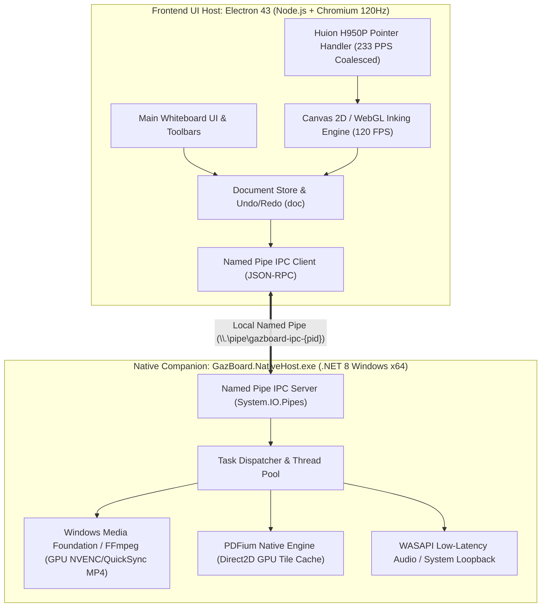
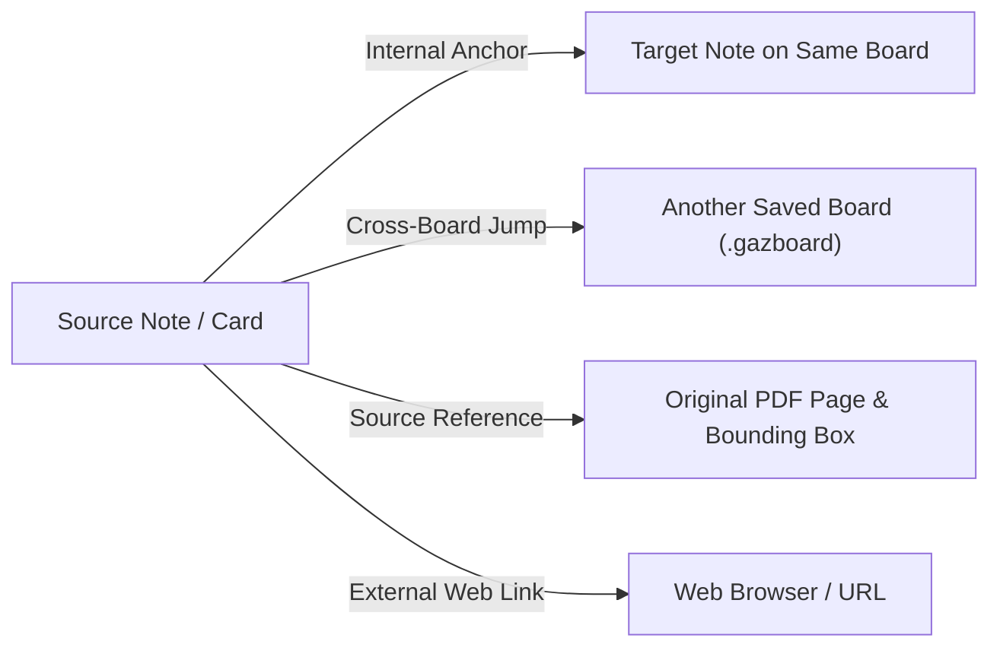

# GazBoard Replay — Master Architectural Blueprint & Feature Specification
## Windows Hybrid Architecture (Electron + C# .NET 8 Companion) & Hardware Digitizer Optimization

> **Document Status:** Authoritative Architectural Proposal, Feature Specification, and External AI Evaluation Dossier.  
> **Target Platform:** Windows 10 / 11 (Packaged `.exe` / NSIS / Portable).  
> **Primary Hardware Setup:** Huion H950P Graphics Tablet (8,192 pressure levels, ~233 PPS) + 23.8" 120Hz ASUS Display (8.33ms frame-time budget).  
> **Resource Philosophy:** Performance and fluid responsiveness over resource frugality. Memory consumption (RAM) and application binary size are intentionally unconstrained to ensure 120 FPS inking and rapid feature delivery using proven open-source libraries.  
> **Layer System Status:** Strictly **ON HOLD** (documented in appendix for future reference).

---

## 1. Executive Summary & Hardware Profile

GazBoard Replay is evolving from an upstream pure-JavaScript whiteboard (v4.8.1 baseline) into a specialized, high-performance Windows note-taking, active-recall study, and audio-synchronized lecture suite inspired by **StarNote (Android)** and **Flexcil (Android/iOS)**.

Rather than building low-level media, PDF, and inking primitives from scratch in pure client-side JavaScript, this architecture adopts a **Hybrid Companion Topology**:
1. **Frontend / UX Host:** An optimized **Electron 43 shell** rendering at **120 FPS**, hosting the user interface, study tools, canvas layout, i18n dictionaries, and JSON document store (`Store`).
2. **Native Performance Host:** A background **C# .NET 8 companion service (`GazBoard.NativeHost.exe`)** communicating over local high-speed Named Pipes / JSON-RPC. The native host directly leverages Windows APIs (Windows Media Foundation for NVENC/QuickSync hardware MP4 video export, PDFium for instantaneous textbook rasterization, and high-precision timers).
3. **Off-The-Shelf OSS Integration:** Leveraging established, production-grade open-source libraries (`perfect-freehand`, `pdfium`, `FFmpeg` / `MediaFoundation`, `KaTeX`) so that advanced features can be integrated cleanly with minimal custom code.

```
┌────────────────────────────────────────────────────────────────────────────────────────┐
│                                 HARDWARE RUNTIME TARGET                                │
├──────────────────────────┬─────────────────────────────────┬───────────────────────────┤
│ Component                │ Specifications                  │ Engineering Implication   │
├──────────────────────────┼─────────────────────────────────┼───────────────────────────┤
│ **Huion H950P Tablet**   │ • 8,192 Pressure Levels         │ Requires `getCoalescedEvents()`│
│                          │ • ~233 PPS (Points Per Second)  │ to consume raw digitizer  │
│                          │ • Windows Ink / WinTab drivers  │ packets without frame drop│
├──────────────────────────┼─────────────────────────────────┼───────────────────────────┤
│ **ASUS 120Hz Monitor**   │ • 120 FPS VSync (8.33ms budget) │ Uncapped Chromium frame   │
│                          │ • 23.8-inch Desktop Display     │ clock; Direct2D / WebGL   │
│                          │ • High-DPI Desktop Scaling      │ hardware acceleration     │
├──────────────────────────┼─────────────────────────────────┼───────────────────────────┤
│ **System Resource Allot**│ • Multi-GB RAM allowed          │ Retain in-memory tile     │
│                          │ • Multi-hundred MB binary allowed│ caches, bundle native DLLs│
│                          │ • Dedicated / Integrated GPU    │ Use GPU video encode (MP4)│
└──────────────────────────┴─────────────────────────────────┴───────────────────────────┘
```

---

## 2. Complete Feature Inventory & StarNote / Flexcil Inspirations

The application's capability surface is categorized into four distinct functional pillars:

```mermaid
mindmap
  root((GazBoard Windows))
    Base Capabilities (v4.8.1)
      Infinite 2D Canvas & Camera
      Basic Inking & Eraser
      Shape Recognition & Connectors
      KaTeX Math & Rich Text
      Images, Clipboard & Paper Ruling
      JSON Doc Store & PNG/SVG Export
    Shipped Evolution (v4.8.2-v4.8.8)
      Audio-Synced Inking (p.t timestamps)
      Density Scrubber & Audio Cards
      Active-Recall Study Tape
      Bézier & Catmull-Rom Inking Engines
      50% Highlighter with Color-Pop
      Split Study Workspace
      Page Margins & Background PDF Mode
    StarNote & Flexcil Inspirations
      Deep Linking (Board-to-Board, Intra-Board)
      PDF Excerpt Hyperlink Cards
      Table of Contents (TOC) Extraction
      Rich Pen Arsenal (Fountain, Brush, Pencil)
      Interactive Study Bookmarks
      Auto-Follow Camera & Subtitles
    Hybrid Native Powerups
      Hardware NVENC/QuickSync MP4 Export
      Native PDFium Page Pre-rendering
      System Audio Loopback Recording
      High-Speed Named Pipe IPC
```

### 2.1. Feature Catalog Matrix

| Feature ID | Feature Name | Origin / Inspiration | Functional Meaning & User Value | Implementation Strategy (Best Optimal OSS / Language) |
| :--- | :--- | :--- | :--- | :--- |
| **F-001** | **Infinite 2D Canvas & Camera** | Base (v4.8.1) | World-to-screen coordinate mapping, pan, zoom (10%–500%), DPI scaling. | Native HTML5 Canvas 2D / WebGL inside Electron shell (`camera.js`, `surface.js`). |
| **F-002** | **Rich Pen Arsenal** | StarNote | Ballpoint (uniform), Fountain/Calligraphy (velocity/pressure taper), Brush (pressure response), Pencil (textured stroke), Highlighter (translucent). | **`perfect-freehand` (OSS)** + Canvas 2D path rendering. Generates fluid polygon meshes from raw 8,192-level Huion pressure data without writing custom spline math. |
| **F-003** | **Scratch-Out Gesture Eraser** | StarNote | Rapid zig-zag scribbling over text, ink, or shapes automatically deletes them without switching to the eraser tool. | Retain and optimize pure JS spatial reversal detector (`scratch.js`). |
| **F-004** | **Active-Recall Study Tape** | Flexcil | Masking tape strips placed over textbook formulas or notes. Tap toggles between opaque concealed state and revealed state. | Native Canvas 2D overlay with diagonal hatched pattern (`hit.js`, `render.js`). |
| **F-005** | **PDF Excerpt Hyperlink Cards** | Flexcil | Box-select any diagram or paragraph on an imported PDF page and drag it to the notebook as an excerpt card with a clickable `[Jump to Page X]` anchor. | **PDFium C# Native Host**: Extracts bounding-box image crops + text; Electron renders card with URI jump link `gazboard://page/<id>#rect=<coords>`. |
| **F-006** | **Deep Linking Ecosystem** | Flexcil & Obsidian | • **Board-to-Board Links:** Reference cards opening other boards.<br>• **Intra-Board Links:** Text/button jumping to a specific note, page, or anchor on the same board.<br>• **Image & URL Links:** Attaching web links or source file links to embedded assets. | Custom protocol handler (`gazboard://`) and internal anchor index stored in `doc.links`. Clean DOM click dispatch. |
| **F-007** | **Table of Contents (TOC) Navigator** | Flexcil | Automatic extraction of PDF document outlines (chapters, sections) into an expandable sidebar tree, plus manual user chapter bookmarks. | **PDFium / `pdfjs-dist` outline parser**: Reads PDF `getOutline()` and binds nodes to camera seek actions. |
| **F-008** | **Interactive Study Bookmarks** | Flexcil & StarNote | Color-coded, named bookmark ribbons attached to specific canvas regions or audio timestamps (e.g., *"Midterm Exam Hint"*). | Metadata array `doc.bookmarks = [{ id, name, color, pageId, camera: {x,y,z}, audioTimeMs }]` displayed in sidebar. |
| **F-009** | **Audio-Synced Inking & Replay** | Notability | Every pen stroke retains millisecond offset (`p.t`). Playback reanimates strokes in sync with lecture audio; click-to-seek jumps audio by clicking any stroke. | Built-in tick loop (`replay.js`, `audio-recorder.js`) + high-precision timer in C# companion. |
| **F-010** | **Split Study Workspace** | Flexcil | Dual-pane viewport: reference textbook on the left, active revision scratchpad on the right, independent zoom/pan. | Existing CSS grid split layout (`split-workspace.js`) synchronized to the single `Store`. |
| **F-011** | **Hardware Video Export (MP4)** | Evolution | Replays canvas lecture annotations with synchronized audio and exports to standalone 1080p60 MP4. | **C# .NET 8 + Windows Media Foundation / FFmpeg**: Electron streams stroke actions/frames; C# native host encodes MP4 via NVENC/QuickSync at hardware speed. |
| **F-012** | **Highlighter Color-Pop** | v4.8.6 Shipped | Highlighting behind dark text boosts font luminance so ink never obscures handwritten or printed text. | Canvas 2D global composite operations (`destination-over` or custom pixel shader). |
| **F-013** | **Multi-Layer System** | Standby | Discrete layers with independent z-index, visibility, opacity, and locking. | **ON HOLD per user directive.** Documented architecture ready in Appendix. |

---

## 3. The Hybrid Architecture: Electron + C# .NET 8 Companion

### 3.1. Topology & Process Boundary



### 3.2. Division of Responsibilities

1. **What Remains in Electron (JavaScript / WebGL)**:
   * Real-time pointer handling (`pointerdown`, `pointermove`, `pointerup`) with pressure sensitivity from the Huion tablet.
   * On-screen 120 FPS canvas updates via `requestAnimationFrame`.
   * User interface: toolbar ribbons, modal dialogs, search (OmniSearch), i18n locale strings, settings menus.
   * Document serialization: `.gazboard` JSON save, unpack, and undo/redo operations.
   * Study tools: Study Tape toggle rendering, gesture scratch-out detection, split workspace layout.

2. **What Offloads to the C# .NET 8 Native Host**:
   * **GPU-Accelerated Video Rendering & Export:** Headless rendering of stroke animations combined with audio tracks, encoded directly into **H.264/MP4** via Windows Media Foundation or embedded FFmpeg. Eliminates Chromium `MediaRecorder` frame drops and memory spikes.
   * **High-Speed PDF Processing & Tile Caching:** Large 500-page textbooks are parsed natively using PDFium. Pages and excerpts are rendered directly into pre-scaled WebP or raw bitmap shared-memory buffers.
   * **System Loopback Audio Recording (Optional):** Capturing computer audio during remote lectures/Zoom/YouTube alongside microphone input using Windows Audio Session API (WASAPI).
   * **High-Precision Timing:** Multimedia timer services (`timeBeginPeriod(1)`) to guarantee zero audio-ink drift.

### 3.3. Inter-Process Communication (IPC) Protocol

The communication layer uses standard **JSON-RPC 2.0 over Windows Named Pipes (`\\.\pipe\gazboard-ipc-{session}`)**:

* **Throughput:** Named Pipes achieve transfer rates $> 1.5\text{ GB/sec}$ in local memory on Windows, allowing uncompressed bitmap frames or large PDF page buffers to pass between processes in $< 2\text{ms}$.
* **Message Format**:
  ```json
  // Video Export Job Request
  {
    "jsonrpc": "2.0",
    "id": "job_vid_001",
    "method": "video.exportMp4",
    "params": {
      "boardPath": "C:\\Users\\...\\Lecture1.gazboard",
      "audioTrackId": "aud_101",
      "resolution": { "width": 1920, "height": 1080 },
      "fps": 60,
      "bitrateKbps": 8000,
      "encoder": "hardware_nvenc",
      "outputPath": "C:\\Users\\...\\Lecture1_Replay.mp4"
    }
  }
  ```
* **Process Lifecycle & Resilience**:
  * `GazBoard.NativeHost.exe` is spawned as a child process by Electron's `main.js` on startup.
  * A 5-second bi-directional heartbeat watchdog monitors health.
  * If the helper crashes or is terminated by anti-virus, Electron automatically relaunches it and retries pending jobs without freezing the user's drawing session.

---

## 4. Off-The-Shelf Libraries & Framework Integration Guide

To maximize development velocity and avoid writing low-level mathematical or media pipelines from scratch, the architecture incorporates the following proven open-source libraries:

```
┌────────────────────────────────────────────────────────────────────────────────────────┐
│                          OFF-THE-SHELF LIBRARY MAPPING MATRIX                          │
├───────────────────────┬─────────────────────────────┬──────────────────────────────────┤
│ Functional Domain     │ Recommended Open-Source Lib │ Role & Justification             │
├───────────────────────┼─────────────────────────────┼──────────────────────────────────┤
│ **Pen Stroke Curves** │ `perfect-freehand` (NPM)    │ • Zero-dependency vector outline │
│                       │                             │   generator by Steve Ruiz        │
│                       │                             │ • Produces smooth calligraphy,   │
│                       │                             │   fountain, and brush paths      │
│                       │                             │ • Native support for 8192 levels │
├───────────────────────┼─────────────────────────────┼──────────────────────────────────┤
│ **Hardware Video**    │ `FFmpeg.AutoGen` / WinMF    │ • C# bindings to native FFmpeg   │
│                       │ (.NET 8 NuGet)              │   or Windows Media Foundation    │
│                       │                             │ • Direct NVENC / Intel QuickSync │
│                       │                             │ • True 60 FPS 1080p MP4 output   │
├───────────────────────┼─────────────────────────────┼──────────────────────────────────┤
│ **Native PDF Engine** │ `PdfiumViewer` / PDFium C#  │ • Google Chrome's PDFium engine  │
│                       │ (NuGet: bblanchon/pdfium)   │ • 10x faster than PDF.js         │
│                       │                             │ • Native TOC outline extraction  │
│                       │                             │ • Precise text bounding boxes    │
├───────────────────────┼─────────────────────────────┼──────────────────────────────────┤
│ **Math & Formulas**   │ `KaTeX` (Already in tree)   │ • Offline LaTeX formula layout   │
│                       │                             │ • Sub-millisecond text rendering │
├───────────────────────┼─────────────────────────────┼──────────────────────────────────┤
│ **Deep Linking**      │ Custom URI Scheme           │ • `gazboard://` Windows handler  │
│                       │ (`main.js` + protocol reg)  │ • Bidirectional anchor registry  │
└───────────────────────┴─────────────────────────────┴──────────────────────────────────┘
```

### Detailed Integration Breakdown:

1. **Inking Variety via `perfect-freehand`**:
   * *Problem:* Implementing custom spline math for fountain pens, calligraphy nibs, and pressure tapering is notoriously bug-prone and jittery.
   * *Solution:* Integrate the MIT-licensed `perfect-freehand` package. It takes an array of raw points `[x, y, pressure]` and returns an outline polygon path that can be rendered directly to HTML5 Canvas via `ctx.fill(new Path2D(svgPath))`.
   * *Preset Tuning for Huion H950P*:
     * **Ballpoint Pen:** `size: 3, thinning: 0.1, smoothing: 0.5, streamline: 0.5`
     * **Fountain / Calligraphy:** `size: 6, thinning: 0.7, smoothing: 0.65, streamline: 0.4`
     * **Artistic Brush:** `size: 14, thinning: 0.85, smoothing: 0.8, streamline: 0.2`
     * **Highlighter:** `size: 24, thinning: 0, smoothing: 0.4, streamline: 0.6` (with `globalCompositeOperation = 'multiply'`).

2. **Native PDF Excerpting & TOC via PDFium**:
   * *Problem:* PDF.js running inside Electron struggles with 500-page medical or engineering textbooks, consuming over 1.5GB of RAM and rendering slowly.
   * *Solution:* In `GazBoard.NativeHost.exe`, embed `pdfium.dll`.
     * **TOC Extraction:** Call `FPDFBookmark_GetFirstChild()` to traverse the complete document outline tree and return structured JSON to Electron for the navigation sidebar.
     * **Excerpt Clipping:** When the user draws a selection box over a PDF page, Electron sends `{ pageIndex, cropRect: { x, y, w, h } }` to the C# host. PDFium renders that sub-rectangle at 300 DPI into a WebP image asset in `< 20ms`.
     * **Hyperlink Anchor:** The excerpt card is placed on the canvas with an embedded metadata tag:
       ```javascript
       {
         type: "image",
         subtype: "excerpt_card",
         assetId: "ast_crop_123",
         sourceDoc: "Biology_Campbell.pdf",
         sourcePage: 142,
         sourceRect: [100, 250, 400, 300]
       }
       ```
       Clicking the card's jump button dispatches a camera transition smoothly flying the viewport back to the textbook page.

3. **Hardware Video Export via C# .NET Media Foundation**:
   * *Problem:* In-browser Canvas `MediaRecorder` drops frames on high-resolution displays, cannot maintain steady 60 FPS, and produces WebM files instead of universally compatible MP4 files.
   * *Solution:*
     1. Electron sends the board's serialized JSON actions (strokes with timestamps) + audio asset path to `GazBoard.NativeHost.exe`.
     2. The native host uses an offscreen Direct2D / SkiaSharp surface to draw frames in exact chronological increments ($t = 0, 16.6\text{ms}, 33.3\text{ms}, \dots$).
     3. Frames are fed directly into a Windows Media Foundation `IMFSinkWriter` configured for **H.264 video + AAC audio**.
     4. The GPU's hardware video encoder (NVIDIA NVENC, Intel QuickSync, or AMD AMF) encodes the video at $> 200\text{ FPS}$ with zero CPU stutter.

---

## 5. 120Hz Display & Huion H950P Digitizer Optimization Blueprint

To achieve uncompromising fluid responsiveness on the **23.8-inch 120Hz ASUS monitor** using the **Huion H950P tablet**, the Electron environment and event loop must be tuned specifically:

### 5.1. Chromium Launch Flags (`main.js`)

In `main.js`, before `app.whenReady()`, the following switches must be appended:

```javascript
// Force high-precision Windows multimedia timer (1ms resolution)
app.commandLine.appendSwitch('enable-highres-timer');

// Unlock frame rate to match the 120Hz monitor refresh rate
app.commandLine.appendSwitch('disable-frame-rate-limit');

// Force hardware GPU rasterization for Canvas 2D
app.commandLine.appendSwitch('enable-gpu-rasterization');
app.commandLine.appendSwitch('enable-zero-copy');
app.commandLine.appendSwitch('ignore-gpu-blocklist');

// Optimize touch/stylus event handling
app.commandLine.appendSwitch('enable-pointer-lock-options');
app.commandLine.appendSwitch('disable-renderer-backgrounding');
```

### 5.2. Digitizer Packet Ingestion (`pointermove` Coalescing)

* The Huion H950P transmits stylus coordinates at **~233 points per second (PPS)**.
* Standard DOM `pointermove` events only fire once per animation frame (at 120Hz, that is once every 8.33ms, which would drop roughly half the digitizer's coordinate data, resulting in angular, jagged curves).
* **The Solution:** The inking handler must call `e.getCoalescedEvents()` to capture all intermediate digitizer reports:

```javascript
// High-Fidelity 120Hz + 233 PPS Inking Loop
function handlePointerMove(e) {
  if (!isDrawing || e.pointerType !== 'pen') return;

  // Retrieve all digitizer points reported since the last frame
  const events = (typeof e.getCoalescedEvents === 'function') 
    ? e.getCoalescedEvents() 
    : [e];

  for (let i = 0; i < events.length; i++) {
    const ev = events[i];
    activeStroke.points.push({
      x: (ev.clientX - camera.x) / camera.scale,
      y: (ev.clientY - camera.y) / camera.scale,
      p: ev.pressure || 0.5,      // 0.0 to 1.0 (Huion 8,192 levels normalized)
      t: performance.now() - sessionStartTime
    });
  }

  // Request immediate hardware repaint
  requestCanvasRedraw();
}
```

---

## 6. Deep Linking & Cross-Document Architecture

Inspired by **Flexcil** and **Obsidian**, GazBoard supports three interconnected tiers of deep linking:



### 6.1. Link Schema (`doc.links`)

The document store maintains an indexed link graph:

```javascript
doc.links = [
  {
    id: "lnk_001",
    sourceObjectId: "card_note_42",
    targetType: "board",           // 'board' | 'page' | 'object' | 'pdf' | 'url'
    targetBoardId: "board_math_exam",
    targetPage: 2,
    targetObjectId: "formula_99",
    targetPdfRect: null,
    label: "See Theorem 4 Proof"
  },
  {
    id: "lnk_002",
    sourceObjectId: "btn_jump_textbook",
    targetType: "pdf",
    sourceDoc: "Physics_Halliday.pdf",
    targetPage: 88,
    targetPdfRect: [120, 300, 450, 600],
    label: "Halliday Fig 3.2"
  }
];
```

### 6.2. Navigation Dispatcher

* When the user taps a linked object or badge:
  1. If `targetType === 'object'` or `'page'` on the current board: The camera executes an interpolated cubic ease-in-out flight to center the target item on screen, followed by a momentary 1.5-second accent highlight pulse around the target object.
  2. If `targetType === 'board'`: The current board is atomically saved, and the target `.gazboard` file is loaded into the viewport.
  3. If `targetType === 'pdf'`: In Split View mode, the left pane navigates immediately to the specified PDF page and flashes the bounding-box highlight.

---

## 7. Rubric & Evaluation Questions for External AIs

When providing this document to other AIs (e.g., Claude 3.5 Sonnet, GPT-4o, DeepSeek-R1) or senior system architects for peer review, ask them to evaluate the following specific architectural decisions:

1. **IPC Latency & Bottleneck Assessment:**
   * *Question:* Does using Windows Named Pipes with JSON-RPC between Electron and C# .NET 8 introduce any perceptible bottlenecks when transferring large PDF bitmap tiles or continuous video frame buffers? Would shared memory (`MemoryMappedFiles` in C# paired with Node.js `mmap`) be preferred for high-resolution tile streaming?
2. **Huion Digitizer Coalescing Integrity:**
   * *Question:* Does `e.getCoalescedEvents()` in Electron 43 running on Windows 10/11 accurately preserve the full 8,192 pressure steps from Huion's WinTab/Windows Ink driver without artificial quantization or deadzones?
3. **Offloading Video Encoding to .NET:**
   * *Question:* What are the failure modes of using Windows Media Foundation (`IMFSinkWriter`) vs. embedding a static `ffmpeg.exe` CLI process spawned on demand for hardware NVENC/QuickSync encoding? Which approach is more maintainable in a portable desktop app?
4. **Inking Pipeline Trade-offs:**
   * *Question:* Is `perfect-freehand` inside a 2D Canvas context sufficient to maintain 120 FPS on a 23.8-inch display, or should the active stroke be rendered using a WebGL / Direct2D overlay shader while drawing and baked back into Canvas 2D on stroke completion?
5. **PDFium vs. PDF.js Memory Footprint:**
   * *Question:* Given the user's explicit tolerance for higher RAM usage in exchange for speed, does hosting PDFium in a separate C# 64-bit process eliminate the risk of Chromium renderer V8 memory exhaustion when handling 1,000+ page textbook PDFs?

---

## 8. Appendix: Multi-Layer System Architecture (On Standby)

> **Note:** Kept strictly on standby per user request. This specification preserves the intended design for whenever the feature is reactivated.

* **Schema Definition**:
  ```javascript
  doc.layers = [
    { id: "layer_bg", name: "Background Plates", visible: true, locked: true, opacity: 1.0 },
    { id: "layer_notes", name: "Lecture Handwriting", visible: true, locked: false, opacity: 1.0 },
    { id: "layer_tape", name: "Study Tape Masks", visible: true, locked: false, opacity: 1.0 }
  ];
  ```
* **Object Assignment:** Every canvas object stores `layerId: "layer_notes"`. Default is the active layer.
* **Rendering Loop Integration:**
  In `render.js`, the scene drawing loop iterates through `doc.layers`:
  1. Skip layer if `layer.visible === false`.
  2. Set canvas `ctx.globalAlpha = layer.opacity`.
  3. Draw objects belonging to `layer.id`.
  4. Hit-testing in `hit.js` skips any object whose parent layer has `locked === true`.
