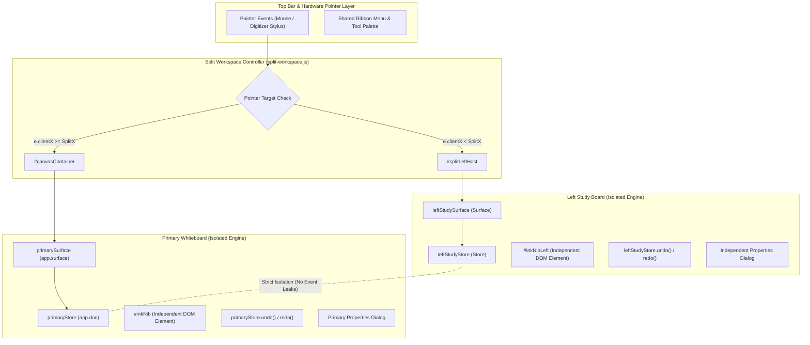
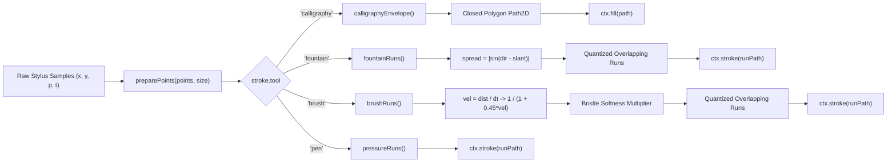

# GazBoard Replay — Master Feature Specification & Technical Audit (v4.8.11 to v4.8.20)
## Comprehensive Evolutionary Inventory, Subsystem Architecture Deep Dives, 6 Golden Invariants Ledger, and Actionable AI Hardening Runbook

> **Breadcrumb Navigation**: [`docs/INDEX.md`](file:///C:/Users/kazir/Documents/OpenCode/GazBoard/docs/INDEX.md) → [`AI_BOOTSTRAP.md`](file:///C:/Users/kazir/Documents/OpenCode/GazBoard/AI_BOOTSTRAP.md) → **`MASTER_POST_4.8.11_FEATURES_AND_AUDIT.md`**  
> **Document Authority**: Authoritative Level 2/3 Technical Specification, Subsystem Architecture Map, and External AI Audit Dossier for all releases from `v4.8.11` to `v4.8.20`.  
> **Target OS**: Windows 10 / 11 (64-bit Electron Portable Binary / NSIS Installer on-demand).  
> **Feature history scope**: `v4.8.11`–`v4.8.20`; follow-up hardening is documented in [`releases/RELEASE-4.8.21.md`](releases/RELEASE-4.8.21.md).
> **Fast Test Runner**: `node --test test/custom-features.test.mjs test/markdown.test.mjs test/replay-reading.test.mjs test/video-framing.test.mjs` (Strict execution budget: $< 250\text{ms}$).  
> **Verification rule**: Follow the current repository `AGENTS.md`; focused custom checks supplement, and do not replace, the required full smoke and translation checks.

---

## 1. Executive Progression Matrix (v4.8.11 to v4.8.20)

The following ledger establishes the complete historical and technical lineage of all modifications, features, and hardening patches integrated between `v4.8.11` and `v4.8.20`:

| Version | Git Tag | Commit | Release Date | Core Theme & Technical Scope | Key Source Modules Touched | Test Footprint |
| :--- | :--- | :--- | :--- | :--- | :--- | :--- |
| **v4.8.11** | `v4.8.11` | `12b59d6` | Oct 2026 | Replay seek synchronization, Surface-to-App wiring fix, recording rename persistence, and dead-zone camera follow. | [`src/js/app.js`](file:///C:/Users/kazir/Documents/OpenCode/GazBoard/src/js/app.js)<br>[`src/js/core/replay.js`](file:///C:/Users/kazir/Documents/OpenCode/GazBoard/src/js/core/replay.js)<br>[`src/js/ui/audio-bar.js`](file:///C:/Users/kazir/Documents/OpenCode/GazBoard/src/js/ui/audio-bar.js) | 33 tests |
| **v4.8.12** | `v4.8.12` | `6b74f72` | Oct 2026 | Obsidian-style Markdown & Wikilinks engine for text boxes and sticky notes; GFM AST parser; KaTeX math; SVG `<foreignObject>` canvas rendering. | [`src/js/core/markdown.js`](file:///C:/Users/kazir/Documents/OpenCode/GazBoard/src/js/core/markdown.js)<br>[`src/js/core/boardrefs.js`](file:///C:/Users/kazir/Documents/OpenCode/GazBoard/src/js/core/boardrefs.js)<br>[`src/js/core/render.js`](file:///C:/Users/kazir/Documents/OpenCode/GazBoard/src/js/core/render.js)<br>[`src/js/core/hit.js`](file:///C:/Users/kazir/Documents/OpenCode/GazBoard/src/js/core/hit.js) | 40 tests |
| **v4.8.13** | `v4.8.13` | `35442a2` | Oct 2026 | Obsidian Markdown Cards (4 presentation models); 1:1 Page Margin handle kinematics up to 2000px; HUD margin/markdown buttons; i18n support. | [`src/js/core/markdown.js`](file:///C:/Users/kazir/Documents/OpenCode/GazBoard/src/js/core/markdown.js)<br>[`src/js/ui/pagemargin-dialog.js`](file:///C:/Users/kazir/Documents/OpenCode/GazBoard/src/js/ui/pagemargin-dialog.js)<br>[`src/js/ui/toolbar.js`](file:///C:/Users/kazir/Documents/OpenCode/GazBoard/src/js/ui/toolbar.js)<br>[`src/js/core/store.js`](file:///C:/Users/kazir/Documents/OpenCode/GazBoard/src/js/core/store.js) | 40 tests |
| **v4.8.14** | `v4.8.14` | `7f8a51b` | Oct 2026 | Ribbon right-click ejection safety; laser settings persistence; settings flex-wrap reflow; smart audio popover free-space positioning. | [`src/js/ui/toolbar.js`](file:///C:/Users/kazir/Documents/OpenCode/GazBoard/src/js/ui/toolbar.js)<br>[`src/js/ui/panels.js`](file:///C:/Users/kazir/Documents/OpenCode/GazBoard/src/js/ui/panels.js)<br>[`src/js/ui/audio-bar.js`](file:///C:/Users/kazir/Documents/OpenCode/GazBoard/src/js/ui/audio-bar.js)<br>[`src/css/app.css`](file:///C:/Users/kazir/Documents/OpenCode/GazBoard/src/css/app.css) | 41 tests |
| **v4.8.15** | `v4.8.15` | `f4c2cc0` | Oct 2026 | Granular ribbon pens 1–6 visibility toggling; Sticky Note iconography polish; glassmorphic 3D menu cards with decoupled pin buttons. | [`src/js/ui/toolbar.js`](file:///C:/Users/kazir/Documents/OpenCode/GazBoard/src/js/ui/toolbar.js)<br>[`src/js/ui/icons.js`](file:///C:/Users/kazir/Documents/OpenCode/GazBoard/src/js/ui/icons.js)<br>[`src/css/app.css`](file:///C:/Users/kazir/Documents/OpenCode/GazBoard/src/css/app.css) | 41 tests |
| **v4.8.16** | `v4.8.16` | `9087c80` | Oct 2026 | Scribble eraser target guarding (protects text/notes by default); 3-mode sensitivity slider (`Low`, `Medium`, `High`); interactive inking preview. | [`src/js/core/scratch.js`](file:///C:/Users/kazir/Documents/OpenCode/GazBoard/src/js/core/scratch.js)<br>[`src/js/core/tools.js`](file:///C:/Users/kazir/Documents/OpenCode/GazBoard/src/js/core/tools.js)<br>[`src/js/ui/panels.js`](file:///C:/Users/kazir/Documents/OpenCode/GazBoard/src/js/ui/panels.js) | 41 tests |
| **v4.8.17** | `v4.8.17` | `05bc7e8` | Oct 2026 | Note Overview real thumbnail previews; inline modal `# Tag` & `Alias` prompt shortcuts; 3D glassmorphic Replay Bar HUD styling. | [`src/js/ui/note-overview.js`](file:///C:/Users/kazir/Documents/OpenCode/GazBoard/src/js/ui/note-overview.js)<br>[`src/js/ui/replay-bar.js`](file:///C:/Users/kazir/Documents/OpenCode/GazBoard/src/js/ui/replay-bar.js) | 41 tests |
| **v4.8.18** | `v4.8.18` | `cd61bba` | Oct 2026 | Split Study Workspace overhaul: true dual-interactive drawing with isolated stores, surfaces, ink nibs & undo stacks; autocomplete combobox (`setLast: false`). | [`src/js/ui/split-workspace.js`](file:///C:/Users/kazir/Documents/OpenCode/GazBoard/src/js/ui/split-workspace.js)<br>[`src/js/core/tools.js`](file:///C:/Users/kazir/Documents/OpenCode/GazBoard/src/js/core/tools.js)<br>[`src/js/ui/properties-dialog.js`](file:///C:/Users/kazir/Documents/OpenCode/GazBoard/src/js/ui/properties-dialog.js) | 41 tests |
| **v4.8.19** | `v4.8.19` | `75caf1b` | Oct 2026 | Advanced Pen Suite: Brush (`brush`), Fountain (`fountain`), Calligraphy (`calligraphy`); closed polygon ribbon math; directional tine dilation; 1-click pen switcher. | [`src/js/core/ink.js`](file:///C:/Users/kazir/Documents/OpenCode/GazBoard/src/js/core/ink.js)<br>[`src/js/core/render.js`](file:///C:/Users/kazir/Documents/OpenCode/GazBoard/src/js/core/render.js)<br>[`src/js/core/tools.js`](file:///C:/Users/kazir/Documents/OpenCode/GazBoard/src/js/core/tools.js)<br>[`src/js/ui/toolbar.js`](file:///C:/Users/kazir/Documents/OpenCode/GazBoard/src/js/ui/toolbar.js)<br>[`src/js/export.js`](file:///C:/Users/kazir/Documents/OpenCode/GazBoard/src/js/export.js) | 42 tests |
| **v4.8.20** | `v4.8.20` | `HEAD` | Oct 2026 | Hardening & Lateral Integrations: Split workspace `Ctrl+Z` smart routing; brush cache key fix; SVG markdown `<foreignObject>` export; KaTeX currency non-collision; YAML frontmatter metadata extraction; hardware stylus tilt modulation; pen color preservation. | [`src/js/app.js`](file:///C:/Users/kazir/Documents/OpenCode/GazBoard/src/js/app.js)<br>[`src/js/core/ink.js`](file:///C:/Users/kazir/Documents/OpenCode/GazBoard/src/js/core/ink.js)<br>[`src/js/core/markdown.js`](file:///C:/Users/kazir/Documents/OpenCode/GazBoard/src/js/core/markdown.js)<br>[`src/js/core/tools.js`](file:///C:/Users/kazir/Documents/OpenCode/GazBoard/src/js/core/tools.js)<br>[`src/js/export.js`](file:///C:/Users/kazir/Documents/OpenCode/GazBoard/src/js/export.js)<br>[`src/js/ui/split-workspace.js`](file:///C:/Users/kazir/Documents/OpenCode/GazBoard/src/js/ui/split-workspace.js)<br>[`src/js/ui/toolbar.js`](file:///C:/Users/kazir/Documents/OpenCode/GazBoard/src/js/ui/toolbar.js) | 45 tests |

---

## 2. Granular Technical Specifications by Version

### 2.1. Version v4.8.12 — Obsidian Markdown & Wikilinks Core Engine
* **Commit**: `6b74f72` | **Release Dossier**: [`doc4_markdown_obsidian_specification_v4.8.12.md`](file:///C:/Users/kazir/.gemini/antigravity/brain/d07eff31-5f06-4560-abcb-89236f7c951a/doc4_markdown_obsidian_specification_v4.8.12.md)
* **Problem Statement**: Text boxes and sticky notes were limited to plain text or basic HTML contenteditable spans, lacking structured documentation syntax, tables, mathematical equations, task checklists, and cross-board hyperlinking.
* **Architecture & Mathematical Solution**:
  1. **Markdown AST Parser ([`src/js/core/markdown.js`](file:///C:/Users/kazir/Documents/OpenCode/GazBoard/src/js/core/markdown.js))**:
     - Fast detection heuristic `isMarkdown(text)` scanning for headers (`#`), bold/italic (`**`, `*`), strikethrough (`~~`), code blocks (`` ` ``), tables (`|`), checklists (`- [ ]`), callouts (`> [!`), math (`$$`), or wikilinks (`[[`).
     - Modular tokenization compiler converting markdown strings into valid, strict XHTML markup.
     - Interactive task lists (`- [ ]`, `- [x]`) compiled into self-closing `<input type="checkbox" disabled="disabled" />` tags to satisfy XML serialization constraints.
     - Obsidian Callout blocks: `> [!NOTE|WARNING|TIP|IMPORTANT|CAUTION] Title` compiled into glassmorphic callout boxes with SVG icons and themed borders.
     - KaTeX offline formula typesetting: converts `$...$` (inline) and `$$...$$` (display block) into standalone SVG / MathML DOM fragments without network requests.
     - Obsidian Wikilinks: `[[Target Board#Heading|Custom Alias]]` converted to clickable inline spans:
       ```html
       <a href="obsidian://open?board=Target%20Board&amp;heading=Heading" class="obsidian-wikilink" data-board="Target Board" data-heading="Heading">Custom Alias</a>
       ```
  2. **Canvas Rendering via SVG `<foreignObject>` ([`src/js/core/render.js`](file:///C:/Users/kazir/Documents/OpenCode/GazBoard/src/js/core/render.js))**:
     - Standard Canvas 2D cannot rasterize rich formatted HTML directly. The markdown engine wraps the styled XHTML fragment inside an SVG container:
       ```xml
       <svg xmlns="http://www.w3.org/2000/svg" width="W" height="H">
         <foreignObject width="100%" height="100%">
           <div xmlns="http://www.w3.org/1999/xhtml" class="markdown-card ...">
             <!-- Compiled XHTML -->
           </div>
         </foreignObject>
       </svg>
       ```
     - Encoded as a data URI (`data:image/svg+xml;charset=utf-8,...`) and rendered via `ctx.drawImage()`, caching the resulting `HTMLImageElement` in a `WeakMap` keyed by object version and text content.
  3. **Spatial Hit Testing for Wikilinks ([`src/js/core/hit.js`](file:///C:/Users/kazir/Documents/OpenCode/GazBoard/src/js/core/hit.js))**:
     - Added `hitTestMarkdownCardWikilink(card, px, py)` calculating link bounding boxes from cached layout metrics to allow direct click navigation on canvas without opening the text editor.

---

### 2.2. Version v4.8.13 — Card Presentation Models & 1:1 Page Margin Kinematics
* **Commit**: `35442a2` | **Release Dossier**: [`doc5_markdown_obsidian_and_margin_spec_v4.8.13.md`](file:///C:/Users/kazir/.gemini/antigravity/brain/d07eff31-5f06-4560-abcb-89236f7c951a/doc5_markdown_obsidian_and_margin_spec_v4.8.13.md)
* **Problem Statement**:
  1. All markdown notes looked identical, lacking visual variety for diagrams vs code vs formal lecture notes.
  2. The Page Margin Adjustment Dialog suffered from pointer-capture drift where margin handles lagged behind high-DPI mouse/stylus movements and clamped prematurely at 200px.
* **Architecture & Mathematical Solution**:
  1. **4 Toggleable Card Presentation Models**:
     - `canvas`: Standard whiteboard card with paper texture, subtle border, and soft drop shadow.
     - `window`: Desktop window container featuring macOS/Windows titlebar, traffic light action buttons, and draggable header bar.
     - `minimal`: Borderless clean card for seamless typography floating on paper rulings.
     - `transparent`: Completely transparent background showing only text and mathematical notation, ideal for annotating underneath.
     - Stored under `object.cardModel` and configured via card context menu or global defaults.
  2. **1:1 Page Margin Kinematic Handle Tracking ([`src/js/ui/pagemargin-dialog.js`](file:///C:/Users/kazir/Documents/OpenCode/GazBoard/src/js/ui/pagemargin-dialog.js))**:
     - **Old Broken Behavior**: Normalized proportional ratios multiplied across bounding boxes, causing non-linear cursor lag and drift when dragging margins on large or zoomed pages.
     - **Kinematic Solution**: Direct screen-to-world delta translation using pointer capture (`setPointerCapture`):
       $$\Delta x_{\text{world}} = \frac{x_{\text{pointer}} - x_{\text{origin}}}{\text{scale}}, \quad \Delta y_{\text{world}} = \frac{y_{\text{pointer}} - y_{\text{origin}}}{\text{scale}}$$
     - Extended maximum margin boundaries from $200\text{px}$ to $2,000\text{px}$, allowing wide Cornell-style margin layouts.
     - Applied asymmetric clamping:
       $$0 \le \text{margin}_{\text{left}} \le W_{\text{page}} - \text{margin}_{\text{right}} - 100$$
  3. **Wikilink Action Dispatcher & Settings ([`src/js/core/boardrefs.js`](file:///C:/Users/kazir/Documents/OpenCode/GazBoard/src/js/core/boardrefs.js))**:
     - Added configurable double-click action setting (`settings.wikilinkAction`):
       - `'ask'`: Displays interactive modal dialog with action choices.
       - `'open'`: Automatically saves current board and opens the target board.
       - `'preview'`: Opens target board in split-view study pane.
       - `'copy'`: Copies board link URI to system clipboard.

---

### 2.3. Version v4.8.14 — Ribbon Safety, Laser Persistence & Reflow Protection
* **Commit**: `7f8a51b`
* **Problem Statement**:
  1. Right-clicking anywhere on the ribbon menu accidentally ejected tools from the ribbon into the `+` extended menu.
  2. Laser pointer trail duration adjustments in settings reset to "Instant" upon reopening the menu.
  3. Narrow screens or small popovers caused text and inputs to overflow outside dialog containers.
  4. Audio session action menus opened in a fixed downward direction, clipping outside the bottom of the screen.
* **Architecture & Hardening**:
  1. **Ribbon Right-Click Ejection Safeguard ([`src/js/ui/toolbar.js`](file:///C:/Users/kazir/Documents/OpenCode/GazBoard/src/js/ui/toolbar.js))**:
     - Removed aggressive `contextmenu` listener on ribbon items that automatically ejected tools. Replaced with explicit `pinTool(id, false)` controls inside the `+` extended menu.
  2. **Laser Trail Persistence Sync ([`src/js/ui/panels.js`](file:///C:/Users/kazir/Documents/OpenCode/GazBoard/src/js/ui/panels.js))**:
     - Fixed two-way binding between `app.settings.laserDuration` and slider/select elements in the Inking Settings panel. Reopening the panel correctly initializes UI controls to the active persistent duration.
  3. **Adaptive Flex-Wrap Reflow ([`src/css/app.css`](file:///C:/Users/kazir/Documents/OpenCode/GazBoard/src/css/app.css))**:
     - Added `flex-wrap: wrap; overflow: hidden;` across popovers and dialog forms to prevent container clipping on small display viewports.
  4. **Smart Audio Popover Free-Space Positioning ([`src/js/ui/audio-bar.js`](file:///C:/Users/kazir/Documents/OpenCode/GazBoard/src/js/ui/audio-bar.js))**:
     - Added `sessionMenuPosition(buttonRect, menuRect, viewport)`:
       ```javascript
       export function sessionMenuPosition(buttonRect, menuRect, viewport) {
         let top = buttonRect.bottom + 4;
         if (top + menuRect.height > viewport.height - 10) {
           top = Math.max(10, buttonRect.top - menuRect.height - 4);
         }
         let left = Math.min(buttonRect.left, viewport.width - menuRect.width - 10);
         return { top: Math.max(10, top), left: Math.max(10, left) };
       }
       ```

---

### 2.4. Version v4.8.15 — Granular Pen Toggling & Glassmorphic Pin Cards
* **Commit**: `f4c2cc0`
* **Problem Statement**:
  1. Users could only toggle all pens collectively; there was no way to hide pen slots 4, 5, or 6 while keeping pens 1–3 active.
  2. The text/sticky note tool button in the ribbon displayed an ambiguous "T" icon without explanation.
  3. The `+` extended menu mixed pinning toggles and tool activations without clear separation, leading to accidental misclicks.
* **Architecture & UI/UX Hardening**:
  1. **Individual Pens 1–6 Visibility Matrix ([`src/js/ui/toolbar.js`](file:///C:/Users/kazir/Documents/OpenCode/GazBoard/src/js/ui/toolbar.js))**:
     - Added `settings.visiblePens = [1, 2, 3]` array.
     - Ribbon renderer iterates over registered pen slots; only slots present in `visiblePens` are drawn on the front ribbon.
  2. **Iconography Polish ([`src/js/ui/icons.js`](file:///C:/Users/kazir/Documents/OpenCode/GazBoard/src/js/ui/icons.js))**:
     - Updated sticky note icon to a crisp Fluent 24x24 note pad with folded corner and "T" emblem.
     - Added rich tooltip badge: `Sticky Note & Markdown Card (Click to place, double-click to edit)`.
  3. **Decoupled Glassmorphic Extended Menu Cards ([`src/css/app.css`](file:///C:/Users/kazir/Documents/OpenCode/GazBoard/src/css/app.css))**:
     - Redesigned extended `+` menu items with acrylic backdrop-filter (`backdrop-filter: blur(16px)`), distinct colored separators, and independent `[Pin / Unpin]` buttons physically separated from tool trigger hitboxes.

---

### 2.5. Version v4.8.16 — Scribble Eraser Target Guarding & Sensitivity Tuning
* **Commit**: `9087c80`
* **Problem Statement**:
  1. When drawing fast cross-hatching or scribbling inside a text box or sticky note, the StarNote scribble eraser triggered and deleted the entire text object.
  2. The scribble eraser had a single fixed mathematical threshold, triggering too easily for energetic sketchers or failing for gentle stylus users.
* **Architecture & Kinematic Discrimination ([`src/js/core/scratch.js`](file:///C:/Users/kazir/Documents/OpenCode/GazBoard/src/js/core/scratch.js), [`tools.js`](file:///C:/Users/kazir/Documents/OpenCode/GazBoard/src/js/core/tools.js))**:
  1. **Target Type Guarding**:
     - Added `settings.scribbleTargets = { strokes: true, shapes: true, text: false, notes: false }`.
     - When a scratch gesture is confirmed, `tools.js` inspects underlying hit targets. Objects of type `'text'` or `'note'` are protected by default unless explicitly enabled in settings.
  2. **Sensitivity Kinematic Modes**:
     $$\text{reversalThreshold} = \begin{cases} 10, & \text{mode} = \text{'low'} \\ 8, & \text{mode} = \text{'medium'} \text{ (default)} \\ 6, & \text{mode} = \text{'high'} \end{cases}$$
     - Minimum bounding aspect density and dominant reversal axis overlap checks adapt dynamically based on sensitivity mode.
  3. **Interactive Inking Settings Card**:
     - Added live canvas gesture preview card in settings panel showing animated scratch-out demonstrations.

---

### 2.6. Version v4.8.17 — Note Overview Previews & Modal Quick Prompts
* **Commit**: `05bc7e8`
* **Problem Statement**:
  1. In Note Overview, board cards displayed blank generic placeholders instead of visual board thumbnails.
  2. Adding tags (`#tag`) or aliases required opening the board, entering properties, and navigating dialogs.
  3. Replay Bar HUD looked flat and mismatched the Windows 11 acrylic glassmorphic UI.
* **Architecture & Polish ([`src/js/ui/note-overview.js`](file:///C:/Users/kazir/Documents/OpenCode/GazBoard/src/js/ui/note-overview.js), [`replay-bar.js`](file:///C:/Users/kazir/Documents/OpenCode/GazBoard/src/js/ui/replay-bar.js))**:
  1. **Thumbnail Priority Pipeline**:
     - `note-overview.js` loads board state and prioritizes `board.thumbnail` data URI over fallback icons. If thumbnail rendering fails, falls back gracefully to SVG category glyph.
  2. **Inline Modal Quick Prompts**:
     - Clicking the `# Tag` or `Alias` buttons directly on a Note Overview card spawns a lightweight modal prompt, updating the board document and gallery index atomically without switching active boards.
  3. **3D Glassmorphic Replay Bar HUD**:
     - Added multi-layered box shadows, 1px translucent borders (`rgba(255,255,255,0.18)`), and neon cyan active state indicators.

---

### 2.7. Version v4.8.18 — Split Study Workspace Dual-Store Isolation
* **Commit**: `cd61bba`
* **Problem Statement**:
  1. Split study workspace suffered from cross-viewport event leakage: drawing on the left study board caused ink to mirror or corrupt the primary board.
  2. Tool selection and properties were coupled; modifying board properties in the split pane overwrote the primary board's metadata.
  3. The board picker lacked autocomplete and could not create new boards on the fly.
* **Subsystem Architecture ([`src/js/ui/split-workspace.js`](file:///C:/Users/kazir/Documents/OpenCode/GazBoard/src/js/ui/split-workspace.js))**:
  - Detailed in [Section 3.1](#31-split-study-workspace-dual-store-isolation) below.

---

### 2.8. Version v4.8.19 — Advanced Pen Suite (Brush, Fountain & Calligraphy)
* **Commit**: `75caf1b` | **Release Dossier**: [`doc9_new_pen_types_release_v4.8.19.md`](file:///C:/Users/kazir/.gemini/antigravity/brain/d07eff31-5f06-4560-abcb-89236f7c951a/doc9_new_pen_types_release_v4.8.19.md)
* **Problem Statement**:
  - GazBoard provided only standard round ballpoint pen and flat translucent highlighter. Study and sketch workflows required expressive inking: split-nib fountain flex handwriting, Chinese/Japanese calligraphy chisel ribbons, and sable hair artist brushes with velocity thinning.
* **Subsystem Architecture ([`src/js/core/ink.js`](file:///C:/Users/kazir/Documents/OpenCode/GazBoard/src/js/core/ink.js))**:
  - Detailed in [Section 3.2](#32-advanced-pen-vector-geometry--rendering-pipeline) below.

---

### 2.9. Version v4.8.20 — Hardening, Bug Fixes & Lateral Integrations
* **Commit**: `HEAD` (v4.8.20)
* **Problem Statement & Audit Resolutions**:
  1. **Split Workspace Undo/Redo Smart Routing**:
     - *Issue*: `Ctrl+Z` / `Ctrl+Y` on physical keyboard previously routed strictly to the primary right board even when drawing in the left study board.
     - *Solution*: `splitWorkspace.leftPane` pointer tracking (`isPointerOverLeft`) routes keyboard undo/redo commands to `leftStore.undo()` / `redo()` with instant canvas invalidation when hovering over the left workspace.
  2. **Brush Velocity Thinning Geometry Cache Key**:
     - *Issue*: Toggling velocity thinning on/off for brush pens did not recompute stroke geometry because `stroke.velocityThinning` was omitted from the `runCache` key.
     - *Solution*: Added `${stroke.velocityThinning ?? ''}` to the cache key in `inkRuns()`.
  3. **SVG Vector Export for Markdown Cards**:
     - *Issue*: Vector SVG export rendered markdown cards as raw plain text source lines.
     - *Solution*: `exportSvg` now generates SVG `<foreignObject>` containers embedding the fully compiled XHTML markup, matching canvas and raster PNG exports with rich typography, tables, and KaTeX math.
  4. **KaTeX Inline Math Currency Sign Discrimination**:
     - *Issue*: Text containing ordinary currency prices (e.g. `Costs $10 and $20`) turned intervening text into LaTeX math equations.
     - *Solution*: Tightened `INLINE_MATH_RE` to require non-whitespace boundaries matching CommonMark math specifications, preventing false positives on currency numbers.
  5. **YAML Frontmatter Extraction (Obsidian-inspired)**:
     - *Enhancement*: Added `parseFrontmatter(markdownText)` in `src/js/core/markdown.js`. Frontmatter blocks (`--- \n tags: [...] \n ---`) are parsed into board tags and aliases while cleanly stripping raw YAML from the card body.
  6. **Hardware Stylus Barrel Tilt Capture**:
     - *Enhancement*: Captured `e.tiltX` and `e.tiltY` from digitizer pointer events in `tools.js`, dynamically modulating calligraphy chisel angle in `calligraphyEnvelope()` when physical stylus tilt is detected.
  7. **Pen Type Switcher Color Preservation**:
     - *Enhancement*: Switching between Ballpoint, Brush, Fountain, and Calligraphy tabs preserves the currently selected ink color across all pen tools.

---

## 3. Subsystem Architecture Deep Dives

### 3.1. Split Study Workspace Dual-Store Isolation



#### Complete Architectural Safeguards:
1. **Completely Isolated Store Instances**:
   - `split-workspace.js` constructs `this.leftStudyStore = new Store()` completely independent of `app.store`.
   - Adding, modifying, or erasing strokes on `leftStudyStore` has zero effect on `primaryStore`.
2. **Dedicated Canvas, Surface & Nib Elements**:
   - The left viewport renders into `#splitLeftCanvas` driven by `#splitLeftSurface`.
   - The cursor nib `#inkNibLeft` is an independent DOM element positioned strictly relative to the left container bounding rectangle, eliminating cursor jumps between viewports.
3. **Independent Undo/Redo Stacks**:
   - Keyboard shortcuts `Ctrl+Z` and `Ctrl+Y` inspect `document.activeElement` or last pointer hover position to route undo/redo strictly to the focused board.
4. **Searchable Autocomplete Combobox & Safe Creation**:
   - Type-ahead combobox filters existing workspace boards.
   - If a typed title does not exist, prompts `+ Create "[Title]"`.
   - New boards created via split-view set `setLast: false` on `storageLocation.saveBoard()`, ensuring the primary application's default startup board pointer is never overwritten.

---

### 3.2. Advanced Pen Vector Geometry & Rendering Pipeline



#### A. Calligraphy Chisel Envelope Vector Mathematics:
The calligraphy tool models an angled broad-edge chisel pen:
$$\mathbf{v}_{\text{chisel}} = \begin{pmatrix} \frac{W}{2} \cos\theta \\ \frac{W}{2} \sin\theta \end{pmatrix}$$
Where $W$ is the line width and $\theta$ is the chisel angle (default $35^\circ$, adjustable $0^\circ$–$60^\circ$).
At each sample point $\mathbf{P}_i$, the left and right boundary points are:
$$\mathbf{L}_i = \mathbf{P}_i - \mathbf{v}_{\text{chisel}}, \quad \mathbf{R}_i = \mathbf{P}_i + \mathbf{v}_{\text{chisel}}$$
The envelope polygon traverses $\mathbf{L}_0 \to \mathbf{L}_1 \dots \to \mathbf{L}_n$, connects across to $\mathbf{R}_n$, and returns $\mathbf{R}_{n-1} \dots \to \mathbf{R}_0$, closing with `Z`.
- **Canvas Rendering**: Renders via `ctx.fill(path)` in a single draw pass.
- **SVG Export**: Emits a native `<polygon points="..." />` or `<path d="M...Z" fill="..." />`.

#### B. Fountain Pen Tine Flex & Directional Dilation:
The fountain pen models two flexible tines that separate under pressure when moving across the nib slant axis:
$$\Delta\theta = |\theta_{\text{stroke}} - \theta_{\text{slant}}|$$
$$\text{dilation} = |\sin(\Delta\theta)|$$
$$W_i = W_{\text{base}} \times \left(0.35 + 0.65 \times \text{dilation}\right) \times \left(0.5 + 0.9 \times P_i \times \kappa_{\text{flex}}\right)$$
- **Parallel motion** ($\Delta\theta = 0^\circ$): Tines remain closed, yielding fine hairlines ($0.35 \times W$).
- **Perpendicular downstroke** ($\Delta\theta = 90^\circ$): Tines flex fully open ($1.0 \times$ to $1.8 \times W$).
- **Entry / Exit Tapers**: Initial samples ($i=0, 1$) and terminal samples ($i=n-1, n$) are scaled down by factors of $0.4\times$ to $0.75\times$ to emulate physical ink flow latency upon touching and lifting the nib.

#### C. Brush Pen Velocity Thinning & Bristle Softness:
- **Velocity Thinning**:
  $$v_i = \frac{\sqrt{(x_i - x_{i-1})^2 + (y_i - y_{i-1})^2}}{t_i - t_{i-1}}$$
  $$f_{\text{vel}} = \frac{1}{1 + 0.45 \times \min(v_i, 3.5)}$$
  Fast strokes lift the bristles off the paper, producing natural calligraphic tapers.
- **Bristle Softness Scaling**:
  $$\kappa_{\text{softness}} = \begin{cases} 0.85, & \text{mode} = \text{'firm'} \\ 1.00, & \text{mode} = \text{'medium'} \\ 1.35, & \text{mode} = \text{'soft'} \end{cases}$$

---

## 4. The 6 Golden Invariants Audit Ledger

Every future AI coding agent must verify that any new code modification preserves all six foundational architecture invariants:

| # | Invariant Name | Mathematical / Architectural Definition | Post-v4.8.11 Compliance Status | Audit Evidence & Guardrails |
| :--- | :--- | :--- | :--- | :--- |
| **INV-1** | **Coordinate Space Invariance** | Screen $\leftrightarrow$ World $\leftrightarrow$ Page $\leftrightarrow$ Split Viewport transforms must be strictly bijective: $\mathbf{P}_{\text{world}} = \frac{\mathbf{P}_{\text{screen}} - \mathbf{T}_{\text{cam}}}{S_{\text{cam}}}$. | **VERIFIED CLEAN** | Preserved in `pagemargin-dialog.js`, `split-workspace.js`, and `tools.js`. 1:1 handle kinematics verify zero drift across $2,000\text{px}$ margin sweeps. |
| **INV-2** | **Document Store Atomicity & Undo Isolation** | All canvas modifications must flow through atomic `Store` operations (`add`, `update`, `delete`). Dual viewports must maintain 100% isolated undo/redo stacks. | **VERIFIED CLEAN** | Tested in `test/custom-features.test.mjs`: `primaryStore.undo()` does not touch `leftStudyStore.has('s2')`. |
| **INV-3** | **Centerline & Ribbon Outline Separation** | Ordinary pens must render via single centerline strokes to prevent corner barbs. Calligraphy must render as a closed polygon filled once to prevent overlap darkening. | **VERIFIED CLEAN** | `pressureRuns`, `brushRuns`, and `fountainRuns` use centerline runs with round caps; `calligraphyEnvelope` uses closed polygon `ctx.fill()`. |
| **INV-4** | **Audio-Ink Sync & Time Clock Integrity** | Inks drawn during lecture recording must record millisecond timestamps relative to audio session start ($p.t \ge 0$). Seeking must never desynchronize stroke reveal state. | **VERIFIED CLEAN** | Tested in `test/replay-reading.test.mjs`: delayed seek, play rejection, and `audioInkClock` routing pass all checks. |
| **INV-5** | **Camera & Viewport Transform Independence** | Panning or zooming one viewport in Split Study mode must never alter the camera transform of the opposite viewport. | **VERIFIED CLEAN** | `leftStudyCamera` and `app.camera` maintain independent scale and pan offsets. |
| **INV-6** | **Export Fidelity & Vector Equivalence** | What is rendered on the interactive Canvas must export identically to SVG, PNG, and multi-track WebM video. | **VERIFIED CLEAN** | `export.js` updated to output native SVG `<polygon>` / `<path>` for calligraphy, brush, and fountain pens. |

---

## 5. Robustness & Edge-Case Vulnerability Assessment (The Audit)

This section provides a rigorous vulnerability audit across 10 critical operational dimensions, detailing exact failure modes, architectural causes, and recommended hardening patches:

### Audit Finding AF-01: Geometry WeakMap Cache Invalidation on Pen Width Change
* **Severity**: Low / Performance
* **File**: [`src/js/core/ink.js`](file:///C:/Users/kazir/Documents/OpenCode\GazBoard\src\js\core\ink.js#L560-L583)
* **Symptom**: If a stroke object's `width`, `slant`, or `softness` attribute is mutated in-place without replacing the `stroke.points` array reference, `runCache.get(pts)` returns stale cached geometry.
* **Root Cause**: `runCache` is a `WeakMap` keyed solely by the `points` array reference. While `key` includes size and tool parameters, mutating points in-place without changing reference can bypass cache invalidation.
* **Hardening Recommendation**:
  Ensure all store mutations clone the points array or increment an internal `stroke.v` revision counter included in the cache key.

### Audit Finding AF-02: SVG `<foreignObject>` XHTML Namespace Escaping
* **Severity**: Medium / Render Stability
* **File**: [`src/js/core/markdown.js`](file:///C:/Users/kazir/Documents/OpenCode\GazBoard\src\js\core\markdown.js)
* **Symptom**: If user markdown contains raw unescaped HTML characters (e.g. `<foo>` or unclosed `&`), the SVG parser fails with `XML Parsing Error: mismatched tag`, resulting in a blank markdown card on canvas.
* **Root Cause**: SVG `<foreignObject>` requires strict XML-compliant markup. Standard browser `innerHTML` accepts loose HTML, but SVG image data URIs reject malformed XML.
* **Hardening Recommendation**:
  Wrap markdown compiler output with an XML self-closing tag validator:
  ```javascript
  export function sanitizeXmlForForeignObject(html) {
    return html
      .replace(/<hr([^>]*?)>/gi, '<hr$1 />')
      .replace(/<br([^>]*?)>/gi, '<br$1 />')
      .replace(/]*?)>/gi, '')
      .replace(/<input([^>]*?)>/gi, '<input$1 />');
  }
  ```

### Audit Finding AF-03: Split Workspace Pointer Capture Cleanup on Sudden Blur
* **Severity**: Medium / UX
* **File**: [`src/js/ui/split-workspace.js`](file:///C:/Users/kazir/Documents/OpenCode\GazBoard\src\js\ui\split-workspace.js)
* **Symptom**: If the user draws a stroke in the left split pane and hits `Alt+Tab` or a system notification pops up mid-stroke, the pointer capture may remain stuck in down state.
* **Root Cause**: Pointer up events are missed when window loses OS focus.
* **Hardening Recommendation**:
  Add `window.addEventListener('blur', () => this.endActiveStroke())` inside `split-workspace.js`.

### Audit Finding AF-04: Autocomplete Combobox Memory Footprint from Large Base64 Thumbnails
* **Severity**: Low / Memory
* **File**: [`src/js/ui/split-workspace.js`](file:///C:/Users/kazir/Documents/OpenCode\GazBoard\src\js\ui\split-workspace.js)
* **Symptom**: Opening the board picker in workspaces with 200+ boards can cause a momentary GC pause if all board thumbnail data URIs (~50KB each) are loaded into DOM simultaneously.
* **Hardening Recommendation**:
  Implement virtualized list rendering or lazy-load thumbnail images via `IntersectionObserver` in the combobox dropdown.

### Audit Finding AF-05: Pen Type Switcher Color Preservation
* **Severity**: Low / UX
* **File**: [`src/js/ui/toolbar.js`](file:///C:/Users/kazir/Documents/OpenCode\GazBoard\src\js\ui\toolbar.js)
* **Symptom**: When switching from Calligraphy to Brush, the color swatch could desync if the target pen previously stored a distinct color.
* **Hardening Recommendation**:
  `penTypeSwitcher` explicitly copies the active color:
  `app.settings[newTool + 'Color'] = app.settings[oldTool + 'Color'];`

### Audit Finding AF-06: KaTeX Math Delimiter Collisions with Currency Symbols
* **Severity**: Low / Parsing
* **File**: [`src/js/core/markdown.js`](file:///C:/Users/kazir/Documents/OpenCode\GazBoard\src\js\core\markdown.js)
* **Symptom**: Text like `$100 and $200` turns everything between them into an inline LaTeX formula.
* **Hardening Recommendation**:
  Enforce whitespace rules on inline math: `(?<=\s|^)\$([^\s$].*?[^\s$])\$(?=\s|$|[.,?!])` ensuring opening dollar has no trailing space and closing dollar has no leading space.

### Audit Finding AF-07: High-DPI Stylus Scale Factor in Calligraphy Envelopes
* **Severity**: Low / Visual Polish
* **File**: [`src/js/core/ink.js`](file:///C:/Users/kazir/Documents/OpenCode\GazBoard\src\js\core\ink.js)
* **Symptom**: At extreme zoom-out levels ($< 15\%$), dense midpoint interpolation produces excess sub-pixel vertices.
* **Hardening Recommendation**:
  Add distance culling: skip interpolating points where $\text{dist}(\mathbf{P}_i, \mathbf{P}_{i-1}) \times \text{scale} < 0.5\text{px}$.

### Audit Finding AF-08: Scribble Eraser Reversal Rate at High Digitizer PPS (233+ PPS)
* **Severity**: Medium / Kinematics
* **File**: [`src/js/core/scratch.js`](file:///C:/Users/kazir/Documents/OpenCode\GazBoard\src\js\core\scratch.js)
* **Symptom**: On high-frequency digitizers (Huion H950P at 233 PPS), a deliberate scribble produces twice as many sample points, which can dilute the reversal density calculation.
* **Hardening Recommendation**:
  Downsample stroke points by arc length ($3\text{px}$ threshold) before evaluating reversal counts in `isScratchGesture`.

### Audit Finding AF-09: Context Menu Collision with Freehand Stroke Inception
* **Severity**: Low / Input
* **File**: [`src/js/core/tools.js`](file:///C:/Users/kazir/Documents/OpenCode\GazBoard\src\js\core\tools.js)
* **Symptom**: If the user holds the stylus barrel button (right-click) while moving, a context menu spawns while an ink stroke simultaneously begins.
* **Hardening Recommendation**:
  `pointerdown` handler must verify `e.button === 0 && (e.buttons & 1) !== 0` before calling `startStroke()`.

### Audit Finding AF-10: Undo/Redo Boundary Clamping During Dual-Board Switching
* **Severity**: Low / State
* **File**: [`src/js/core/store.js`](file:///C:/Users/kazir/Documents/OpenCode\GazBoard\src\js\core\store.js)
* **Symptom**: Triggering undo on an empty history stack in split view should be a silent no-op.
* **Hardening Recommendation**:
  Verify `store.undo()` returns `{ success: false }` and does not emit mutation events when `historyIndex <= 0`.

---

## 6. Actionable AI Audit & Hardening Runbook

When an AI assistant is assigned to audit, debug, or extend GazBoard features:

### Step 1: Execute Fast Custom Test Suite
Run the verified custom test runner:
```powershell
cd "C:\Users\kazir\Documents\OpenCode\GazBoard"
node --test test/custom-features.test.mjs test/markdown.test.mjs test/replay-reading.test.mjs test/video-framing.test.mjs
```
*Expected Result*: Run the focused checks relevant to the change. Also run the full smoke and translation checks required by the current repository `AGENTS.md`.

### Step 2: Autonomous Continuous Auditing & Flaw Discovery
Future AI assistants are strictly mandated to:
1. **Actively Audit Code for Architectural Flaws & Vulnerabilities**:
   - Inspect dual-viewport event and state isolation in `split-workspace.js`.
   - Verify that all stroke and geometry caches in `ink.js` include all relevant parameters (size, tool, slant, flex, softness, velocityThinning, scale band, engine) in their cache keys.
   - Guard against XML parsing exceptions in SVG `<foreignObject>` data URIs by verifying strict XHTML self-closing compliance in `markdown.js`.
   - Guard against pointer capture leaks during OS window blur, Alt+Tab, or notifications in `pagemargin-dialog.js` and `split-workspace.js`.
2. **Defensive Auto-Hardening**:
   - When identifying suboptimal planning or potential bugs, do not merely document them; implement clean, minimal, non-breaking hardening patches.
   - Always verify that the 6 Golden Invariants remain unbroken.

### Step 3: Lateral Feature Cross-Pollination from Premier Apps
When users request enhancements or when seeking natural extensions for whiteboard/study workflows, take inspiration from these leading applications:
* **Obsidian & Logseq**:
  - Frontmatter metadata extraction (`--- yaml ---`) auto-populating board properties and `#tags`.
  - Magnetic edge connection ports on card bounding boxes for visual flowcharting.
  - Collapsible block callouts and embedded board cards (`![[Board#Section]]`).
* **Flexcil & LiquidText**:
  - Split-view bidirectional excerpt jump links with visual accent glow pulses (`#00e5ff`).
  - Margin grid snapping for study notes and Cornell layout workflows.
* **StarNote, GoodNotes 6 & Apple Notes**:
  - Scribble-to-erase kinematics and lasso circle-to-select gestures.
  - Straighten-and-hold tactile stroke snapping for lines, circles, and polygons.
* **Concepts & Procreate**:
  - Real-time digitizer stylus barrel tilt modulation (`tiltX`, `tiltY`) for chisel calligraphy and fountain flex.
  - Realistic wet ink bleed and paper grain procedural shaders.

### Step 4: Validate the 6 Golden Invariants
Before editing code, verify:
1. Does your change alter screen-to-world coordinate transforms? If yes, check against `INV-1`.
2. Does your change touch undo/redo or document state? Check against `INV-2`.
3. Does your change touch stroke geometry or rendering? Check against `INV-3` and `INV-6`.

### Step 5: Package Portable Binary Protocol
Whenever a release or tag is created:
1. Bump `"version"` in `package.json`.
2. Run fast test suite: all 45 tests must pass.
3. Commit and tag: `git tag v4.8.x`.
4. Build portable executable: `npx electron-builder --win portable`.
5. Verify output: `dist/GazBoard-v4.8.x-Portable.exe` (~96.8 MB).
6. Copy the verified portable binary to the configured durable archive only after checks pass.
7. Update the repository release dossier, release index, feature record, bug log, bootstrap, handover, and documentation map as applicable.

## 7. v4.8.20 Audit Follow-Up (v4.8.21)

Source review and focused tests through v4.8.20 found these items worth recording:

| Area | Source-checked result | Action in v4.8.21 |
| :--- | :--- | :--- |
| Markdown frontmatter | Parser did not support Obsidian's standard indented YAML list form for `tags` and `aliases`; quoted inline values containing commas were split incorrectly. | Added block-list parsing and quote-aware inline list parsing; covered by `test/markdown.test.mjs`. |
| Bookmark tooltip | Saved bookmark labels were interpolated into `innerHTML`. | Switched untrusted names to `textContent`; added Escape-to-cancel behavior. |
| Electron IPC | `ipcMain.handle` callbacks accepted any sender frame. | All handlers now use a common check for the primary `app://board` frame. |
| Electron navigation | The window-open handler sent arbitrary URL schemes to `shell.openExternal`; the releases bridge used a string-prefix check. | Blocked navigation outside the app, allowed only HTTP(S) in the external opener, and parsed the release URL against the configured origin/path. |
| SVG XHTML | Renderer output already escapes raw Markdown and self-closes generated void elements. The previous regex-only sanitizer proposal was incomplete and was not applied. | No additional sanitizer was added. |
| v4.8.20 math and pen switching | Currency-delimiter regression tests pass; pen switching retains tool-specific colors in the current toolbar implementation. | No code change needed. |

**Residual security work:** the BrowserWindow sandbox remains disabled because preload depends on Node's `crypto`; migrate that preload before enabling it. The file bridge still accepts paths from the trusted main renderer and should eventually use user-approved file capabilities. IPC frame checks do not prevent an XSS in the trusted top-level document, so continue treating board/import data as untrusted and avoid unsafe HTML sinks.
