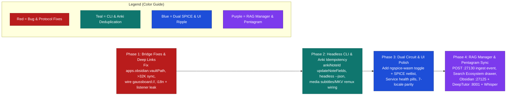

# GaussBoard: Modules 11–14 Audit & Pentagram Integration Roadmap

> **1-Line Summary:** Source-verified Modules 11–14 architecture, CLI/automation, OSS leverage (`ngspice-wasm` dual solver), and 5-app Pentagram + `RAG Manager` (`:27130`) integration plan for `GaussBoard` (`Mostakim2005/GaussBoard` @ `b50afa9`).

## 1. Unified Pentagram Decisions Locked for This Repo
* **Master Standard:** `C:\Users\kazir\Documents\Agentic Harness\Index & Flowcharts\ECOSYSTEM_INTEGRATION_CONTRACT.md` (`v2.0.0`, `2026-11-23`).
* **Upstream-Friendly Separation:** Keep upstream-shared core lines in `main.js` minimal-diff so `fahim9778/GazBoard` commits continue to cherry-pick cleanly; isolate all GaussBoard-custom IPC handlers, circuit engines, and Pentagram/`RAG Manager` integrations inside `electron/*.cjs` and `src/js/core/*`.
* **Dual Circuit Simulation (Keep & Upgrade):** Retain `src/js/core/circuit-sim.js` (`solveMNA`) as the instant real-time interactive simulator (industrial contactors, 3-phase motors, DMM, acoustic synth) **and** add **`ngspice-wasm`** as a switchable SPICE engine mode (`mna-live` vs `ngspice-spice`) plus `.cir` netlist export / TI `TINA` handoff.
* **Hybrid CAS Locked (`Charlie 2`):** Retain `electron/cas-sympy.cjs` (shared OS Python 3.15 + SymPy 1.14.0 via `ecosystem-registry.json`) with automatic pure-JS fallback (`src/js/core/scientific-math.js`).
* **Zero-Context Discovery & Auth:** Resolve ports/paths from `%USERPROFILE%\.local\share\ecosystem-registry.json` (`LOCAL_ECOSYSTEM_REGISTRY`), shared assets from `%LOCALAPPDATA%\SharedLibraries` (`LOCAL_COMMON_LIBRARIES`), and Bearer tokens from `%USERPROFILE%\.local\share\ecosystem-secrets.json` (`LOCAL_ECOSYSTEM_SECRETS`).

---

## 2. Modules 11–14 Findings Summary (Source-Verified)

| ID | Module | Severity | Target Anchors | Finding & Concrete Upgrade |
| :--- | :--- | :--- | :--- | :--- |
| `M11-01` | Module 11 | High *(Phase 1 Done)* | `electron/triarchy-bridge.cjs` -> `resolveObsidianVaultDir`, `parseGaussBoardDeepLink`, `deepLinkFromArgv`; `main.js` -> `registerDeepLinkSchemes`, `openDeepLink`, `second-instance`; `preload.js` -> `onDeepLink`; `src/js/app.js` -> `focusObjectById`, `openBoardRef`; `package.json` -> `build.protocols` | **Broken registry path & dead `gaussboard://` deep links (Fixed in Phase 1):** Updated `resolveObsidianVaultDir` to read `reg?.data?.apps?.obsidian?.vaultPath`, registered `gaussboard` / `gazboard` schemes in `package.json` + `main.js`, and wired `board:deepLink` through `preload.js` to `openBoardRef` / `focusObjectById`. |
| `M11-02` | Module 11 | High *(Phase 4 Done)* | `preload.js` -> `syncToObsidian`, `findSiblingSubtitle`, `remuxToMp4`; `src/js/core/pentagram-sync.js` -> `syncBoardToEcosystem`; `src/js/insert.js` -> `prepareLocalVideoSource`, `insertVideoFromPath`; `src/js/ui/video-dialog.js`; `src/js/ui/visualization-dialog.js` | **Orphaned IPC bridges & listener/i18n gaps (Completed across Phases 1–4):** Phase 1 fixed `visualization-dialog.js` i18n and `_unsubMermaidMgr` cleanup. Phase 2 wired `findSiblingSubtitle` and `remuxToMp4` into video import/playback. Phase 4 wired `syncToObsidian` into `syncBoardToEcosystem` (`.md` + `.canvas`). |
| `M11-03` | Module 11 | Medium *(Phase 1 Done)* | `electron/global-resources.cjs` -> `resolveEcosystemSecrets`; `electron/triarchy-bridge.cjs` -> `resolveObsidianApiConfig`, `postObsidianAgentManagerNote`, `syncToObsidianVault`; `electron/media-bridge.cjs` -> `findFfmpegExecutable` | **32K Windows argv risk & missing registry FFmpeg (Fixed in Phase 1):** Replaced `--content` CLI argv with `Obsidian Agent Manager` HTTP `POST /note/create` (`:27125`, `Authorization: Bearer` via `resolveEcosystemSecrets`, no `Origin` header) + atomic UTF-8 disk fallback, and wired `toolchains.ffmpeg` lookup in `findFfmpegExecutable()`. |
| `M12-01` | Module 12 | High *(Phase 2 Done)* | `electron/global-resources.cjs` -> `getEcosystemServices`; `preload.js` -> `getEcosystemServices`; `src/js/core/anki.js` -> `resolveAnkiConnectUrl`, `ensureCardXrefId`, `syncBoardToAnki`, `generatePracticeEngineBank`, `exportBoardToPracticeBank`; `src/js/ui/sidebar-ribbon.js` | **Duplicate Anki cards & hardcoded URL (Fixed in Phase 2):** `syncBoardToAnki` now resolves AnkiConnect URL via `getEcosystemServices`, verifies existing `ankiNoteId` (`notesInfo`) or `xref:<id>` tag (`findNotes`), calls `updateNoteFields` on re-sync (`allowDuplicate: false` for new notes), persists `ankiNoteId`/`xrefId` on cover objects, and exports `Practice Engine` `.md` banks. |
| `M12-02` | Module 12 | Medium *(Phase 2 Done)* | `electron/cli-export.cjs` -> `hasCliFlags`, `readBoardArchive`, `inspectBoard`, `runCli`; `main.js` -> `isHeadlessCli` | **Headless `--json` CLI surface (Implemented in Phase 2):** Added `electron/cli-export.cjs` supporting `--inspect`, `--export-md`, `--export-canvas`, `--input`, `--out`, and `--json` (with `0`/`1`/`2`/`3` exit codes and pure-Node/JSZip `.gaussboard` support) before single-instance lock in `main.js`. |
| `M13-01` | Module 13 | High *(Phase 3 Done)* | `src/js/core/circuit-sim.js` -> `IndustrialCircuitSim`; `src/js/core/spice-engine.js` -> `SpiceEngine`, `generateSpiceNetlist`, `exportSpiceNetlistFile`; `electron/spice-bridge.cjs`; `src/js/ui/circuit-workbench.js` | **Dual circuit solver (`MNA Live` + `ngspice-wasm`, Implemented in Phase 3):** Preserved `circuit-sim.js` untouched for instant interactive relay/motor simulation and added `spice-engine.js` + `electron/spice-bridge.cjs` (SharedLibraries `ngspice-wasm` discovery + analytical `.tran`/`.ac` fallback, `<15 MB` PWA budget preserved), `SolverMode` switcher, `.cir` netlist export, and TI `TINA` launcher. |
| `M13-02` | Module 13 | Medium *(Phase 4 Done)* | `src/js/core/markdown-sidecar.js` -> `collectBoardSidecarMetadata`, `generateMarkdownSidecar`; `src/js/core/anki.js` -> `generatePracticeEngineBank` | **Canonical frontmatter & Practice Engine alignment (Completed in Phase 4):** Extended `generateMarkdownSidecar` with `ECOSYSTEM_INTEGRATION_CONTRACT.md` v2.0.0 fields (`xref_id`, `updated_at`, `source_uri`, `anki_note_ids`, `diagram_paths`, plus `## Audio & Subtitle Transcripts`) while keeping existing keys intact; paired with Phase 2 `Practice Engine` `.md` bank export. |
| `M14-01` | Module 14 | High *(Phase 4 Done)* | `electron/rag-bridge.cjs` -> `postRagIngestEvent`, `searchRagEcosystem`, `requestAudioTranscription`, `sendToDeepTutor`; `src/js/core/pentagram-sync.js` -> `syncBoardToEcosystem`, `sendBoardContextToDeepTutor`; `src/js/app.js`; `src/js/ui/sidebar-ribbon.js`; `src/js/ui/panels.js` | **Complete 5-App Pentagram + `RAG Manager` (`:27130`) Loop (Implemented in Phase 4):** Wired `syncBoardToEcosystem` (`.md` + `.canvas` via `:27125` live/disk + `POST /v1/ingest/event` with PNG preview & transcripts, plus opt-in debounced auto-sync on save), in-app **"Search Ecosystem (`RAG Manager`)"** modal, Groq Whisper `/v1/transcribe` bridge, and **"Ask / Quiz in DeepTutor (`:8001`)"**. |
| `M14-02` | Module 14 | Medium *(Phase 3 Done)* | `electron/triarchy-bridge.cjs` -> `checkEcosystemHealth`; `src/js/ui/circuit-workbench.js`; `src/js/ui/panels.js`; `src/locales/*.json` | **UI/UX Ecosystem Ripple (Completed in Phase 3):** Added `SolverMode` selector + collapsible SPICE plot/netlist drawer in `CircuitWorkbenchModal`, lazy-probed collapsible Pentagram Service Health drawer (`RAG :27130`, `Obsidian :27125`, `Anki :8765`, `DeepTutor :8001`, `MermaidApp`, `ngspice-wasm`, `TI TINA`) in Settings (`panels.js`), and 7-locale parity (`2,409/2,409`). |

---

## 3. Dependency-Ordered Execution Phases (Module 15)

1. **Phase 1 — Existing Bridge Bugs & `gaussboard://` Deep Links *(Completed)*:**
   - Fixed `reg?.data?.apps?.obsidian?.vaultPath` in `electron/triarchy-bridge.cjs -> resolveObsidianVaultDir`; resolved `ffmpeg` via `ecosystem-registry.json` (`toolchains.ffmpeg`) in `electron/media-bridge.cjs -> findFfmpegExecutable`.
   - Added `resolveEcosystemSecrets` in `electron/global-resources.cjs` and replaced `--content <string>` CLI arg in `syncToObsidianVault` with `Obsidian Agent Manager` HTTP (`POST http://127.0.0.1:27125/note/create` via `postObsidianAgentManagerNote` with Bearer token, no `Origin` header) and atomic UTF-8 disk fallback so >32 KB boards never hit Windows argv limits.
   - Registered `gaussboard` / `gazboard` protocols in `package.json -> build.protocols` and `main.js` (`registerDeepLinkSchemes`, `openDeepLink`, `second-instance`, `open-url`, initial `process.argv`), dispatched via `preload.js -> onDeepLink` to `src/js/app.js -> openBoardRef` / `focusObjectById` to jump directly to `boardId`, `objId`, and `page`.
   - Wrapped `'Edit in Mermaid Manager'` in `t('Edit in Mermaid Manager')` across all 7 locales, fixed `#vizCodeTextarea` lookup, and ensured `this._unsubMermaidMgr` cleanup in `VisualizationDialog`.
2. **Phase 2 — Anki Deduplication, Headless `--json` CLI & Media Bridges *(Completed)*:**
   - Tracked `obj.ankiNoteId` + `xref_id` in `src/js/core/anki.js -> syncBoardToAnki`; added `notesInfo` / `findNotes` + `updateNoteFields` deduplication (`allowDuplicate: false`), read `services.ankiConnect.url` via `getEcosystemServices` IPC, fixed occlusion crop coordinate lookup (`obj.*`), and added `Practice Engine` bank (`.md`) export (`generatePracticeEngineBank` / `exportBoardToPracticeBank` + ribbon button).
   - Wired `findSiblingSubtitle` + `remuxToMp4` via `src/js/insert.js -> prepareLocalVideoSource` / `insertVideoFromPath` into `dropPaths`, `openVideoInsertDialog`, and `VideoPlayerDialog`.
   - Added headless CLI module (`electron/cli-export.cjs`, invoked early in `main.js` before `requestSingleInstanceLock` when `--inspect`, `--export-md`, `--export-canvas`, `--help-cli` are present) emitting `--json` with `0`/`1`/`2`/`3` exit codes.
3. **Phase 3 — Dual Circuit Simulator (`MNA Live` + `ngspice-wasm`) & UI Ripple *(Completed)*:**
   - Kept `src/js/core/circuit-sim.js` untouched as default `MNA Live` mode; added `src/js/core/spice-engine.js` (registered in `src/sw.js`) + `electron/spice-bridge.cjs` SharedLibraries `ngspice-wasm` loader (`<15 MB` PWA budget preserved) with `SolverMode` switch, collapsible `.tran`/`.ac` SPICE waveform plot & netlist drawer, `.cir` netlist export, and TI `TINA` launcher.
   - Kept `main.js` upstream-minimal; added `checkEcosystemHealth` loopback prober and lazy-loaded Pentagram service health drawer in Settings (`src/js/ui/panels.js`) with 7-locale parity (`2,409/2,409`).
4. **Phase 4 — `RAG Manager` (`:27130`) & Full Pentagram Synchronization *(Completed)*:**
   - Extended `generateMarkdownSidecar` frontmatter (`collectBoardSidecarMetadata`) with `xref_id`, `updated_at`, `source_uri`, `anki_note_ids`, `diagram_paths`, and `## Audio & Subtitle Transcripts`.
   - Added `electron/rag-bridge.cjs` (`postRagIngestEvent`, `searchRagEcosystem`, `requestAudioTranscription`, `sendToDeepTutor`) and `src/js/core/pentagram-sync.js` (registered in `src/sw.js`), wiring **"Sync Board to Obsidian + RAG Manager"** (with opt-in debounced auto-sync on save in Settings) emitting `POST http://127.0.0.1:27130/v1/ingest/event` alongside `.md`/`.canvas`, board preview PNG, and transcripts.
   - Added in-app **"Search Ecosystem (`RAG Manager`)"** modal and **"Ask / Quiz in DeepTutor (`:8001`)"** actions in `sidebar-ribbon.js`, plus 7-locale parity (`2,424/2,424`).

## 4. Verification Checklist
* `node scripts/smoke.js --new-features` (24/24 passing)
* `node scripts/i18n-check.js` (100% parity across all 7 locales)
* `node --test test/ecosystem-bridges.test.mjs test/phase5-obsidian-and-graph.test.mjs test/p1-hardening.test.mjs`
* `node --test test/android-*.test.js`
* Manual/automated verification: `gaussboard://open?board=<id>&obj=<objId>&page=2` focuses/opens target object; second Anki sync updates existing `ankiNoteId` with zero duplicate notes; switching circuit solver between `MNA Live` and `ngspice-wasm` preserves relay/motor simulation.
