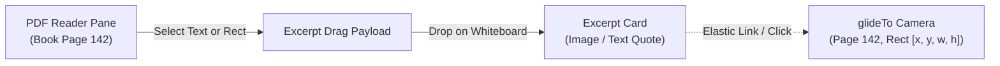

# Advanced PDF Annotation & Book Reader Architecture

> **Parent Documentation**: [`docs/INDEX.md`](../INDEX.md) | [`docs/layers/05-pdf-and-pagemargins.md`](../layers/05-pdf-and-pagemargins.md) | [`docs/plan/06-roadmap-phases-2-to-5.md`](06-roadmap-phases-2-to-5.md)  
> **Status**: Verified Blueprint & Library Resource Dossier  
> **Target Release Line**: v5.6.0+ (Phase 4 PDF & Book Reader Enhancements)  
> **Compliance**: Strict adherence to the 6 Golden Invariants (Zero native C++ `node-gyp` dependencies, 100% i18n parity across all 7 locales).

---

## 1. Executive Summary & Technology Stack

To elevate GazBoard into a world-class academic and technical PDF annotator (rivaling specialized tools like **LiquidText**, **Flexcil**, **GoodNotes**, and **MarginNote**), we combine pure JavaScript/WASM open-source libraries that require zero native compilation:

```
┌────────────────────────────────────────────────────────────────────────┐
│               GazBoard PDF Annotation & Book Reader Stack              │
├────────────────────────────────┬───────────────────────────────────────┤
│ Layer / Capability             │ Technology Engine & Version           │
├────────────────────────────────┼───────────────────────────────────────┤
│ 1. Core PDF Parsing & Render   │ Mozilla PDF.js v4.10.38 (Core)        │
│ 2. Text Selection & Markups    │ Mozilla PDF.js TextLayer & Annotations│
│ 3. Native PDF Manipulation     │ pdf-lib v1.17.1 (Pure JS)             │
│ 4. Custom Font Embedding       │ @pdf-lib/fontkit v1.1.1 (UMD)         │
│ 5. Scanned Book Offline OCR    │ Tesseract.js v5.1.1 (WASM + Fast Eng) │
│ 6. In-App Whiteboard Excerpts  │ GazBoard Linked Excerpt Engine v5.1.0 │
│ 7. LaTeX Math in Annotations   │ KaTeX v0.16.21                        │
└────────────────────────────────┴───────────────────────────────────────┘
```

All required runtime libraries have been verified, downloaded, and registered in the system-wide repository:  
`C:\Users\kazir\Documents\Antigravity\CommonLibraries\`  
and cataloged in [`C:\Users\kazir\Documents\Antigravity\TOPIC_CATALOG.md`](file:///C:/Users/kazir/Documents/Antigravity/TOPIC_CATALOG.md).

---

## 2. Capability Matrix: Modern PDF Annotator Features

| Feature Category | Industry Standard (Flexcil / LiquidText) | GazBoard Replay Implementation | Technology / Library |
| :--- | :--- | :--- | :--- |
| **1. Text Markup** | Highlight, Underline, Strikethrough, Squiggly | Direct text selection on PDF text layer with color picker & opacity slider. | `PDF.js` `TextLayerBuilder` + `AnnotationEditorLayer` |
| **2. Pin-and-Tear Excerpts** | Drag text quote or image rect out of PDF onto workspace with dynamic linking strings. | Rectangular crop or text excerpt dragged to whiteboard; clicking excerpt glides PDF camera back to exact source page & coordinates. | GazBoard `excerpt` data schema + `glideTo` camera easing |
| **3. Book Margin Expansion** | Enlarge white gutter around pages for marginalia handwriting. | Dynamic `MediaBox` / `CropBox` enlargement ($+W_\text{margin}$) preserving all internal links and text streams. | `pdf-lib` (`setMediaBox`) |
| **4. Book Reader Navigation** | Continuous scroll, 2-page book spread, Table of Contents (TOC). | Dual-page spread layout, vertical smooth scroll, hierarchical outline tree drawer. | `PDF.js` `PDFViewer` + `getOutline()` |
| **5. In-Document Search** | Search full book text with occurrence count & jump keys. | Fast regex/word search with yellow bounding boxes across canvas and <kbd>F3</kbd> / <kbd>Shift+F3</kbd> navigation. | `PDF.js` `PDFFindController` |
| **6. Scanned Book OCR** | Search & highlight scanned books lacking native text layers. | On-demand background Web Worker OCR synthesizing selectable text overlays. | `Tesseract.js` (Offline WASM) |
| **7. FreeText & Sticky Notes** | Formatted text boxes and collapsible comment icons. | Markdown-capable sticky notes attached to PDF coordinates, with KaTeX math. | GazBoard `note` / `text` + `markdown.js` |
| **8. Page Manipulation** | Reorder, rotate, delete, or insert blank note pages. | Interactive thumbnail organizer with drag-and-drop page reordering and blank sheet insertion. | `pdf-lib` (`copyPages`, `insertPage`, `removePage`) |
| **9. Native Export** | Save annotations back into standard PDF format. | Export ISO 32000-1 compliant annotated PDF (compatible with Acrobat, Apple Books, Chrome) or flatten. | `pdfDocument.saveDocument()` or `pdf-lib` |

---

## 3. Deep-Dive Implementation Architecture

### 3.1. LiquidText-Style Pin-and-Tear Excerpts

Modern research workflows require connecting isolated notes to their original context in reference books:



#### Data Schema Extension
In `Store.doc.objects[id]`:
```javascript
{
  id: "excerpt-9102",
  type: "image", // or "note"
  subtype: "pdf-excerpt",
  pdfPath: "C:/Books/LinearAlgebra.pdf",
  pageNumber: 142,
  rect: [120, 340, 280, 110], // [x, y, width, height] in PDF points
  textQuote: "A linear transformation preserves vector addition...",
  assetId: "asset-crop-9102",
  x: 540,
  y: 320,
  w: 280,
  h: 110
}
```

When an excerpt card is double-clicked or tapped:
1. The app verifies if the PDF reader pane is open; if not, it opens the PDF in split-view.
2. The PDF viewer glides smoothly to `pageNumber: 142`.
3. A cyan glow highlight box flashes over `[120, 340, 280, 110]` for 600ms, immediately drawing the student's eye to the source.

---

### 3.2. Book Margin Expansion (Gutter Padding for Marginalia)

Standard textbooks frequently have tight margins that do not accommodate extensive student notes. Using `pdf-lib`, GazBoard can expand page dimensions without rasterizing or damaging vector quality:

```javascript
import { PDFDocument } from 'pdf-lib';

/**
 * Expands PDF page margins for book note-taking (e.g. +200pt right gutter).
 * Preserves all vector streams, text layers, and embedded links.
 */
export async function expandPdfBookMargins(pdfBytes, options = {}) {
  const { right = 200, left = 0, top = 40, bottom = 40 } = options;
  const doc = await PDFDocument.load(pdfBytes);
  const pages = doc.getPages();

  for (const page of pages) {
    const { x, y, width, height } = page.getMediaBox();
    
    // Shift page content if adding left or bottom gutters
    if (left > 0 || bottom > 0) {
      page.translateContent(left, bottom);
    }

    // Expand bounding boxes
    const newWidth = width + left + right;
    const newHeight = height + top + bottom;
    page.setMediaBox(x, y, newWidth, newHeight);
    page.setCropBox(x, y, newWidth, newHeight);
  }

  return await doc.save();
}
```

---

### 3.3. Scanned Book Offline OCR Layer (Tesseract.js)

When reading older scanned books or lecture slides that have no native text layer:
1. `Tesseract.js` initializes in an offscreen Web Worker using the offline core wasm:  
   `C:\Users\kazir\Documents\Antigravity\CommonLibraries\tesseract\worker.min.js`
2. It processes rendered page canvas blobs in the background.
3. It emits word-level bounding boxes: `{ text, bbox: { x0, y0, x1, y1 } }`.
4. The PDF viewer injects these bounding boxes into the `textLayer` DOM overlay with transparent text (`color: transparent`), allowing the user to select, copy, and highlight text exactly as if it were a modern vector PDF!

---

## 4. Packaging & Deployment: Android APK vs Windows Desktop

A central design requirement is ensuring seamless operation across both desktop (Windows Electron) and mobile/tablet (Android APK):

```
┌────────────────────────────────────────────────────────────────────────┐
│                   Dual Deployment Architecture                         │
├───────────────────────────────────┬────────────────────────────────────┤
│ Windows Desktop (Electron)        │ Android Tablet / Mobile (APK)      │
├───────────────────────────────────┼────────────────────────────────────┤
│ • Core libraries bundled in app   │ • Core libraries bundled in APK    │
│   (src/vendor/): ~1.2 MB.         │   (assets/vendor/): ~1.8 MB.       │
│ • Heavy engines (OCR WASM,        │ • APK binary kept slim (~25 MB).   │
│   Tesseract language data,        │ • OCR language packs and heavy     │
│   Mermaid, Chart.js) reside in    │   extras downloaded on-demand      │
│   C:\...\CommonLibraries\.        │   to app-internal storage.         │
│ • Library Inspector modal shows   │ • Missing optional library shows   │
│   paths & Explorer button.        │   friendly download prompt modal.  │
└───────────────────────────────────┴────────────────────────────────────┘
```

### Warning Pop-up Specification (Missing Optional Engine)
When an optional heavy feature is triggered (e.g. Scanned Book OCR or Advanced Vector Embedding) and its engine is not found on disk:

```
┌──────────────────────────────────────────────────────────────┐
│  ⚠️ Optional Feature Engine Needed                           │
├──────────────────────────────────────────────────────────────┤
│  The Scanned Book OCR engine (Tesseract.js) is not currently │
│  installed in your CommonLibraries repository.              │
│                                                              │
│  Expected Location:                                          │
│  C:\Users\kazir\Documents\Antigravity\CommonLibraries\       │
│  tesseract\tesseract.min.js                                  │
│                                                              │
│  [ Open Library Inspector ]         [ Download / Dismiss ]   │
└──────────────────────────────────────────────────────────────┘
```

- In Electron: Clicking **Open Library Inspector** opens the inspector modal with full diagnostics and folder launcher.
- In Android APK: The modal provides a **Download Engine Over Wi-Fi** action that downloads the necessary assets directly into the app's internal cache directory.

---

## 5. Phased Implementation Roadmap

### Phase 4A: PDF Viewer Infrastructure & Split-Screen Reader
- Upgrade reader mode to use Mozilla `pdf_viewer.mjs` with `TextLayerBuilder` and `PDFFindController`.
- Implement continuous vertical scrolling and 2-page book spread mode.
- Add Table of Contents (TOC) outline drawer.

### Phase 4B: Interactive Text Markups & Native Bi-Directional Saving
- Integrate text selection toolbar (Highlight colors, Underline, Strikethrough, Copy Quote).
- Implement `pdfDocument.saveDocument()` export to write real ISO 32000-1 annotations back into the original PDF.

### Phase 4C: LiquidText-Style Linked Excerpts
- Add "Tear & Pin Excerpt" action on text selections and rectangular crops.
- Wire double-click camera navigation back to source book page and bounding box.

### Phase 4D: Book Margin Expansion & Scanned OCR
- Add "Expand Book Margins" dialog with preset gutters (+150pt, +250pt, Custom).
- Wire offline `Tesseract.js` background worker for scanned book text generation.
