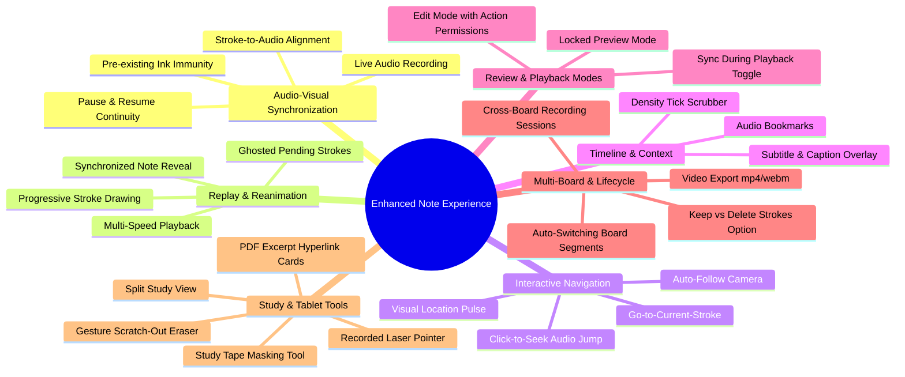

# Document 1: Master Feature Specification & User Experience Catalog

This document defines the complete catalog of **user-facing capabilities, interactions, and functional requirements** for the enhanced note-taking and whiteboard experience on Windows. It synthesizes requirements from **StarNote**, **Flexcil**, **Notability**, and the provided specification into a clear product definition.

In accordance with product design principles, this document focuses strictly on **what the user experiences and can do (the Feature Set)**, leaving technical mechanisms and engineering architecture to Documents 2 and 3.

---

## 1. Feature Map & Taxonomy

---

## 2. Core Audio-Visual Synchronization

### F-101: Live Audio Recording
* **Description**: The user can start an audio recording at any time while writing on the canvas (e.g., during a lecture, seminar, meeting, or personal voice-memo session).
* **User Experience**:
  * Clicking a prominent "Record" button starts recording from the active system microphone.
  * A clear visual indicator shows active recording status with an elapsed timer (`00:00`) and audio input volume meter.
  * Pen and stylus performance remains 100% fluid, with zero latency or dropped frames introduced to writing.

### F-102: Pause & Resume Continuity
* **Description**: The user can pause the recording (e.g., during a classroom break or off-topic discussion) and resume later.
* **User Experience**:
  * While paused, the recording timer halts.
  * Any notes written while paused are treated as paused-time notes; upon resumption, the timeline continues seamlessly without creating awkward gaps in the synchronized timeline.

### F-103: Stroke-to-Audio Temporal Alignment
* **Description**: Every drawing action performed during an active recording is intrinsically linked to the audio timeline.
* **User Experience**:
  * Each pen stroke, highlighter line, text box, or shape placed while recording remembers the exact audio timestamp of when it was created.
  * Individual strokes record both when the stylus touched the glass ($t_{start}$) and when the stylus lifted ($t_{end}$), enabling smooth, continuous animation during playback.

### F-104: Pre-Existing Drawing Immunity
* **Description**: Drawings created before the recording started are never treated as part of the new audio timeline.
* **User Experience**:
  * Existing drawings, background templates, imported PDF pages, and previous sketches remain permanently visible and unchanged when recording begins.
  * The user can freely annotate on top of pre-existing PDF slides or lecture notes while recording new spoken commentary.

---

## 3. Synchronized Note Replay & Reanimation ("Note Replay")

### F-201: Real-Time Audio-Synchronized Reveal
* **Description**: Playing back the recorded audio progressively re-reveals notes exactly as they were spoken and drawn.
* **User Experience**:
  * As the speaker talks, notes and diagrams appear on screen at the exact second they were originally written.
  * Hearing a teacher explain a concept is visually synchronized with watching the corresponding diagram or formula unfold.

### F-202: Visual Styling of "Pending" Notes (Ghosting / Preview)
* **Description**: Notes that were written later in the lecture are visually distinguished so the user knows notes exist ahead without spoiling the timeline.
* **User Experience**:
  * **Configurable Pending Style**: The user can choose how unrevealed notes appear:
    1. *Translucent Ghosting (Flexcil / StarNote style)*: Notes written in the future appear at soft, dimmed opacity (~12–15%) or faint monochrome.
    2. *Hidden Mode*: Future notes remain completely invisible until their audio timestamp is reached.
    3. *Accent Border / Bounding Outline*: A subtle dashed outline indicates that an annotation exists in that region.
  * When playback reaches a stroke's timestamp, it instantly transitions from pending to vibrant, full-opacity ink.

### F-203: Progressive Sub-Stroke Animation
* **Description**: Rather than a whole complex formula popping in all at once, individual strokes draw out progressively along the path.
* **User Experience**:
  * Long handwriting strokes or arrows unfold smoothly from start to finish as the speaker says the words.
  * An optional glowing pen-tip dot leads the drawing edge during playback.

### F-204: Multi-Speed Playback
* **Description**: The user can accelerate or decelerate playback without losing synchronization.
* **User Experience**:
  * Speed options: `0.5×`, `0.75×`, `1.0×` (normal), `1.25×`, `1.5×`, `2.0×`.
  * Visual stroke reveals and animations accelerate or decelerate in exact lockstep with the audio.

---

## 4. Interactive Navigation & Camera Intelligence

### F-301: Click-to-Seek ("Audio Jump")
* **Description**: Tapping any handwritten stroke, diagram, or word instantly jumps audio playback to the exact moment that item was drawn.
* **User Experience**:
  * While reviewing a 60-minute lecture, the user sees a complex diagram at the bottom of the page.
  * Clicking on that diagram immediately seeks the audio player to minute 42:15 when that diagram was drawn and begins playing the explanation.
  * The selected stroke briefly pulses with a colored halo to confirm which part of the board is currently being heard.

### F-302: Auto-Follow Camera
* **Description**: The viewport automatically pans and zooms to keep newly revealed notes in the center of the screen during playback.
* **User Experience**:
  * As playback progresses across an expansive canvas or tall document, the camera smoothly glides to follow the writing.
  * **Manual Override & Graceful Pause**: If the user manually scrolls, pans, or zooms to inspect something elsewhere, auto-follow immediately disengages. A floating "Re-center / Follow" button appears, allowing the user to snap back to following the playback whenever ready.

### F-303: "Go to Current Stroke" Shortcut
* **Description**: A dedicated button or keyboard shortcut that instantly jumps the viewport to the stroke currently being spoken/revealed.

---

## 5. Timeline Scrubber, Bookmarks & Subtitles

### F-401: Timeline Scrubber with Stroke Density Ticks
* **Description**: An interactive audio scrubber bar that visually displays where note-taking activity occurred.
* **User Experience**:
  * The scrubber bar shows small vertical tick marks or a mini heatmap showing when notes were being actively written.
  * Silent or non-writing intervals are visually obvious, allowing the user to skip directly to dense note-taking sections.

### F-402: Audio Bookmarks with Custom Labels
* **Description**: The user can drop bookmark pins onto the audio timeline during either recording or review.
* **User Experience**:
  * Tapping "Add Bookmark" (or hotkey `B`) creates a labeled flag on the scrubber (e.g., *"Midterm Exam Hint"*, *"Theorem Proof"*, *"Questions Q&A"*).
  * Clicking a bookmark flag instantly seeks the audio and centers the canvas on that moment.

### F-403: External Subtitle & Caption Display (`.srt` / `.vtt`)
* **Description**: Users who transcribe their lecture audio using external AI or transcription tools (Whisper, etc.) can load subtitle files.
* **User Experience**:
  * Attaching an `.srt` or `.vtt` file displays synchronized captions in a clean, floating banner at the bottom of the canvas during playback.

---

## 6. Playback Modes & Editing Permissions

### F-501: Dual Playback Modes: Preview (Locked) vs. Edit
* **Description**: Differentiates between casual study review and active note expansion.
* **User Experience**:
  * **Preview Mode (Study / Review)**:
    * The canvas is locked against accidental drawing marks or moves.
    * A plain click anywhere on a stroke seeks the audio immediately.
    * Ideal for tablet touch and stylus browsing during revision.
  * **Edit Mode (Active Revision)**:
    * Allows the user to take new notes or highlight existing notes while listening to the audio.
    * Seeking audio requires a modifier (e.g. `Alt + Click`) or a dedicated seek tool so clicking doesn't conflict with normal selection or inking.

### F-502: Granular Action Permissions During Playback
* **Description**: When in Edit Mode, the user can toggle permissions to prevent accidental destruction of synchronized material:
  * *Allow Adding*: Can draw new notes while listening.
  * *Lock Moving*: Prevents accidentally displacing synced lecture notes.
  * *Lock Erasing*: Prevents accidentally rubbing out historical lecture notes.

### F-503: "Sync New Notes During Playback" Setting
* **Description**: A user choice determining whether new annotations drawn while listening to a recording should be inserted into the existing audio timeline or kept as timeless static annotations.

---

## 7. Multi-Board Sessions & Recording Lifecycle

### F-601: Cross-Board & Cross-Sheet Continuous Recording
* **Description**: A single audio recording session can span multiple boards, sheets, or imported PDF slide decks.
* **User Experience**:
  * When moving from "Chapter 1 Board" to "Chapter 2 Board", the audio recording never stops.
  * The session records segment intervals per board.
  * During playback, when the audio reaches the timestamp of Chapter 2, GazBoard automatically opens or switches to the Chapter 2 board and continues the stroke animation.

### F-602: Safe Deletion Dialog (Keep vs. Delete Strokes)
* **Description**: Deleting an audio recording offers a clear, explicit choice:
  * **Option A: "Keep Notes"**: Removes the audio file and unlinks the timestamps; all handwritten drawings remain permanently on the board as regular ink.
  * **Option B: "Delete Notes & Audio"**: Deletes the audio file and removes the strokes that were created during that recording session.

### F-603: Audio Export & Local Storage
* **Description**: Recordings are saved locally on disk; users can export the raw audio file (`.webm` / `.opus` / `.wav`), reveal it in Windows File Explorer, or copy its path with one click.

---

## 8. StarNote & Flexcil Signature Tablet & Study Features

### F-701: Study Tape / Masking Tool (Active Recall & Self-Quizzing)
* **Description**: A digital masking tape tool inspired by Flexcil and StarNote designed specifically for students and active recall study.
* **User Experience**:
  * The user selects the **Tape Tool** from the toolbar and drags a colored rectangular tape strip over formulas, vocabulary words, or textbook diagrams.
  * The tape is completely opaque, concealing the content beneath.
  * **One-Tap Reveal**: Tapping on a tape strip temporarily makes it translucent, revealing the hidden answer. Tapping it again conceals it.
  * A master toggle ("Reveal All Tape" / "Hide All Tape") allows quick testing across the entire sheet.

### F-702: PDF Excerpt & Reference Hyperlink Cards
* **Description**: Inspired by Flexcil's signature study workflow—connecting lecture notes directly to textbook sources.
* **User Experience**:
  * Using the selection tool on an imported PDF page, the user can box-select an excerpt (e.g. a chart, paragraph, or diagram) and click "Create Reference Card".
  * The excerpt is placed onto the study canvas as an independent visual card carrying a small link badge (`[Jump to Page 24]`).
  * Clicking the badge smoothly pans and zooms the canvas back to the exact page and paragraph in the source PDF.

### F-703: Gesture Scratch-Out Eraser
* **Description**: Eliminates the friction of switching back and forth between Pen and Eraser tools on Windows tablets.
* **User Experience**:
  * While using any pen or stylus, quickly scribbling back and forth (a rapid zig-zag gesture) over a word, stroke, or shape immediately deletes that item.
  * The user never has to lift their hand to click the eraser button on the toolbar.

### F-704: Side-by-Side Split Study Workspace
* **Description**: A structured workspace layout allowing side-by-side study.
* **User Experience**:
  * One half of the window displays reference materials (imported PDF slides or textbooks), while the other half provides a freehand scratchpad / notebook for active summary writing.

### F-705: Recorded Laser Pointer Trail
* **Description**: Optional recording of the laser pointer tool during a lecture.
* **User Experience**:
  * If enabled, whenever the presenter uses the laser pointer to circle a diagram, that moving glowing dot is recorded and replayed during playback, showing exactly where attention was directed.

---

## 9. Media Export: Video with Replay & Audio

### F-801: Animated Video Export (`.webm` / `.mp4`)
* **Description**: Exports the synchronized audio and canvas reanimation as a standalone video file that can be shared with classmates or students.
* **User Experience**:
  * The user clicks **Export ▸ Video Replay**.
  * **Camera Mode Selection**:
    * *Fit-All*: A fixed bird’s-eye perspective capturing the entire drawing area.
    * *Follow Camera*: An animated, cinematic video where the camera automatically pans and zooms to follow the handwriting in real time.
  * Includes the synchronized audio track and optional subtitle overlay.

---

## Summary Matrix: Feature Tiers

| Tier | Category | Features Included |
| :--- | :--- | :--- |
| **Tier 1: Core Synchronized Inking** | Audio & Ink Sync | F-101 (Recording), F-102 (Pause/Resume), F-103 (Stroke Timestamps), F-104 (Pre-existing Ink Immunity), F-201 (Note Replay), F-202 (Ghosted Pending Strokes), F-301 (Click-to-Seek) |
| **Tier 2: Study & Playback Polish** | Navigation & Controls | F-204 (Speed Control), F-302 (Auto-Follow Camera), F-401 (Scrubber Ticks), F-402 (Bookmarks), F-501 (Preview/Edit Modes), F-602 (Safe Delete Dialog), F-701 (Study Tape Masking Tool) |
| **Tier 3: Advanced Student Workflows** | Document Study & Gestures | F-702 (PDF Excerpt Hyperlinks), F-703 (Gesture Scratch-Out Eraser), F-403 (Subtitle Overlay), F-601 (Multi-Board Sessions), F-801 (Video Export) |
