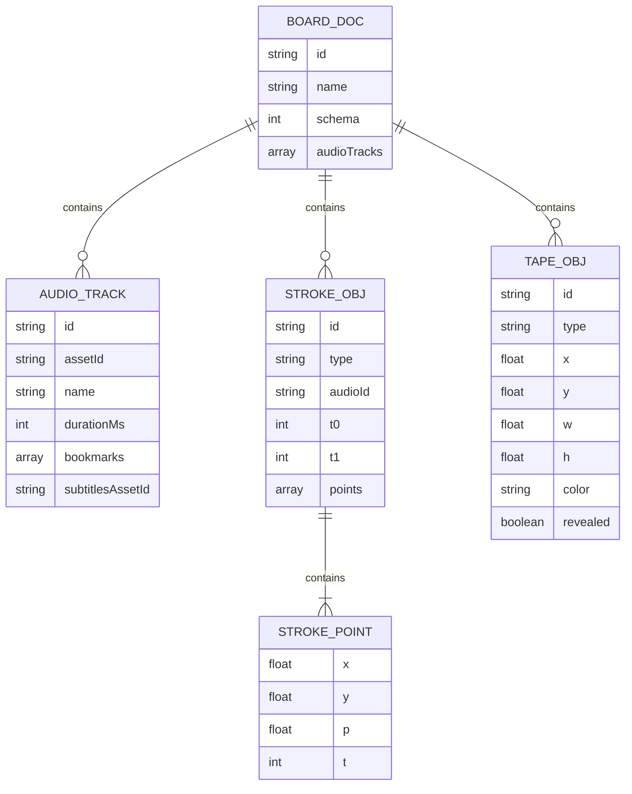
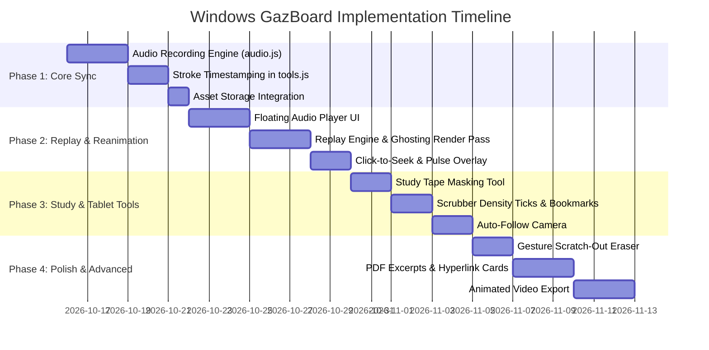

# Document 3: Proposed Technical Implementation Strategy & Windows Engineering Blueprint

> **Document status:** Historical implementation roadmap; proposed phases do not necessarily match shipped code. Consult [`../../FEATURE_EVOLUTION-4.8.1-to-4.8.8.md`](../../FEATURE_EVOLUTION-4.8.1-to-4.8.8.md) and `../../releases/RELEASE-4.8.8.md` for the current source release and verification record.

This document specifies the **optimized engineering design, data structures, algorithms, and implementation blueprint** for building all desired features into **GazBoard on Windows**. 

Because GazBoard is a dedicated desktop application with full control over its HTML5 2D Canvas and Electron environment, we can implement these features using direct, low-overhead, native techniques rather than the complex workarounds required by third-party plugin frameworks.

---

## 1. Engineering Principles for Windows

1. **Direct Native Canvas Rendering**:
   * Instead of masking with DOM overlays or diffing scenes, GazBoard directly controls its 2D rendering pass in [render.js](file:///C:/Users/kazir/.gemini/antigravity/scratch/GazBoard/src/js/core/render.js). Ghosting, progressive reveals, and glowing pen tips are drawn natively at 60–120 FPS.
2. **Audio Clock as Single Source of Truth**:
   * The HTML5 `<audio>` element's `currentTime` is the absolute master clock. Visual animations, camera easing, and subtitle cues poll this clock via `requestAnimationFrame`—completely eliminating clock drift.
3. **Strict Non-Destructive Rendering**:
   * Stored stroke geometry, colors, opacities, and undo stacks in [store.js](file:///C:/Users/kazir/.gemini/antigravity/scratch/GazBoard/src/js/core/store.js) are **never mutated** for visual effects. Ghosting and pending states are computed transiently during the paint pass, guaranteeing that autosave cannot corrupt user drawings.
4. **Hardware Acceleration & Windows Pen Optimization**:
   * Windows stylus input uses `PointerEvent.getCoalescedEvents()` for micro-timing accuracy and preserves compatibility with Windows Delegated Ink Trails ([inktrail.js](file:///C:/Users/kazir/.gemini/antigravity/scratch/GazBoard/src/js/core/inktrail.js)).

---

## 2. Data Model Extensions

The document model in [store.js](file:///C:/Users/kazir/.gemini/antigravity/scratch/GazBoard/src/js/core/store.js) is extended cleanly and backwards-compatibly:



### 2.1 Document-Level Audio Tracks (`doc.audioTracks`)
```javascript
doc.audioTracks = [
  {
    id: "aud_9f2a",
    assetId: "a1b2c3d4...",           // SHA-256 asset pointer in assets/ directory
    name: "Lecture Audio 1",
    durationMs: 342000,
    created: 1729000000000,
    bookmarks: [
      { t: 45200, label: "Theorem Proof" },
      { t: 182400, label: "Exam Question" }
    ],
    subtitlesAssetId: "sub_e5f6..."    // Optional .srt / .vtt text file asset
  }
];
```

### 2.2 Stroke Object Extensions
Strokes recorded during an active audio session receive three metadata fields:
```javascript
{
  id: "s_101",
  type: "stroke",
  tool: "pen",
  color: "#0078d4",
  width: 4,
  audioId: "aud_9f2a",                // Link to active recording session
  t0: 12450,                          // Stroke start time (ms from recording start)
  t1: 14200,                          // Stroke end time (ms from recording start)
  points: [
    { x: 120.5, y: 340.2, p: 0.62, t: 12450 },
    { x: 122.1, y: 341.0, p: 0.65, t: 12480 },
    // ...
  ]
}
```

---

## 3. Module Specifications & Implementations

### 3.1 Audio Recording Subsystem (`src/js/core/audio.js`)

A dedicated `AudioRecorder` class manages audio hardware capture, pause/resume time accumulation, and local asset storage:

```javascript
// src/js/core/audio.js
import { uid } from './util.js';

export class AudioRecorder {
  constructor(app) {
    this.app = app;
    this.mediaRecorder = null;
    this.chunks = [];
    this.activeTrackId = null;
    this.isRecording = false;
    this.isPaused = false;
    this.accumulatedMs = 0;
    this.lastResumeAt = 0;
  }

  get currentTimeMs() {
    if (!this.isRecording) return 0;
    if (this.isPaused) return this.accumulatedMs;
    return this.accumulatedMs + Math.round(performance.now() - this.lastResumeAt);
  }

  async start() {
    const stream = await navigator.mediaDevices.getUserMedia({ 
      audio: { echoCancellation: true, noiseSuppression: true } 
    });
    this.chunks = [];
    this.mediaRecorder = new MediaRecorder(stream, { mimeType: 'audio/webm;codecs=opus' });
    this.activeTrackId = uid('aud');
    this.accumulatedMs = 0;
    this.lastResumeAt = performance.now();
    this.isRecording = true;
    this.isPaused = false;

    this.mediaRecorder.ondataavailable = (e) => {
      if (e.data && e.data.size > 0) this.chunks.push(e.data);
    };

    // Sliced recording (every 5s) for instant crash resilience
    this.mediaRecorder.start(5000);
    return this.activeTrackId;
  }

  pause() {
    if (!this.isRecording || this.isPaused) return;
    this.accumulatedMs += Math.round(performance.now() - this.lastResumeAt);
    this.isPaused = true;
    this.mediaRecorder.pause();
  }

  resume() {
    if (!this.isRecording || !this.isPaused) return;
    this.lastResumeAt = performance.now();
    this.isPaused = false;
    this.mediaRecorder.resume();
  }

  async stop() {
    if (!this.isRecording) return null;
    this.isRecording = false;
    const finalDuration = this.currentTimeMs;

    return new Promise((resolve) => {
      this.mediaRecorder.onstop = async () => {
        const blob = new Blob(this.chunks, { type: 'audio/webm' });
        const reader = new FileReader();
        reader.onloadend = async () => {
          const dataUrl = reader.result;
          // Store directly in GazBoard's content-addressable asset store
          const assetId = await window.board.assets.put(dataUrl);
          const track = {
            id: this.activeTrackId,
            assetId,
            name: `Recording ${new Date().toLocaleTimeString([], { hour: '2-digit', minute: '2-digit' })}`,
            durationMs: finalDuration,
            created: Date.now(),
            bookmarks: []
          };
          // Persist track metadata into board document
          const existing = this.app.store.doc.audioTracks || [];
          this.app.store.commit('add audio recording', [
            { t: 'doc', before: { audioTracks: existing }, after: { audioTracks: [...existing, track] } }
          ]);
          resolve(track);
        };
        reader.readAsDataURL(blob);
      };
      this.mediaRecorder.stop();
      this.mediaRecorder.stream.getTracks().forEach((track) => track.stop());
    });
  }
}
```

---

### 3.2 Stroke Timestamping Engine ([tools.js](file:///C:/Users/kazir/.gemini/antigravity/scratch/GazBoard/src/js/core/tools.js))

Integrate into GazBoard's existing stroke lifecycle:

1. **At `startStroke` (pen touch)**:
   ```javascript
   // Inside tools.js:startStroke()
   const rec = this.app.audioRecorder;
   if (rec && rec.isRecording) {
     obj.audioId = rec.activeTrackId;
     obj.t0 = rec.currentTimeMs;
   }
   ```
2. **At `pointermove` (gathering points)**:
   ```javascript
   // Inside tools.js pointermove offer() loop
   const tOffset = (rec && rec.isRecording) ? rec.currentTimeMs : 0;
   obj.points.push(this.snapToRuler({ ...wp, p: this.pressure(e), t: tOffset }, act));
   ```
3. **At `finishStroke` (pen lift)**:
   ```javascript
   // Inside tools.js:finishStroke()
   if (obj.audioId) {
     obj.t1 = rec.currentTimeMs;
   }
   ```

---

### 3.3 Replay & Real-Time Reanimation Engine ([render.js](file:///C:/Users/kazir/.gemini/antigravity/scratch/GazBoard/src/js/core/render.js))

During audio playback, `App` supplies the current playback state `replayState = { active: true, audioId, currentTimeMs, pendingStyle }` to the renderer.

In [render.js:drawStroke](file:///C:/Users/kazir/.gemini/antigravity/scratch/GazBoard/src/js/core/render.js#L379):
```javascript
export function drawStroke(ctx, o, replayState = null) {
  const pts = o.points;
  if (!pts || !pts.length) return;

  // REPLAY LOGIC:
  if (replayState && replayState.active && o.audioId === replayState.audioId) {
    const tCurrent = replayState.currentTimeMs;

    // 1. FUTURE STROKE (Ghosted or Hidden)
    if (tCurrent < o.t0) {
      if (replayState.pendingStyle === 'hidden') return;
      ctx.save();
      ctx.globalAlpha = 0.12; // Dimmed ghost preview
      ctx.strokeStyle = '#9e9e9e';
      ctx.stroke(inkPath(o));
      ctx.restore();
      return;
    }

    // 2. ACTIVE STROKE IN PROGRESS (Progressive Path Drawing + Glowing Tip)
    if (tCurrent >= o.t0 && tCurrent < o.t1) {
      const visiblePts = pts.filter(p => (p.t ?? o.t0) <= tCurrent);
      if (visiblePts.length >= 2) {
        const animPath = centrelinePath(visiblePts, o.width || 4);
        ctx.save();
        ctx.lineWidth = o.width || 4;
        ctx.strokeStyle = inkStyle(ctx, o);
        ctx.stroke(animPath);

        // Glowing pen-tip leading edge
        const last = visiblePts[visiblePts.length - 1];
        ctx.fillStyle = '#0078d4';
        ctx.shadowColor = '#0078d4';
        ctx.shadowBlur = 8;
        ctx.beginPath();
        ctx.arc(last.x, last.y, (o.width || 4) * 0.9, 0, Math.PI * 2);
        ctx.fill();
        ctx.restore();
        return;
      }
    }

    // 3. PAST STROKE (Full normal opacity) -> falls through to standard render
  }

  // Standard GazBoard rendering (normal opacity, pressureRuns, effects) ...
}
```

---

### 3.4 Interactive Click-to-Seek ("Audio Jump")

Leverage GazBoard's spatial hit testing in [hit.js](file:///C:/Users/kazir/.gemini/antigravity/scratch/GazBoard/src/js/core/hit.js):

```javascript
// In tools.js pointerdown handler
onPointerDown(e) {
  const wp = this.surface.cam.toWorld(e.clientX, e.clientY);
  
  if (this.app.audioPlayer?.isOpen) {
    // Check if user clicked a synced stroke
    const hitId = this.hitTestObjects(wp);
    const obj = hitId ? this.store.get(hitId) : null;
    
    if (obj && obj.audioId && obj.audioId === this.app.audioPlayer.activeTrackId) {
      // Instant seek!
      this.app.audioPlayer.seekMs(obj.t0);
      
      // Trigger transient visual pulse overlay
      this.surface.pulseHighlight(boundsOf(obj));
      if (this.app.playbackMode === 'preview') return; // Handled
    }
  }
  // Regular tool handling continues ...
}
```

---

### 3.5 Floating Audio Player & Scrubber UI (`src/js/ui/audioplayer.js`)

Designed as a sleek, non-intrusive floating bar following the pattern established by [timer.js](file:///C:/Users/kazir/.gemini/antigravity/scratch/GazBoard/src/js/ui/timer.js):

```
┌────────────────────────────────────────────────────────────────────────────────────────┐
│  ▶  ■  [==|===================== 04:15 / 32:00 =====================]  1.5×  🏷+  ✕   │
└────────────────────────────────────────────────────────────────────────────────────────┘
```

* **Controls**:
  * Play / Pause / Record toggle.
  * Interactive Scrubber with stroke density ticks (small canvas strip rendering vertical tick lines at each stroke's `t0`).
  * Speed selector dropdown (`0.75×`, `1.0×`, `1.25×`, `1.5×`, `2.0×`).
  * Bookmark button (`🏷+`) to drop named markers at current playback position.
  * Mode Switcher: **Preview (Locked)** vs. **Edit**.

---

### 3.6 StarNote & Flexcil Features

#### A. Study Tape / Masking Tool (`src/js/core/tape.js` & `render.js`)
* **Data Representation**:
  ```javascript
  {
    id: "tape_1",
    type: "tape",
    x: 200, y: 350, w: 180, h: 40,
    color: "#ffc83b",            // Classic sticky tape yellow
    revealed: false
  }
  ```
* **Rendering in [render.js](file:///C:/Users/kazir/.gemini/antigravity/scratch/GazBoard/src/js/core/render.js)**:
  * When `!revealed`: Draws opaque textured tape rectangle concealing underlying ink.
  * When `revealed`: Draws faint 15% opacity dashed outline revealing what is underneath.
* **Interaction**: Tapping with pen or mouse flips `revealed = !revealed`.

#### B. Gesture Scratch-Out Eraser ([tools.js](file:///C:/Users/kazir/.gemini/antigravity/scratch/GazBoard/src/js/core/tools.js))
* In `finishStroke()`: Evaluate point coordinates of the candidate stroke before committing it.
* **Algorithm**:
  * Count sharp directional reversals along the X or Y axis ($> 4$ reversals).
  * Compute ratio of total travel distance to bounding box diagonal ($\text{length} / \text{diagonal} > 3.5$).
  * If both thresholds match: Treat the stroke as a scratch-out gesture.
  * Find all strokes/objects intersecting the bounding box using [hit.js](file:///C:/Users/kazir/.gemini/antigravity/scratch/GazBoard/src/js/core/hit.js) and call `this.store.remove(intersectedIds, 'scratch erase')`. Discard the scratch stroke without saving it.

#### C. PDF Excerpt & Hyperlink Cards
* In selection tool: Box-select an area on an imported PDF page and click "Create Excerpt".
* Creates an excerpt card holding the cropped bitmap and metadata `{ targetPage: 5, targetBox: { x, y, w, h } }`.
* Clicking the card's jump badge executes `app.surface.cam.panTo(targetBox)`.

---

## 4. Phased Implementation Roadmap



### Phase 1: Core Recording & Timestamping Engine
* Create `src/js/core/audio.js` with `AudioRecorder`.
* Add `t0`, `t1`, `audioId` to stroke objects in [tools.js](file:///C:/Users/kazir/.gemini/antigravity/scratch/GazBoard/src/js/core/tools.js).
* Save audio assets to GazBoard’s local asset directory via `window.board.assets.put()`.

### Phase 2: Playback Bar & Real-Time Reanimation
* Create floating audio bar `src/js/ui/audioplayer.js`.
* Update [render.js:drawStroke](file:///C:/Users/kazir/.gemini/antigravity/scratch/GazBoard/src/js/core/render.js#L379) to support ghosting of pending strokes and progressive sub-stroke reveals.
* Implement interactive click-to-seek in [tools.js](file:///C:/Users/kazir/.gemini/antigravity/scratch/GazBoard/src/js/core/tools.js) with spatial hit test.

### Phase 3: Study Tools & Timeline Intelligence
* Implement the **Study Tape Tool** (`tape.js`, `render.js`).
* Add stroke density tick marks and bookmarks to the audio scrubber bar.
* Implement **Auto-Follow Camera** in [camera.js](file:///C:/Users/kazir/.gemini/antigravity/scratch/GazBoard/src/js/core/camera.js).

### Phase 4: Gestures & Media Export
* Implement **Gesture Scratch-Out Eraser** in [tools.js](file:///C:/Users/kazir/.gemini/antigravity/scratch/GazBoard/src/js/core/tools.js).
* Implement PDF Excerpt cards with jump hyperlinks.
* Implement **Animated Video Export** (`export-video.js`) combining canvas stream and audio into `.webm`.
