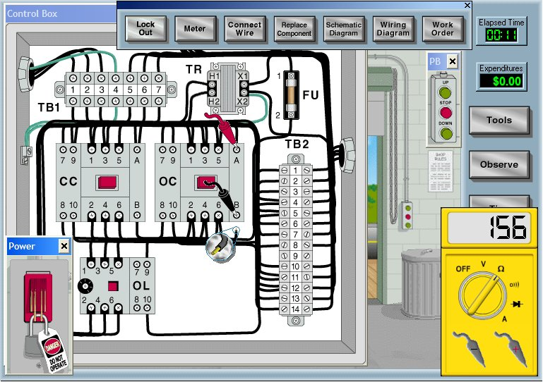
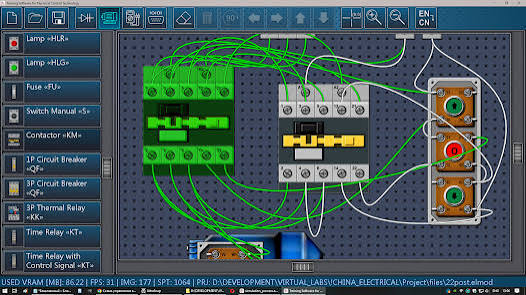

# GazBoard (GaussBoard / JazaBoard) — Engineering, STEM Revision & EE Simulation Architecture Specification

> **Document Identifier**: `doc6_engineering_stem_ee_and_simulation_architecture.md`  
> **Status**: Approved Architecture & Implementation Blueprint  
> **Target Environment**: Windows 10/11 Desktop (Electron 43, Vanilla ES6 Modules, HTML5 Canvas 2D, Pure Portable JS)  
> **Target Audience**: AI Engineering Agents (Antigravity, Cursor, Claude Code, OpenMuse) and Systems Developers  
> **Hardware Constraint**: Low-spec PC compatible (Intel integrated graphics / zero dedicated GPU requirement, low RAM footprint)  

---

## 1. Executive Summary & Golden Invariant Alignment

This specification extends GazBoard from a general-purpose digital whiteboard into a high-performance **Engineering & STEM Learning Workstation**. It preserves the existing lightweight Electron 43 + Vanilla JavaScript architecture while adding:
1. **Interactive Circuit Simulation**: 2D/2.5D realistic graphical component wiring alongside schematic netlists.
2. **Advanced Mathematical Input & Lightweight CAS**: Natural language math pop-up, syntax-guarded formula editing via `MathLive`, local Windows Ink mathematical handwriting recognition, and sub-second client-side symbolic calculus.
3. **Spaced Repetition & Study Tape**: Bi-directional Anki desktop synchronization (`AnkiConnect`), native FSRS v5 embedded scheduling, `.apkg` export for mobile, and digital Study Tape image occlusion.
4. **Grades 11–12 STEM Revision Engines**: Chemistry equation creator/balancer/explainer, 3D molecular viewer, interactive periodic table, offline PhET physics simulation runner, and dynamic formula relation graphs.
5. **ESL & Technical English Tools**: Double-click offline dictionary/collocation lookup, lightweight grammar checking, and zero-download native Text-to-Speech (TTS).
6. **Architectural Thinking & Document Synthesis**: Form-assisted Mermaid/block diagram builder, and LiquidText-style bidirectional PDF excerpt anchoring.

### Architectural Invariants (Must Be Preserved)
* **Zero Heavy Native Dependencies**: No `node-gyp` C++ binaries that break portability or require Visual Studio build tools.
* **Low-Spec CPU/GPU Profile**: All graphics utilize HTML5 Canvas 2D, SVG DOM, or lightweight WebGL with fallback shaders. Total background runtime memory must not exceed ~120 MB.
* **Audio-Ink Timestamp Continuity (`p.t`)**: Inking on schematics, formula cards, or circuit diagrams must preserve millisecond timestamps so audio replay operates seamlessly across all objects.
* **Full Offline Independence**: Core functionality (formula solving, equation balancing, dictionary lookup, simulation playback) must function 100% offline without internet.

---

## 2. Electrical Engineering & Circuit Simulation Ecosystem

### 2.1 Realistic Graphical & Physical Component View (2D / 2.5D)

#### Reference Analysis
GazBoard supports two synchronized circuit perspectives:
* **Abstract Schematic View**: Standard IEEE/IEC schematic symbols.
* **Realistic Physical Wiring View**: High-resolution 2.5D industrial components with visible terminal screws, live test probes, and flexible wire routing.




#### Architecture for Low-Spec Hardware
* **Why Not Heavy 3D (Three.js/WebGL)?** High-poly 3D meshes and PBR materials cause thermal throttling and frame drops on integrated Intel GPUs.
* **The 2.5D SVG + HTML5 Canvas Solution**:
  * Component bodies (contactors `KM`, circuit breakers `QF`, thermal overload relays `KK`, terminal blocks `TB`, pushbuttons) are rendered as lightweight, layered vector SVGs.
  * Terminal screws and connection lugs are registered as coordinate connection hitboxes (`{ x, y, id, netId }`).
  * Connecting wires are drawn as cubic Bézier curves (splines) on a dedicated canvas overlay. Wire color (green, yellow, black, red, blue) is selectable.
  * **Digital Multimeter Tool**: Floating draggable multimeter widget with red and black probe leads. Touching probe tips to component terminals reads real-time nodal voltages and branch currents.

#### Simulation Backend Integration
* **Engine**: Headless `circuitjs1` (Falstad WebAssembly/JS engine, GPL-2.0, ~2.5 MB).
* **Netlist Synchronization**:
  $$\text{Schematic View} \iff \text{Internal SPICE Netlist} \iff \text{Physical 2.5D Component View}$$
  Placing a physical wire between Terminal `KM1:A1` and `FU1:2` updates the underlying netlist, which is solved by the simulation engine at 60 Hz.

```
+--------------------------------------------------------------------------------------------------+
|  GAUSSBOARD WORKBENCH                                                        [View: Physical / 2D]|
+--------------------------------------------------------------------------------------------------+
| [COMPONENTS] |                                                                                   |
| > Breakers   |    +---------------+           +---------------+           +-----------------+    |
| > Relays     |    | 3P Breaker QF |           | Contactor KM1 |           | Pushbutton Box  |    |
| > Fuses      |    | [ON] [OFF]    |======wire=| (A1)     (A2) |=====wire==|  (G) Start [I]  |    |
| > Motors     |    | (1) (3) (5)   |           | (1) (3) (5)   |           |  (R) Stop  [O]  |    |
| > Multimeter |    +---------------+           +---------------+           +-----------------+    |
|              |                                                                                   |
| [TEST LEADS] |    Live Multimeter Probe: [ Black -> KM1:A2 ]  [ Red -> KM1:A1 ]                  |
| [Red] [Blk]  |    Digital Multimeter Readout: [ 230.4 V AC | 50.0 Hz ]                           |
+--------------------------------------------------------------------------------------------------+
```

---

### 2.2 Schematic Drafting & Toggleable Ribbon Stencil Palette
* **UI Integration**: A dedicated toggle button on the main toolbar opens a collapsible side ribbon (left or right dock).
* **Component Categories**:
  * *Passives*: Resistors, inductors, capacitors, potentiometers.
  * *Semiconductors*: Diodes, Zener diodes, BJTs (NPN/PNP), MOSFETs (N/P channel), Op-Amps.
  * *Industrial*: Contactors, overload relays, circuit breakers, 3-phase motors, limit switches, solenoids.
  * *Power Sources*: DC voltage/current sources, AC sinusoidal supplies, ground references.
* **Smart Snap**: Terminals automatically snap to a configurable 10px or 20px grid. Dropping a two-terminal component directly onto an existing wire splits the wire and splices the component in series.

---

### 2.3 Signal Analysis & Waveform Instruments
* **Engine**: `uPlot` (MIT, ~40 KB) or `Plotly.js basic` (~300 KB).
* **Virtual Dual-Trace Oscilloscope**:
  * Floating bottom drawer displaying live time-domain waveforms ($V(t)$, $I(t)$).
  * Channel A (Yellow) and Channel B (Cyan) with independent voltage scaling ($1\,\text{mV/div}$ to $50\,\text{V/div}$) and timebase ($1\,\mu\text{s/div}$ to $1\,\text{s/div}$).
* **Bode Plotter & Phasor View**:
  * Calculates logarithmic gain ($20\log_{10}|H(j\omega)|$) and phase angles.
  * Phasor visualizer displays complex rotating vectors on an Argand diagram, showing lead/lag relationships and active/reactive power vectors.

---

### 2.4 Dynamic Application Display Name & Rebranding
* **Architecture**: A lightweight preference in `src/js/core/config.js` and stored in `localStorage`:
  ```javascript
  const AppBrand = {
    getName() { return localStorage.getItem('gazboard_custom_brand') || 'GaussBoard'; },
    setName(val) {
      const name = val.trim() || 'GaussBoard';
      localStorage.setItem('gazboard_custom_brand', name);
      document.title = `${name} - Engineering Notebook`;
      const brandEl = document.getElementById('app-brand-title');
      if (brandEl) brandEl.textContent = name;
    }
  };
  ```
* **User Control**: In Settings $\rightarrow$ General, an input allows switching display names immediately between **GaussBoard**, **JazaBoard**, or **GazBoard**.

---

## 3. Advanced LaTeX, Symbolic Math & Natural Language Input

### 3.1 Natural Language Math Pop-Up (Wolfram / MATLAB Style)
* **Trigger**: `Ctrl+K` or clicking the $\sqrt{\alpha}$ icon in the math toolbar.
* **Features**:
  * Modal with instant typeahead filter, syntax suggestions, and user-defined expansion macros.
  * Natural language parsing engine using `Math.js` expression parser and pattern mapping:
    * Input: `solve 3x + 12 = 0` $\rightarrow$ Evaluates root $x = -4$ and renders: $3x + 12 = 0 \implies x = -4$.
    * Input: `parallel 10k 47k` $\rightarrow$ Computes equivalent parallel impedance: $R_{\text{eq}} = 10\,\text{k}\Omega \parallel 47\,\text{k}\Omega = 8.24\,\text{k}\Omega$.
    * Input: `phasor 120V at 30 deg` $\rightarrow$ Formats polar phasor: $120\angle 30^\circ\text{ V} = (103.92 + j60.00)\text{ V}$.
* **User Custom Shortcuts**: Saved in a JSON dictionary so users can define shortcuts (e.g., `thev` creates a Thevenin equivalent analysis scaffold).

---

### 3.2 Visual Formula Editing via MathLive & Windows Ink Handwriting
* **Syntax Error Prevention**:
  * Instead of a raw text box where missing brackets break KaTeX, the UI integrates **`MathLive`** (MIT, ~3.5 MB).
  * MathLive enforces structural Abstract Syntax Tree (AST) editing with visual placeholder slots ($\Box$).
  * Navigating with arrow keys allows typing into valid slots without syntax breakages.
* **Handwriting-to-LaTeX on Low-Spec PC**:
  * **Native Windows Ink API Integration**: Uses the Windows 10/11 built-in handwriting recognizer (`ms-pen` / Math Input Panel API).
  * **Resource Footprint**: **0 MB download**, hardware-accelerated locally by Windows, completely offline, zero GPU usage, and 100% free.

---

### 3.3 Reactive LaTeX Variable Binding
* Values assigned in note cards (e.g., $V_{\text{supply}} = 48\text{ V}$, $R_1 = 12\,\Omega$) are stored in a reactive notebook state dictionary.
* Subsequent equations referencing those variables ($I = \frac{V_{\text{supply}}}{R_1}$) calculate the live result ($4\text{ A}$) and update automatically whenever the source value changes.

---

## 4. Lightweight Computer Algebra System (CAS) & Scientific Calculators

### 4.1 In-App Local CAS (Math.js + Nerdamer)
* **Storage Footprint**: Total combined size under **800 KB** (pure JavaScript).
* **Execution Time**: Sub-millisecond algebraic evaluations on any standard CPU.
* **Capabilities**:
  * **Symbolic Differentiation**: $\frac{d}{dx}(x^3 \sin x) = 3x^2 \sin x + x^3 \cos x$.
  * **Polynomial Factoring & Root Finding**: Factoring polynomials and solving systems of linear equations.
  * **Complex Number Arithmetic ($j$)**: Rectangular ($a + jb$) to polar ($r\angle\theta$) conversions and complex matrix inversion for multi-loop AC mesh analysis.
  * **Dimensional Unit Engine**: Enforces engineering unit math (e.g., $(12\text{ V}) / (4\text{ mA}) = 3\text{ k}\Omega$). Flags dimensional mismatches automatically.

### 4.2 Heavy AI Offload Fallback
* For non-linear differential equations or complex boundary-value problems exceeding local CAS capabilities, an optional "Ask AI Solver" button sends the formula prompt to an external LLM, keeping the desktop app lightweight.

---

## 5. Spaced Repetition (Anki & FSRS) Integration Engine

### 5.1 Dual-Mode Synchronization
1. **AnkiConnect Bridge (Desktop Sync)**:
   * Connects to local Anki via HTTP POST to `http://127.0.0.1:8765`.
   * Cards created in GazBoard are pushed directly into designated Anki decks with tags and reverse links back to the GazBoard note file.
2. **Native Embedded FSRS v5 & `.apkg` Packaging**:
   * For users without desktop Anki, GazBoard bundles `ts-fsrs` (MIT, ~40 KB) to schedule reviews locally.
   * A single click on *"Export to .apkg"* produces a standards-compliant deck bundle via `anki-apkg-export` (MIT, ~100 KB) for import into **AnkiDroid** or **AnkiMobile**.

---

### 5.2 Active-Recall Study Tape & Image Occlusion
* **Alignment with Existing Invariant**: Integrates directly with GazBoard's established Study Tape subsystem (`layers/03-canvas-and-study-tape.md`).
* **Workflow**:
  1. The user activates the **Study Tape** tool from the toolbar.
  2. Drags rectangular or freehand tape strips over labels, formulas, or pin numbers on circuit schematics and PDF excerpts.
  3. In **Review Mode**, tape strips turn opaque with a subtle striped pattern.
  4. Tapping a tape strip reveals the answer with a smooth flip animation.
  5. The user rates retention (**Again / Hard / Good / Easy**), updating FSRS stability and review schedules.

```
+----------------------------------------------------------------------------------+
|  STUDY TAPE / IMAGE OCCLUSION MODE                                   [Card 4/25] |
+----------------------------------------------------------------------------------+
|                                                                                  |
|          +----------------------------------------------+                        |
|          |         THREE-PHASE INDUCTION MOTOR          |                        |
|          +----------------------------------------------+                        |
|          | Stator Core: [====== REVEALED ======]        |                        |
|          | Rotor Bars:  [██████ TAP TO REVEAL ██████]   |  <-- Active Occlusion  |
|          | Slip Rings:  [====== REVEALED ======]        |                        |
|          +----------------------------------------------+                        |
|                                                                                  |
|   [ 1: Again (<10m) ]   [ 2: Hard (1d) ]   [ 3: Good (3d) ]   [ 4: Easy (7d) ]   |
+----------------------------------------------------------------------------------+
```

---

## 6. High School (Grades 11–12) STEM Revision & Foundation Suite

### 6.1 Chemistry Suite: Equation Creator, Balancer & Explanations

#### 1. Chemical Equation Balancer & Stoichiometry Engine
* **Engine**: `chemical-equation-balancer` (MIT, ~25 KB).
* **Features**: Balances redox and acid-base equations using Gaussian matrix elimination. Calculates molar masses, limiting reagents, and theoretical yields.

#### 2. Equation Creator & Explanation Database
* **Local Database**: Offline curated JSON file (~2.5 MB) covering all standard Grade 11–12 reaction types:
  * Synthesis, Decomposition, Single Replacement (Activity series rules), Double Replacement (Precipitation & Solubility rules), Combustion, Acid-Base Neutralization.
* **Validation & Spontaneity Checker**:
  * Flags thermodynamically unfeasible reactions (e.g., $\text{Cu} + \text{HCl} \rightarrow \text{No Reaction}$).
  * Highlights reaction requirements (heat $\Delta$, catalysts, state symbols $(s), (l), (g), (aq)$).

#### 3. Interactive Periodic Table Dock
* **Features**: Displays atomic numbers, electronegativity gradients, electron configurations, oxidation states, and atomic radii.
* **Storage Footprint**: ~350 KB offline JSON data + vector SVG grid.

#### 4. 3D Molecular Viewer
* **Engine**: `3Dmol.js` (BSD-2-Clause, ~1.2 MB).
* **Performance**: Optimized WebGL rendering running smoothly on basic Intel integrated graphics. Renders ball-and-stick and space-filling models from SMILES or PDB codes.

---

### 6.2 Physics Simulation & Conceptual Sandboxes
* **PhET Interactive HTML5 Simulation Runner**:
  * Embeds open-source (GPL-3.0 / CC-BY) HTML5 simulations from CU Boulder.
  * Each simulation is a self-contained offline package (~3–5 MB).
  * 15–20 high-value simulations (Ohm's Law, Circuit Construction Kit AC/DC, Wave Interference, Photoelectric Effect, Projectile Motion) can be stored locally and loaded in offline iframes.
* **2D Mechanics Sandbox**:
  * Powered by `Matter.js` (MIT, ~80 KB).
  * Allows placing inclined planes, springs, friction blocks, and pulleys directly on the whiteboard canvas.

---

### 6.3 Mathematics: Dynamic Grapher & Formula Relation Book

#### 1. Dynamic Function Grapher
* **Engine**: `JSXGraph` (LGPL-3.0, ~500 KB) or `Function-Plot` (MIT, ~120 KB).
* **Features**: 2D coordinate system for plotting $f(x)$, derivatives $f'(x)$, tangent slopes, integrals $\int_a^b f(x)\,dx$, and polar graphs.

#### 2. The Formula Relation Book & Tree
* **Concept**: Interactive mind map showing how mathematical formulas derive from fundamental roots.
* **Trigonometry Sub-Tree**:
  $$\text{Euler's Formula: } e^{j\theta} = \cos\theta + j\sin\theta \implies \cos(\alpha \pm \beta) \implies \cos(2\theta) = 2\cos^2\theta - 1$$
* **Calculus / EE Sub-Tree**:
  $$i(t) = C\frac{dv}{dt} \implies v(t) = \frac{1}{C}\int i(t)\,dt \implies \text{Impedance } Z_C = \frac{1}{j\omega C}$$

---

## 7. ESL (English as a Second Language) & Technical Writing

### 7.1 Double-Click Dictionary, Thesaurus & Collocations
* **Interaction**: Double-clicking any word in a note or PDF datasheet opens a floating definition card.
* **Content**:
  * Phonetic transcription and audio pronunciation.
  * Everyday definition + technical engineering definition.
  * Synonyms, antonyms, and technical collocations (e.g., *dielectric*: "dielectric breakdown", "dielectric constant").
* **Resource**:
  * *Online*: Free Dictionary API (zero API key, 100% free).
  * *Offline Fallback*: Pre-packaged WordNet SQLite/JSON database (~18 MB, public domain).

### 7.2 Lightweight Grammar & Spell Checking
* **Engine**: `write-good` and `typo.js` (MIT, ~1.5 MB total).
* **Features**: Offline rule-based linting for passive voice, repeated words, and common ESL grammatical slip-ups without heavy background processes.

### 7.3 Text-to-Speech (TTS) Pronunciation Helper
* **Technology**: Native HTML5 Web Speech API (`window.speechSynthesis`).
* **Download Size**: **0 MB (Zero download)**.
* **Cost**: **100% Free & Unlimited**.
* **Capabilities**: Uses built-in Windows high-definition voices (David, Zira, Mark) to read aloud technical terms and definitions offline with adjustable speech rate.

---

## 8. Architectural, Algorithmic & Systems Thinking

### 8.1 Visual Builder for Mermaid Diagrams & Block Diagrams
* **Problem**: Writing raw Mermaid code (`graph TD; A[Sensor]-->B(ADC)`) is tedious and prone to typos.
* **Solution**: A visual form assistant:
  * Select block types: *Process Block*, *Decision Diamond*, *Summing Junction ($+$ / $-$)*, *Transfer Function $G(s)$*.
  * Click to connect source and destination ports.
  * The tool automatically generates valid Mermaid syntax in the note's markdown block.

### 8.2 LiquidText-Style Document Synthesis Extensions
* **Bidirectional Excerpt Anchoring**:
  * Dragging an excerpt or equation out of a PDF datasheet onto the canvas creates a linked excerpt node.
  * Clicking the anchor icon smoothly animates the PDF viewer back to the exact page and paragraph.
* **Pinch-to-Compare**:
  * Side-by-side docking of 2–3 PDF datasheets (e.g., comparing pinouts of STM32F4 vs. ESP32).
  * Draw connecting relationship arrows across excerpts.

---

## 9. Comprehensive Feasibility, Size & Cost Matrix

| Feature / Component | Recommended Technology / Library | Download Size | Computational Load (CPU/RAM/GPU) | Online vs. Offline | License / Cost | Implementation Complexity |
| :--- | :--- | :--- | :--- | :--- | :--- | :--- |
| **Realistic 2D Circuit View** | `@wokwi/elements` + Custom SVGs | ~1.5 MB | Low CPU, No GPU needed | 100% Offline | MIT / Free | **Medium** |
| **Circuit Simulation Engine** | `circuitjs1` (Falstad WASM) | ~2.5 MB | Moderate CPU during transient run | 100% Offline | GPL-2.0 / Free | **Medium** |
| **Interactive Formula Editor** | `MathLive` | ~3.5 MB | Very Low CPU / RAM | 100% Offline | MIT / Free | **Low** |
| **Handwriting-to-LaTeX** | Windows Ink API (native) | **0 MB** | Low CPU, Native OS | 100% Offline | Built-in / Free | **Medium** |
| **Lightweight CAS Solver** | `Math.js` + `Nerdamer` | ~800 KB | Low CPU (sub-second calculation) | 100% Offline | Apache/MIT / Free | **Low** |
| **Spaced Repetition (SRS)** | `ts-fsrs` | ~40 KB | Negligible | 100% Offline | MIT / Free | **Low** |
| **Anki Desktop Sync** | `AnkiConnect` | 0 MB (uses Anki) | Negligible | Localhost HTTP | GPL-3.0 / Free | **Low** |
| **Study Tape / Occlusion** | Canvas SVG Mask Overlay | ~15 KB | Negligible | 100% Offline | Custom / Free | **Low** |
| **Chemical Equation Balancer**| `chemical-equation-balancer` | ~25 KB | Instant calculation | 100% Offline | MIT / Free | **Low** |
| **Chemistry 3D Viewer** | `3Dmol.js` | ~1.2 MB | Low-end WebGL (runs on Intel iGPU)| 100% Offline | BSD-2 / Free | **Low** |
| **PhET Physics Simulations** | Bundled HTML5 packages | ~3 MB per sim | Low-to-Moderate CPU | 100% Offline | GPL-3.0 / Free | **Low** (Embed) |
| **Math Function Grapher** | `JSXGraph` | ~500 KB | Low CPU | 100% Offline | LGPL-3.0 / Free | **Low** |
| **Offline Dictionary Database**| WordNet SQLite / JSON | ~18 MB | Negligible | 100% Offline | Public Domain / Free| **Low** |
| **Text-to-Speech (TTS)** | Web Speech API | **0 MB** | Native OS synthesis | 100% Offline | Built-in / Free | **Trivial** |
| **Visual Diagram Builder** | `Mermaid.js` + Form UI | ~1.8 MB | Low CPU | 100% Offline | MIT / Free | **Medium** |
| **LiquidText Excerpting** | `PDF.js` + Canvas Anchors | ~4.5 MB | Moderate RAM (~100 MB per PDF) | 100% Offline | Apache-2.0 / Free | **High** |

---

## 10. Phased Implementation Roadmap

```
PHASE 1: Core Workbench & Formula Infrastructure
├── 1. Toggleable ribbon menu with circuit stencils & EE math macros
├── 2. MathLive interactive formula editor with syntax guard
├── 3. Math.js + Nerdamer lightweight CAS engine
└── 4. In-App Brand Display Name switcher (GaussBoard / JazaBoard)

PHASE 2: Memory & Document Synthesis
├── 1. Study Tape & image occlusion integration with FSRS v5
├── 2. AnkiConnect bridge & .apkg exporter
└── 3. Bidirectional PDF excerpt anchoring (LiquidText style)

PHASE 3: STEM Engines & Interactive Simulations
├── 1. Chemical equation balancer & reaction explanation database
├── 2. Offline PhET simulation iframe runner
├── 3. Formula relationship book & tree
└── 4. Native Web Speech TTS & double-click dictionary pop-up

PHASE 4: Realistic 2D/2.5D Industrial Circuit Simulation
├── 1. Layered SVG industrial component library (breakers, contactors, relays, meters)
└── 2. Headless circuitjs1 simulator linking physical wires to schematic nodes
```
