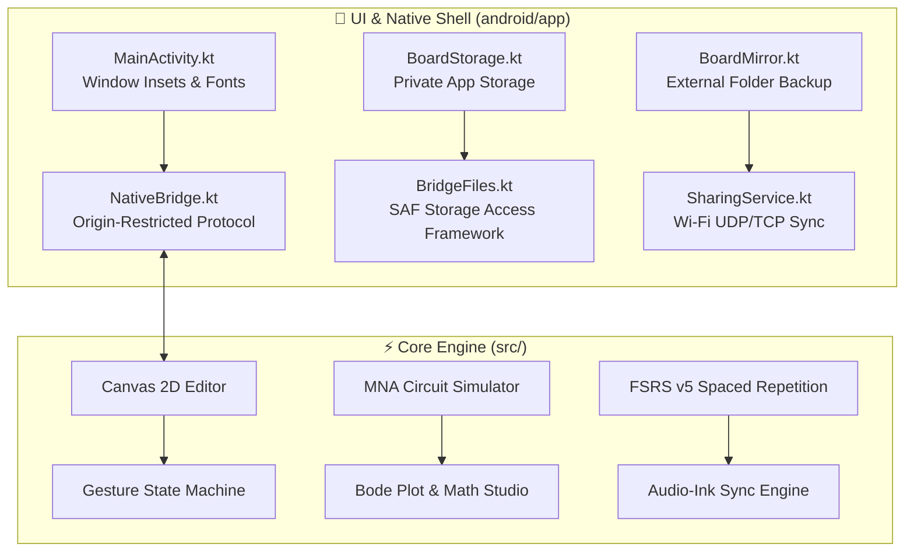

# Android Release Readiness & Build Specification (`docs/releases/ANDROID_READINESS.md`)
> **1-Line Summary:** Comprehensive guide for configuring, building, testing, signing, and releasing the GaussBoard Android APK.

---

## 1. Architectural Overview
GaussBoard for Android is a hybrid native Kotlin + Android System WebView application that runs 100% offline without accounts, telemetry, or cloud dependencies.



- **Shared Core:** The Gradle build task (`:app:mergeReleaseAssets`) copies the entire pure-JS codebase from `src/` directly into the Android asset bundle. All custom Electrical Engineering, STEM tools, and gesture handlers run seamlessly inside Android System WebView.
- **Min SDK:** 26 (Android 8.0 Oreo)
- **Target / Compile SDK:** 36 (Android 16 / Vanilla Ice Cream)
- **Gradle:** 8.13 with Kotlin DSL (`build.gradle.kts`)

---

## 2. Resolved Platform Parity Fixes (Active in Repository)

The following 5 platform alignments are permanently maintained:

1. **Font CDN Bases:**
   - [MainActivity.kt](file:///c:/Users/kazir/Documents/Agentic%20Harness/GaussBoard/android/app/src/main/java/com/gazboard/app/MainActivity.kt) routes Chinese/Japanese CJK web font downloads to `https://cdn.jsdelivr.net/gh/Mostakim2005/GaussBoard@main/fonts/` and `https://raw.githubusercontent.com/Mostakim2005/GaussBoard/main/fonts/`.
2. **Release Update Endpoint:**
   - In-app update check in [MainActivity.kt](file:///c:/Users/kazir/Documents/Agentic%20Harness/GaussBoard/android/app/src/main/java/com/gazboard/app/MainActivity.kt) queries `https://api.github.com/repos/Mostakim2005/GaussBoard/releases?per_page=30` and displays updates under user-agent `GaussBoard-Android/<version>`.
3. **Native File Format Parity (`.gaussboard`):**
   - [MainActivity.kt](file:///c:/Users/kazir/Documents/Agentic%20Harness/GaussBoard/android/app/src/main/java/com/gazboard/app/MainActivity.kt) recognizes `.gaussboard`, `.gazboard`, and `.openboard` for SAF imports and exports, defaulting to `Board.gaussboard`.
   - [BridgeFiles.kt](file:///c:/Users/kazir/Documents/Agentic%20Harness/GaussBoard/android/app/src/main/java/com/gazboard/app/BridgeFiles.kt) normalizes de-duplicated names like `Lesson.gaussboard (1)` back to `Lesson (1).gaussboard`.
4. **App Name & Branding:**
   - `android/app/src/main/AndroidManifest.xml` sets `android:label="GaussBoard"`.
5. **Storage Folder Mirroring:**
   - [BoardMirror.kt](file:///c:/Users/kazir/Documents/Agentic%20Harness/GaussBoard/android/app/src/main/java/com/gazboard/app/BoardMirror.kt) detects and creates `GaussBoard/` folders on device storage, retaining backward compatibility with existing `GazBoard/` folders.

---

## 3. Automated Verification Commands

From the repository root:
```bash
# Run full Android Node adapter and bridge test suite (82/82 tests):
node --test test/android-*.test.js

# Check 100% internationalization parity across all 7 locales:
node scripts/i18n-check.js

# Run new-features smoke test suite (24/24 tests):
node scripts/smoke.js --new-features
```

From the `android/` directory (requires JDK 17 & Android SDK 36):
```bash
# Test network sync and assemble debug APK:
./gradlew :sync:test :app:assembleDebug :app:lintDebug

# Output APK path:
# android/app/build/outputs/apk/debug/app-debug.apk
```

---

## 4. Production Release Workflow & Signing Configuration

Production APK releases are compiled in the cloud via GitHub Actions to preserve reproducible, hermetic builds without local toolchain pollution.

### Required GitHub Repository Secrets
Under **Settings -> Secrets and variables -> Actions** in `https://github.com/Mostakim2005/GaussBoard`:

| Secret Name | Value Description |
|---|---|
| `ANDROID_KEYSTORE_BASE64` | Base64-encoded production `.jks` / `.keystore` private key file (`base64 -w 0 release.jks`) |
| `ANDROID_KEYSTORE_PASSWORD` | Password protecting the keystore file |
| `ANDROID_KEY_ALIAS` | Alias of the signing key inside the keystore |
| `ANDROID_KEY_PASSWORD` | Password protecting the specific key alias |

### Cutting a Release Tag
To trigger the automated Android release build in [.github/workflows/android-release.yml](file:///c:/Users/kazir/Documents/Agentic%20Harness/GaussBoard/.github/workflows/android-release.yml):
```bash
# Tag format: android-<version>-v<build_number>
git tag android-6.9.3-v1
git push origin android-6.9.3-v1
```
*Note: Android release tags must start with `android-` (never `v`), preventing any collision with desktop Windows portable releases.*
